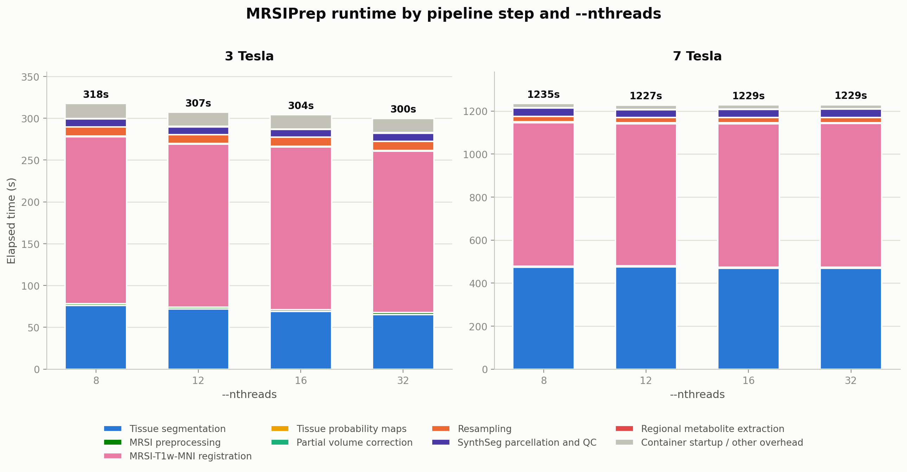

# Runtime Benchmarks

Wall-clock timing for a default MRSIPrep run (`--parcellation-mode synthseg`, ANTs
registration backend) across a range of `--nthreads` values, on two
subjects acquired at different field strengths, to give a sense of how
runtime scales with acquisition resolution as well as thread count.

## Hardware

### Compute (this benchmark)

| Component | Spec |
|---|---|
| CPU | Intel Core i9-14900K, 24 cores / 32 threads, up to 6.0 GHz |
| RAM | 125 GB |
| GPU | NVIDIA RTX 5000 Ada Generation, 32 GB VRAM (not used by this configuration; SynthSeg here ran CPU-only) |
| OS | Linux 5.15 (Ubuntu) |
| Docker | 29.4.1 |
| MRSIPrep image | `mrsiup/mrsiprep:cpu` |

### MRI scanners

| | 3 Tesla | 7 Tesla |
|---|---|---|
| Scanner | Magnetom TrioTim | Magnetom Terra.X |
| Coil | 32-channel | 32-channel |

## MRSI Acquisition: ECCENTRIC

Both datasets were acquired with the **ECCENTRIC** FID-MRSI sequence
([Klauser et al., 2024, *Imaging Neuroscience*](https://direct.mit.edu/imag/article/doi/10.1162/imag_a_00313/124597/ECCENTRIC-A-fast-and-unrestrained-approach-for),
"ECCENTRIC: A fast and unrestrained approach for high-resolution
whole-brain metabolic imaging at ultra-high magnetic field"), a
compressed-sensing-accelerated concentric-ring k-space trajectory
designed for fast, high-resolution whole-brain MRSI.

### Metabolite acquisition

| Parameter | 3 Tesla | 7 Tesla |
|---|---|---|
| Field of view | 220 × 220 × 130 mm³ | 220 × 220 × 110 mm³ |
| Slab thickness | 95 mm | 100 mm |
| Nominal voxel size | 5.0 × 5.0 × 5.2 mm³ | 3.4 × 3.4 × 3.5 mm³ |
| Scan resolution | 44 × 44 × 25 | 64 × 64 × 31 |
| TR | 457 ms | 400 ms |
| TE₁ / TE₂ | 0.78 ms / 65 ms | 0.68 ms |
| Flip angle | 45° | 35° |
| Spectral bandwidth | 1320 Hz | 2280 Hz |
| Vector size | 512 points | 688 FID points |
| Spatial encoding | ECCENTRIC trajectory, circle radius 0.25 k_max | ECCENTRIC trajectory, circle radius 0.25 k_max |
| Acceleration factor | 2.5 | 2.5 |
| Total acquisition time | 6 min 54 s | 11 min 52 s |

### Water reference

Matched spatial coverage, lower resolution: used for coil combination,
field correction, and metabolite intensity normalization.

| Parameter | 3 Tesla | 7 Tesla |
|---|---|---|
| Field of view | 220 × 220 × 130 mm³ | 220 × 220 × 110 mm³ |
| Nominal voxel size / resolution | 10.0 × 10.0 × 10.0 mm³ | 10 × 10 × 10 mm³ |
| Scan resolution | 22 × 22 × 13 | N/A |
| TR | 460 ms | 404 ms |
| TE₁ / TE₂ | 0.72 ms / 65 ms | 0.59 ms |
| Flip angle | 45° | 35° |
| Acquisition time | 1 min 21 s | 59 s |

### Reconstruction and quantification

Both MRSI acquisitions were reconstructed using a compressed-sensing SENSE
low-rank framework with total-generalized-variation regularization and
simultaneous lipid suppression. Metabolite quantification was performed
with **LCModel**.

## MRSIPrep Benchmark Method

Two single-subject `mrsiprep` runs, one per dataset, repeated at
`--nthreads` 8, 12, 16, and 32 (`--nproc 1` throughout, one subject per
run, so `--nthreads` is the only varying parameter). Each run used a
**fresh `--work-dir`** (no Nipype caching carried over between
thread-count variants), so every number below reflects genuine
full-pipeline computation, not a partially cached rerun. All 8 runs (2
subjects × 4 thread counts) were executed **strictly sequentially, one at
a time**, with no other run or concurrent load on the machine, to rule
out cross-run resource contention affecting the timings.

- **3 Tesla subject**: a real MRSI acquisition with an MP2RAGE anatomical.
- **7 Tesla subject**: a real MRSI acquisition with an MP2RAGE
  anatomical.

Both runs: `--metabolites NAANAAG,GPCPCh,CrPCr,GluGln,Ins
--ref-met CrPCr`, default `--synthseg-mode robust`, default ANTs
registration backend.

### Resolution and useful-voxel counts

The two subjects differ substantially in both anatomical (T1w) and MRSI
grid resolution: this is the main driver of the runtime difference below,
since ANTs registration and SynthSeg both operate on the full-resolution
T1w volume, not the coarser MRSI grid.

| | 3 Tesla | 7 Tesla | Ratio (7T / 3T) |
|---|---:|---:|---:|
| T1w voxel size (mm) | 1.00 × 1.33 × 1.33 | 0.66 × 0.60 × 0.60 | N/A |
| T1w volume shape | 160 × 192 × 192 | 256 × 396 × 416 | N/A |
| T1w total voxels | ~5.9 M | ~42.2 M | **~7.2×** |
| MRSI voxel size (mm) | 5.00 × 5.00 × 5.25 | 3.44 × 3.44 × 3.55 | N/A |
| MRSI useful (non-zero, in-brain) voxels | 15,315 | 32,638 | **~2.1×** |

## Results



Stacked bar height = total wall-clock elapsed time (label above each bar);
segments show each pipeline step's share. "Container startup / other
overhead" covers Docker startup and the CLI's own preflight input-check,
which aren't wrapped in a named, timed pipeline step.

## Interpretation

* **Runtime is essentially flat from 8 to 32 threads** for both subjects when each run is isolated from other load: 3T ranges 300–318s (~6% spread) and 7T ranges 1227–1235s (under 1% spread), with no consistent downward trend past 8 threads. ANTs registration (the largest single segment at both field strengths) and SynthSeg tissue segmentation show effectively no benefit from more than ~8 threads, so for batch processing it is generally better to use ~8 threads per subject and increase `--nproc` (running more subjects in parallel) rather than allocate more threads to each individual subject.

* **The 7T subject takes about 4× longer than the 3T subject** (~20.5 vs. ~5.1 minutes). This is mainly due to the 7T T1w image having ~7.2× more voxels, which increases registration and segmentation costs. The MRSI grid has only ~2.1× more usable voxels, making anatomical, not MRSI, resolution the main runtime driver. Tissue segmentation (`mri_synthseg`) and MRSI-T1w-MNI registration (ANTs rigid+affine+SyN) together account for the large majority of total runtime at both field strengths.

(registration-frameworks)=
## Registration comparison

The registration comparison now has its own page:
[Registration benchmark](registration_benchmark.md). See
[Validation overview](validation.md) for the full set of benchmarks.

## Collect new runtime measurements

For a prepared input recording, repeat the command with isolated outputs
and force a fresh computation. For example:

```bash
for threads in 8 12 16 32; do
  mrsiprep-docker /path/to/bids "/path/to/benchmark/nthreads-${threads}" participant \
    --participant-label S001 --session-label V1 \
    --metabolites NAANAAG,GPCPCh,CrPCr,GluGln,Ins --ref-met CrPCr \
    --parcellation-mode synthseg --registration-backend ants \
    --nthreads "${threads}" --nproc 1 --overwrite --verbose 2
done
```

Run sequentially without competing load, repeat with the other acquisition,
and retain each recording's runtime metrics and provenance JSON. These
commands collect new measurements with the installed image; they do not
identify the exact historical `cpu` image used for the figures above.
Only two subjects and one run per thread-count setting were measured here,
so the observed spreads are descriptive rather than confidence intervals.
