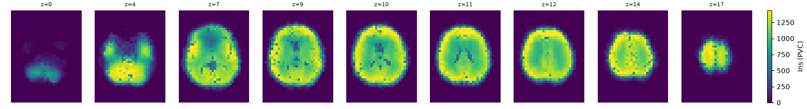
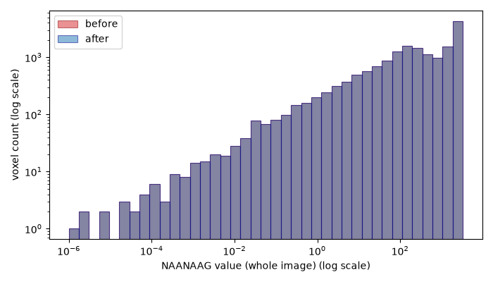
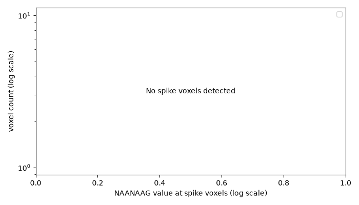
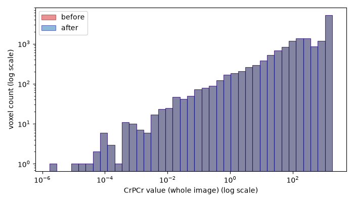
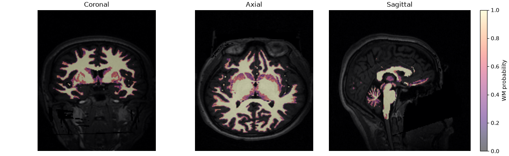
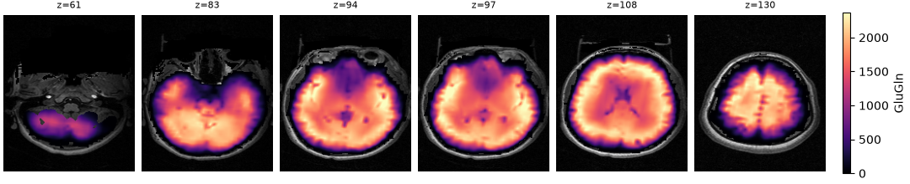
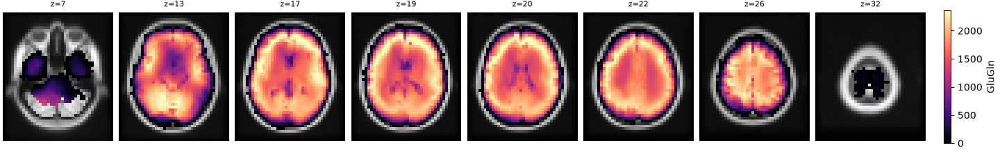
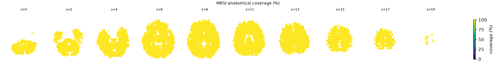
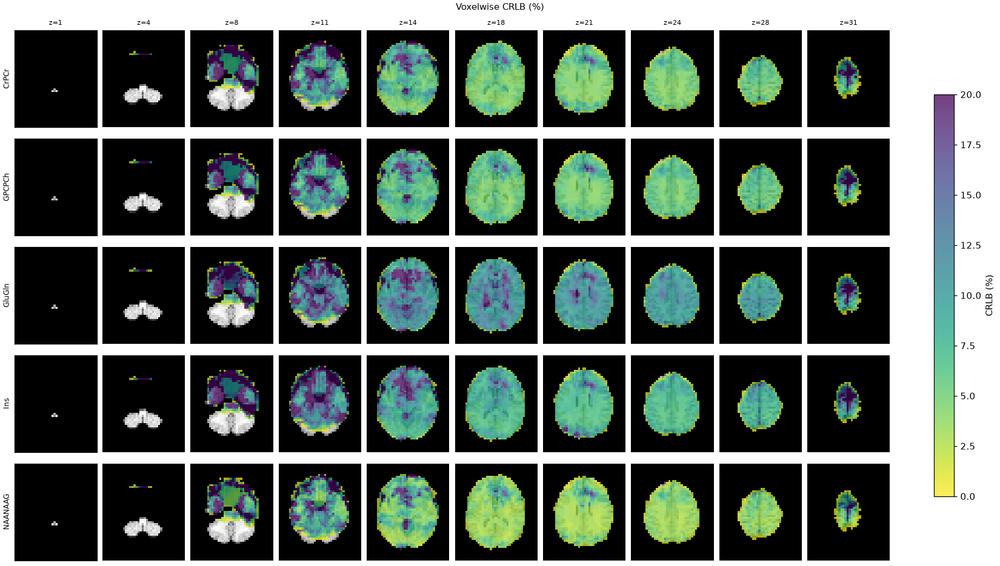

# MRSIPrep report: SynthMRSI-Project · sub-01 ses-01

MRSIPrep version: `2.2.2`

## Inputs

BIDS directory: `/data`

Output directory: `/out/mrsiprep`

Parcellation mode: `synthseg`

Tissue backend: `synthseg-fast`

## MRSI Raw

### Raw metabolite maps (pre-pipeline)

### Metabolite: CrPCr


### Metabolite: GPCPCh


### Metabolite: GluGln


### Metabolite: Ins


### Metabolite: NAANAAG


## MRSI Raw QC

| metabolite | n_total_voxels | mean_snr | median_snr | mean_linewidth | median_linewidth | mean_crlb | median_crlb |
| --- | --- | --- | --- | --- | --- | --- | --- |
| NAANAAG | 20738 | 14.135942 | 15.0 | 0.038052 | 0.036 | 4.933007 | 4.0 |
| GPCPCh | 20738 | 14.228251 | 15.0 | 0.037878 | 0.036 | 6.853189 | 6.0 |
| CrPCr | 20738 | 14.257129 | 15.0 | 0.037799 | 0.036 | 6.431937 | 5.0 |
| GluGln | 20738 | 14.345459 | 15.0 | 0.037970 | 0.036 | 11.069957 | 11.0 |
| Ins | 20738 | 14.465190 | 15.0 | 0.037318 | 0.033 | 8.926435 | 8.0 |

### Ventricle visibility

detected ventricleMNI priornative MRSI space, pre-coregistration · all metabolites at z=10


**Dice with the subject's lateral ventricles** · median 0.14 (SynthSeg, moved to MRSI space by the MRSI→T1w transform; green from 0.15)


## MRSI PVC

### Partial-volume correction

Partial-volume-corrected metabolite maps, on the native MRSI grid, at the same slices as the MRSI Raw tab so the two can be compared directly.

### Metabolite: CrPCr


### Metabolite: GPCPCh


### Metabolite: GluGln


### Metabolite: Ins



### Metabolite: NAANAAG


## Spike Filter

### Filtering summary

| Metabolite | Spike voxels detected |
| --- | --- |
| NAANAAG | 0 |
| GPCPCh | 0 |
| CrPCr | 7 |
| GluGln | 25 |
| Ins | 20 |

### Metabolite: NAANAAG

Spike voxels detected: 0

Hover over the figure to flip between before and after spike filtering.


#### Whole image



#### Spike voxels only



### Metabolite: GPCPCh

Spike voxels detected: 0

Hover over the figure to flip between before and after spike filtering.


#### Whole image


#### Spike voxels only


### Metabolite: CrPCr

Spike voxels detected: 7

Hover over the figure to flip between before and after spike filtering.



#### Whole image



#### Spike voxels only


### Metabolite: GluGln

Spike voxels detected: 25

Hover over the figure to flip between before and after spike filtering.


#### Whole image


#### Spike voxels only


### Metabolite: Ins

Spike voxels detected: 20

Hover over the figure to flip between before and after spike filtering.


#### Whole image


#### Spike voxels only


## Anatomical

### Tissue label outlines


### Tissue probability maps

### GM


### WM



### CSF


## T1-space alignment

### T1w-space alignment

Reference metabolite map (`CrPCr`) overlaid on raw T1w, with the white-matter boundary outlined in light blue. Hover over the figure to cycle between the anatomy with the white-matter boundary, the same plus the metabolite overlay, and the overlay alone without the boundary.


### Per-metabolite alignment

Each metabolite's map resampled into this space, overlaid on the same anatomy as the figure above, at equally-spaced axial slices.

### Metabolite: CrPCr


### Metabolite: GPCPCh


### Metabolite: GluGln



### Metabolite: Ins


### Metabolite: NAANAAG


### Signal-weighted leakage

| metabolite | n_quality_voxels | total_signal_mass | leakage_signal_mass | leakage_fraction | leakage_percent |
| --- | --- | --- | --- | --- | --- |
| CrPCr | 5810188 | 723145024.000 | 2138986.250 | 0.003 | 0.296 |
| GPCPCh | 5819110 | 201610336.000 | 699370.625 | 0.003 | 0.347 |
| GluGln | 5807911 | 990439488.000 | 3493740.000 | 0.004 | 0.353 |
| Ins | 5791332 | 613560128.000 | 2075317.375 | 0.003 | 0.338 |
| NAANAAG | 5841939 | 1130268672.000 | 3479187.250 | 0.003 | 0.308 |

## Template-space alignment

### Template-space alignment

Reference metabolite map (`CrPCr`) overlaid on the full-head `MNI152NLin2009cAsym` template at 5 mm, with the white-matter boundary outlined in light blue. Hover over the figure to cycle between the anatomy with the white-matter boundary, the same plus the metabolite overlay, and the overlay alone without the boundary.


### Per-metabolite alignment

Each metabolite's map resampled into this space, overlaid on the same anatomy as the figure above, at equally-spaced axial slices.

### Metabolite: CrPCr


### Metabolite: GPCPCh


### Metabolite: GluGln



### Metabolite: Ins


### Metabolite: NAANAAG


### Signal-weighted leakage

| metabolite | n_quality_voxels | total_signal_mass | leakage_signal_mass | leakage_fraction | leakage_percent |
| --- | --- | --- | --- | --- | --- |
| CrPCr | 73702 | 15091777.000 | 83692.461 | 0.006 | 0.555 |
| GPCPCh | 73843 | 4212140.000 | 27155.375 | 0.006 | 0.645 |
| GluGln | 73602 | 20510400.000 | 135095.188 | 0.007 | 0.659 |
| Ins | 73361 | 12787429.000 | 80213.000 | 0.006 | 0.627 |
| NAANAAG | 74250 | 23753540.000 | 136478.156 | 0.006 | 0.575 |

## Coverage

### MRSI anatomical coverage



### Parcelwise CRLB quality (green reliable / red unreliable)



`qc_valid_fraction` is the fraction of a parcel's MRSI voxels that passed every per-voxel quality threshold in force for this run (CRLB ≤ 20.0%, SNR ≥ 4.0, linewidth ≤ 0.1 Hz), averaged over metabolites. Rows are ordered worst first. Thresholds assume the lcmodel convention for CRLB/SNR/linewidth.

| parcel_id | parcel_name | hemisphere | mean_crlb | qc_valid_fraction |
| --- | --- | --- | --- | --- |
| 2006 | ctx-rh-entorhinal | R | 40.509 | 0.182 |
| 46 | Right-Cerebellum-White-Matter | R | 16.267 | 0.214 |
| 7 | Left-Cerebellum-White-Matter | L | 12.917 | 0.280 |
| 2033 | ctx-rh-temporalpole | R | 161.413 | 0.280 |
| 1006 | ctx-lh-entorhinal | L | 129.467 | 0.305 |
| 18 | Left-Amygdala | L | 21.233 | 0.317 |
| 1032 | ctx-lh-frontalpole | L | 20.200 | 0.325 |
| 2032 | ctx-rh-frontalpole | R | 251.950 | 0.350 |
| 47 | Right-Cerebellum-Cortex | R | 36.050 | 0.399 |
| 2019 | ctx-rh-parsorbitalis | R | 38.150 | 0.410 |
| 8 | Left-Cerebellum-Cortex | L | 17.627 | 0.410 |
| 1011 | ctx-lh-lateraloccipital | L | 9.010 | 0.478 |
| 1009 | ctx-lh-inferiortemporal | L | 26.368 | 0.486 |
| 1033 | ctx-lh-temporalpole | L | 18.878 | 0.533 |
| 16 | Brain-Stem | NaN | 16.434 | 0.542 |
| 1027 | ctx-lh-rostralmiddlefrontal | L | 8.617 | 0.544 |
| 2011 | ctx-rh-lateraloccipital | R | 7.775 | 0.560 |
| 26 | Left-Accumbens-area | L | 17.200 | 0.600 |
| 1007 | ctx-lh-fusiform | L | 21.647 | 0.693 |
| 2027 | ctx-rh-rostralmiddlefrontal | R | 18.645 | 0.699 |
| 2009 | ctx-rh-inferiortemporal | R | 35.018 | 0.699 |
| 1015 | ctx-lh-middletemporal | L | 22.864 | 0.749 |
| 2012 | ctx-rh-lateralorbitofrontal | R | 25.921 | 0.772 |
| 2002 | ctx-rh-caudalanteriorcingulate | R | 15.722 | 0.778 |
| 1012 | ctx-lh-lateralorbitofrontal | L | 28.191 | 0.783 |
| 1014 | ctx-lh-medialorbitofrontal | L | 32.343 | 0.786 |
| 54 | Right-Amygdala | R | 12.180 | 0.800 |
| 58 | Right-Accumbens-area | R | 17.143 | 0.829 |
| 1003 | ctx-lh-caudalmiddlefrontal | L | 6.631 | 0.839 |
| 2007 | ctx-rh-fusiform | R | 11.623 | 0.843 |
| 1022 | ctx-lh-postcentral | L | 6.663 | 0.845 |
| 1031 | ctx-lh-supramarginal | L | 6.617 | 0.847 |
| 1028 | ctx-lh-superiorfrontal | L | 8.050 | 0.851 |
| 17 | Left-Hippocampus | L | 12.644 | 0.852 |
| 2022 | ctx-rh-postcentral | R | 6.656 | 0.864 |
| 1016 | ctx-lh-parahippocampal | L | 11.578 | 0.878 |
| 2003 | ctx-rh-caudalmiddlefrontal | R | 7.774 | 0.885 |
| 1008 | ctx-lh-inferiorparietal | L | 7.033 | 0.888 |
| 60 | Right-VentralDC | R | 10.207 | 0.900 |
| 2026 | ctx-rh-rostralanteriorcingulate | R | 12.682 | 0.900 |
| 1021 | ctx-lh-pericalcarine | L | 7.400 | 0.900 |
| 53 | Right-Hippocampus | R | 11.092 | 0.900 |
| 2015 | ctx-rh-middletemporal | R | 12.514 | 0.902 |
| 50 | Right-Caudate | R | 10.006 | 0.909 |
| 2029 | ctx-rh-superiorparietal | R | 7.010 | 0.926 |
| 1026 | ctx-lh-rostralanteriorcingulate | L | 17.215 | 0.926 |
| 2020 | ctx-rh-parstriangularis | R | 9.741 | 0.929 |
| 2035 | ctx-rh-insula | R | 7.692 | 0.933 |
| 2014 | ctx-rh-medialorbitofrontal | R | 15.741 | 0.941 |
| 1024 | ctx-lh-precentral | L | 6.848 | 0.942 |
| 28 | Left-VentralDC | L | 11.907 | 0.947 |
| 2028 | ctx-rh-superiorfrontal | R | 7.345 | 0.949 |
| 1030 | ctx-lh-superiortemporal | L | 7.559 | 0.949 |
| 52 | Right-Pallidum | R | 9.975 | 0.950 |
| 1029 | ctx-lh-superiorparietal | L | 7.116 | 0.952 |
| 2031 | ctx-rh-supramarginal | R | 6.070 | 0.952 |
| 1002 | ctx-lh-caudalanteriorcingulate | L | 9.800 | 0.958 |
| 1020 | ctx-lh-parstriangularis | L | 7.986 | 0.959 |
| 11 | Left-Caudate | L | 8.415 | 0.960 |
| 2 | Left-Cerebral-White-Matter | L | 8.465 | 0.961 |
| 12 | Left-Putamen | L | 7.544 | 0.967 |
| 2008 | ctx-rh-inferiorparietal | R | 6.284 | 0.967 |
| 1013 | ctx-lh-lingual | L | 6.762 | 0.969 |
| 2005 | ctx-rh-cuneus | R | 6.576 | 0.970 |
| 1035 | ctx-lh-insula | L | 7.389 | 0.973 |
| 2024 | ctx-rh-precentral | R | 6.830 | 0.973 |
| 2016 | ctx-rh-parahippocampal | R | 8.693 | 0.973 |
| 41 | Right-Cerebral-White-Matter | R | 8.017 | 0.974 |
| 13 | Left-Pallidum | L | 11.025 | 0.975 |
| 1018 | ctx-lh-parsopercularis | L | 6.968 | 0.979 |
| 51 | Right-Putamen | R | 7.631 | 0.979 |
| 1025 | ctx-lh-precuneus | L | 6.374 | 0.984 |
| 2030 | ctx-rh-superiortemporal | R | 7.036 | 0.986 |
| 10 | Left-Thalamus | L | 7.826 | 0.992 |
| 1017 | ctx-lh-paracentral | L | 7.015 | 0.995 |
| 2013 | ctx-rh-lingual | R | 7.204 | 0.996 |
| 49 | Right-Thalamus | R | 7.043 | 0.997 |
| 1005 | ctx-lh-cuneus | L | 7.046 | 1.000 |
| 1010 | ctx-lh-isthmuscingulate | L | 5.794 | 1.000 |
| 1001 | ctx-lh-bankssts | L | 5.678 | 1.000 |
| 2001 | ctx-rh-bankssts | R | 6.925 | 1.000 |
| 1034 | ctx-lh-transversetemporal | L | 5.543 | 1.000 |
| 1019 | ctx-lh-parsorbitalis | L | 7.737 | 1.000 |
| 1023 | ctx-lh-posteriorcingulate | L | 5.910 | 1.000 |
| 2010 | ctx-rh-isthmuscingulate | R | 5.925 | 1.000 |
| 2021 | ctx-rh-pericalcarine | R | 6.800 | 1.000 |
| 2018 | ctx-rh-parsopercularis | R | 7.619 | 1.000 |
| 2017 | ctx-rh-paracentral | R | 6.511 | 1.000 |
| 2023 | ctx-rh-posteriorcingulate | R | 5.869 | 1.000 |
| 2025 | ctx-rh-precuneus | R | 5.864 | 1.000 |
| 2034 | ctx-rh-transversetemporal | R | 5.493 | 1.000 |

## Parcellation

Not available for this configuration.

### Regional metabolites: synthseg

| subject | session | atlas | scale | parcel_id | parcel_name | hemisphere | metabolite | mean | median | std | weighted_mean | n_voxels | coverage | mean_snr | mean_linewidth | mean_crlb | mean_gm_fraction | mean_wm_fraction | mean_csf_fraction |
| --- | --- | --- | --- | --- | --- | --- | --- | --- | --- | --- | --- | --- | --- | --- | --- | --- | --- | --- | --- |
| sub-01 | ses-01 | synthseg | NaN | 2 | Left-Cerebral-White-Matter | L | NAANAAG | 2405.093750 | 2512.891113 | 598.690918 | 2454.398682 | 1546 | 0.968672 | 15.983182 | 0.033426 | 4.187581 | 0.175346 | 0.819371 | 0.005283 |
| sub-01 | ses-01 | synthseg | NaN | 2 | Left-Cerebral-White-Matter | L | GPCPCh | 400.716003 | 409.775482 | 88.274574 | 401.967041 | 1544 | 0.967419 | 15.992876 | 0.033412 | 6.028497 | 0.175482 | 0.819229 | 0.005290 |
| sub-01 | ses-01 | synthseg | NaN | 2 | Left-Cerebral-White-Matter | L | CrPCr | 1365.577148 | 1385.771118 | 250.398209 | 1376.020996 | 1543 | 0.966792 | 16.005833 | 0.033380 | 5.635775 | 0.175181 | 0.819526 | 0.005293 |
| sub-01 | ses-01 | synthseg | NaN | 2 | Left-Cerebral-White-Matter | L | GluGln | 1843.333374 | 1859.153076 | 391.516022 | 1855.754150 | 1509 | 0.945489 | 16.025183 | 0.033540 | 11.163685 | 0.177242 | 0.817726 | 0.005032 |
| sub-01 | ses-01 | synthseg | NaN | 2 | Left-Cerebral-White-Matter | L | Ins | 1164.311523 | 1191.746826 | 220.658829 | 1173.560791 | 1526 | 0.956140 | 16.103539 | 0.033059 | 8.028833 | 0.174497 | 0.820151 | 0.005352 |
| sub-01 | ses-01 | synthseg | NaN | 7 | Left-Cerebellum-White-Matter | L | NAANAAG | 1528.188599 | 1506.833862 | 313.885193 | 1541.565308 | 22 | 0.293333 | 7.090909 | 0.043682 | 8.681818 | 0.151114 | 0.838414 | 0.010472 |
| sub-01 | ses-01 | synthseg | NaN | 7 | Left-Cerebellum-White-Matter | L | GPCPCh | 319.173004 | 318.588318 | 34.568047 | 320.649231 | 21 | 0.280000 | 7.190476 | 0.043762 | 8.714286 | 0.156261 | 0.832769 | 0.010970 |
| sub-01 | ses-01 | synthseg | NaN | 7 | Left-Cerebellum-White-Matter | L | CrPCr | 1271.075806 | 1275.190063 | 205.561401 | 1277.616577 | 22 | 0.293333 | 7.090909 | 0.043682 | 8.681818 | 0.151114 | 0.838414 | 0.010472 |
| sub-01 | ses-01 | synthseg | NaN | 7 | Left-Cerebellum-White-Matter | L | GluGln | 1751.696167 | 1772.565308 | 318.616302 | 1760.322998 | 19 | 0.253333 | 7.315790 | 0.043474 | 13.684211 | 0.171694 | 0.816181 | 0.012125 |
| sub-01 | ses-01 | synthseg | NaN | 7 | Left-Cerebellum-White-Matter | L | Ins | 1111.088623 | 1120.777466 | 174.805603 | 1117.871216 | 21 | 0.280000 | 7.190476 | 0.043762 | 10.904762 | 0.156261 | 0.832769 | 0.010970 |
| sub-01 | ses-01 | synthseg | NaN | 8 | Left-Cerebellum-Cortex | L | NAANAAG | 1805.613159 | 1911.634399 | 446.183044 | 1838.661987 | 91 | 0.421296 | 7.692307 | 0.039626 | 9.098901 | 0.672425 | 0.248577 | 0.078998 |
| sub-01 | ses-01 | synthseg | NaN | 8 | Left-Cerebellum-Cortex | L | GPCPCh | 342.545746 | 363.697662 | 67.408241 | 347.226440 | 91 | 0.421296 | 7.648352 | 0.038846 | 9.813187 | 0.671916 | 0.248577 | 0.079184 |
| sub-01 | ses-01 | synthseg | NaN | 8 | Left-Cerebellum-Cortex | L | CrPCr | 1434.033569 | 1525.431396 | 316.342865 | 1459.583252 | 90 | 0.416667 | 7.677778 | 0.038489 | 9.344444 | 0.672655 | 0.246954 | 0.080063 |
| sub-01 | ses-01 | synthseg | NaN | 8 | Left-Cerebellum-Cortex | L | GluGln | 1976.344727 | 2098.170410 | 458.273163 | 2014.094482 | 82 | 0.379630 | 7.804878 | 0.039500 | 13.304878 | 0.676202 | 0.235723 | 0.088075 |
| sub-01 | ses-01 | synthseg | NaN | 8 | Left-Cerebellum-Cortex | L | Ins | 1263.673340 | 1318.053711 | 237.012817 | 1279.584717 | 89 | 0.412037 | 7.741573 | 0.039124 | 11.393258 | 0.682708 | 0.246791 | 0.070501 |
| sub-01 | ses-01 | synthseg | NaN | 10 | Left-Thalamus | L | NAANAAG | 2015.785767 | 2019.751221 | 230.765854 | 2023.345337 | 53 | 1.000000 | 12.867925 | 0.028226 | 4.415094 | 0.266145 | 0.708914 | 0.024941 |
| sub-01 | ses-01 | synthseg | NaN | 10 | Left-Thalamus | L | GPCPCh | 376.722778 | 381.103424 | 47.058750 | 377.739288 | 53 | 1.000000 | 12.867925 | 0.028226 | 5.811321 | 0.266145 | 0.708914 | 0.024941 |
| sub-01 | ses-01 | synthseg | NaN | 10 | Left-Thalamus | L | CrPCr | 1219.318481 | 1240.737183 | 103.296043 | 1219.799683 | 53 | 1.000000 | 12.867925 | 0.028226 | 6.075472 | 0.266145 | 0.708914 | 0.024941 |
| sub-01 | ses-01 | synthseg | NaN | 10 | Left-Thalamus | L | GluGln | 1525.603271 | 1554.755737 | 118.814049 | 1525.448853 | 51 | 0.962264 | 12.862745 | 0.027627 | 12.431373 | 0.257538 | 0.716542 | 0.025919 |
| sub-01 | ses-01 | synthseg | NaN | 10 | Left-Thalamus | L | Ins | 992.957886 | 1005.072205 | 72.524261 | 993.307739 | 53 | 1.000000 | 12.867925 | 0.028226 | 9.754717 | 0.266145 | 0.708914 | 0.024941 |
| sub-01 | ses-01 | synthseg | NaN | 11 | Left-Caudate | L | NAANAAG | 2031.055420 | 2161.048828 | 379.526794 | 2076.715576 | 40 | 1.000000 | 13.000000 | 0.035550 | 5.075000 | 0.518805 | 0.409537 | 0.071657 |
| sub-01 | ses-01 | synthseg | NaN | 11 | Left-Caudate | L | GPCPCh | 402.641724 | 420.927368 | 55.890148 | 404.190765 | 39 | 0.975000 | 13.230769 | 0.035385 | 5.820513 | 0.511785 | 0.414720 | 0.073495 |
| sub-01 | ses-01 | synthseg | NaN | 11 | Left-Caudate | L | CrPCr | 1094.868774 | 1110.654785 | 133.212631 | 1093.893677 | 38 | 0.950000 | 13.421053 | 0.034605 | 5.868421 | 0.498937 | 0.425634 | 0.075429 |
| sub-01 | ses-01 | synthseg | NaN | 11 | Left-Caudate | L | GluGln | 1264.464233 | 1269.011230 | 162.630081 | 1264.907959 | 38 | 0.950000 | 13.447369 | 0.035211 | 13.184211 | 0.516655 | 0.407916 | 0.075429 |
| sub-01 | ses-01 | synthseg | NaN | 11 | Left-Caudate | L | Ins | 880.649719 | 890.579651 | 104.444000 | 879.717590 | 37 | 0.925000 | 13.648648 | 0.034405 | 9.054054 | 0.503592 | 0.418941 | 0.077467 |
| sub-01 | ses-01 | synthseg | NaN | 12 | Left-Putamen | L | NAANAAG | 2194.964844 | 2337.776123 | 349.763214 | 2271.127197 | 35 | 0.972222 | 13.400000 | 0.031171 | 4.228571 | 0.210043 | 0.789957 | 0.000000 |
| sub-01 | ses-01 | synthseg | NaN | 12 | Left-Putamen | L | GPCPCh | 439.554443 | 449.208710 | 34.479851 | 446.454681 | 35 | 0.972222 | 13.400000 | 0.031171 | 5.371428 | 0.210043 | 0.789957 | 0.000000 |
| sub-01 | ses-01 | synthseg | NaN | 12 | Left-Putamen | L | CrPCr | 1291.319092 | 1310.143188 | 118.575111 | 1310.608521 | 35 | 0.972222 | 13.400000 | 0.031171 | 5.257143 | 0.210043 | 0.789957 | 0.000000 |
| sub-01 | ses-01 | synthseg | NaN | 12 | Left-Putamen | L | GluGln | 1558.833374 | 1548.196289 | 187.779785 | 1582.117432 | 34 | 0.944444 | 13.441176 | 0.031382 | 11.058824 | 0.204869 | 0.795131 | 0.000000 |
| sub-01 | ses-01 | synthseg | NaN | 12 | Left-Putamen | L | Ins | 1025.020142 | 1022.388855 | 100.634445 | 1039.544434 | 35 | 0.972222 | 13.400000 | 0.031171 | 9.000000 | 0.210043 | 0.789957 | 0.000000 |
| sub-01 | ses-01 | synthseg | NaN | 13 | Left-Pallidum | L | NAANAAG | 2135.111572 | 2199.589844 | 220.268875 | 2171.096680 | 8 | 1.000000 | 10.875000 | 0.039125 | 8.375000 | 0.010044 | 0.989956 | 0.000000 |
| sub-01 | ses-01 | synthseg | NaN | 13 | Left-Pallidum | L | GPCPCh | 449.629700 | 457.337769 | 18.351871 | 452.026947 | 8 | 1.000000 | 10.875000 | 0.039125 | 9.625000 | 0.010044 | 0.989956 | 0.000000 |
| sub-01 | ses-01 | synthseg | NaN | 13 | Left-Pallidum | L | CrPCr | 1256.123291 | 1278.000488 | 47.006115 | 1261.810303 | 8 | 1.000000 | 10.875000 | 0.039125 | 9.625000 | 0.010044 | 0.989956 | 0.000000 |
| sub-01 | ses-01 | synthseg | NaN | 13 | Left-Pallidum | L | GluGln | 1462.976929 | 1478.745361 | 43.716354 | 1468.767578 | 8 | 1.000000 | 10.875000 | 0.039125 | 13.500000 | 0.010044 | 0.989956 | 0.000000 |
| sub-01 | ses-01 | synthseg | NaN | 13 | Left-Pallidum | L | Ins | 982.489746 | 991.233521 | 30.522911 | 984.485229 | 7 | 0.875000 | 11.571428 | 0.037143 | 12.285714 | 0.000000 | 1.000000 | 0.000000 |
| sub-01 | ses-01 | synthseg | NaN | 16 | Brain-Stem | NaN | NAANAAG | 1281.700684 | 1344.794067 | 610.062988 | 1407.359985 | 57 | 0.553398 | 9.561403 | 0.056702 | 8.017544 | 0.107167 | 0.753682 | 0.138113 |
| sub-01 | ses-01 | synthseg | NaN | 16 | Brain-Stem | NaN | GPCPCh | 281.837555 | 310.668579 | 100.501526 | 300.928467 | 56 | 0.543689 | 9.642858 | 0.056661 | 9.071428 | 0.106107 | 0.760781 | 0.132055 |
| sub-01 | ses-01 | synthseg | NaN | 16 | Brain-Stem | NaN | CrPCr | 1009.407227 | 1100.708740 | 417.407166 | 1091.299316 | 57 | 0.553398 | 9.561403 | 0.056702 | 9.771930 | 0.107167 | 0.753682 | 0.138113 |
| sub-01 | ses-01 | synthseg | NaN | 16 | Brain-Stem | NaN | GluGln | 1328.483643 | 1439.835205 | 535.617188 | 1434.699341 | 55 | 0.533981 | 9.545455 | 0.057036 | 11.981818 | 0.100892 | 0.761875 | 0.136158 |
| sub-01 | ses-01 | synthseg | NaN | 16 | Brain-Stem | NaN | Ins | 893.484741 | 974.751587 | 307.216980 | 942.990784 | 54 | 0.524272 | 9.833333 | 0.055963 | 12.037037 | 0.110037 | 0.751921 | 0.136946 |
| sub-01 | ses-01 | synthseg | NaN | 17 | Left-Hippocampus | L | NAANAAG | 1414.950439 | 1374.168579 | 501.251648 | 1550.412842 | 25 | 0.925926 | 9.960000 | 0.048480 | 7.120000 | 0.810304 | 0.150675 | 0.039021 |
| sub-01 | ses-01 | synthseg | NaN | 17 | Left-Hippocampus | L | GPCPCh | 309.243866 | 316.425903 | 66.033012 | 323.062256 | 24 | 0.888889 | 10.166667 | 0.048750 | 8.291667 | 0.802400 | 0.156953 | 0.040647 |
| sub-01 | ses-01 | synthseg | NaN | 17 | Left-Hippocampus | L | CrPCr | 1096.970337 | 1074.765625 | 284.996704 | 1160.606689 | 23 | 0.851852 | 10.434783 | 0.048174 | 8.260870 | 0.794001 | 0.163777 | 0.042222 |
| sub-01 | ses-01 | synthseg | NaN | 17 | Left-Hippocampus | L | GluGln | 1375.641479 | 1411.527466 | 411.971863 | 1480.839722 | 22 | 0.814815 | 9.863636 | 0.049409 | 12.818182 | 0.810145 | 0.168844 | 0.021011 |
| sub-01 | ses-01 | synthseg | NaN | 17 | Left-Hippocampus | L | Ins | 946.462036 | 912.820496 | 205.376358 | 987.685669 | 21 | 0.777778 | 10.666667 | 0.046571 | 11.000000 | 0.780527 | 0.177786 | 0.041687 |
| sub-01 | ses-01 | synthseg | NaN | 18 | Left-Amygdala | L | NAANAAG | 1221.535278 | 1183.786621 | 334.895905 | 1244.559448 | 4 | 0.333333 | 8.250000 | 0.069000 | 8.000000 | 0.611534 | 0.388465 | 0.000000 |
| sub-01 | ses-01 | synthseg | NaN | 18 | Left-Amygdala | L | GPCPCh | 318.987823 | 310.100708 | 52.705044 | 322.741180 | 4 | 0.333333 | 8.250000 | 0.069000 | 8.750000 | 0.611534 | 0.388465 | 0.000000 |
| sub-01 | ses-01 | synthseg | NaN | 18 | Left-Amygdala | L | CrPCr | 930.354919 | 907.063843 | 137.410446 | 941.238159 | 4 | 0.333333 | 8.250000 | 0.069000 | 11.000000 | 0.611534 | 0.388465 | 0.000000 |
| sub-01 | ses-01 | synthseg | NaN | 18 | Left-Amygdala | L | GluGln | 1115.645996 | 1087.251953 | 154.263626 | 1128.926025 | 4 | 0.333333 | 8.250000 | 0.069000 | 12.750000 | 0.611534 | 0.388465 | 0.000000 |
| sub-01 | ses-01 | synthseg | NaN | 18 | Left-Amygdala | L | Ins | 804.953430 | 828.846252 | 85.850655 | 814.156250 | 3 | 0.250000 | 8.333333 | 0.062333 | 13.666667 | 0.665453 | 0.334547 | 0.000000 |

## Connectivity

### Connectivity matrix (spearman)


## MRSinMRS

| Parameter | Value | Unit |
| --- | --- | --- |
| AcquisitionDurationMS | 389 | ms |
| Averages | 1 |  |
| AveragingMode | N.A. |  |
| CoilElements | N.A. (synthetic) |  |
| CombinedMetabolites | tNAA (NAA+NAAG), tCr (Cr+PCr), Cho (GPC+PCh), Ins (mI), Glx (Glu+Gln) |  |
| CompressedSensingAccelerationFactor | N.A. (synthetic) |  |
| DataProcessing | Model-synthesized signal (3D U-Net trained on real template subjects); no k-space reconstruction |  |
| DeltaFrequencyPPM | 0.0 | ppm |
| Dimension | 3D |  |
| FIDPointsVectorSize | 512 |  |
| FOV | 220 x 220 x 130 | mm |
| FlipAngle | 45.0 | ° |
| MagneticFieldStrength | 3.0 | T |
| MatrixSize | 44 x 44 x 25 |  |
| Measurements | 1 |  |
| MetaboliteBasisSetLCModel | NAA, NAAG, Cr, PCr, GPC, PCh, mI, sI, Glu, Gln, Lac, GABA, GSH, Tau, Asp, Ala |  |
| Note | SynthMRSI-Project is a synthetic dataset: real T1w anatomicals paired with model-synthesized MRSI metabolite signal (3D U-Net; see MRSIPrep manuscript, Validation Datasets). No real MRSI acquisition underlies these values -- numeric geometry/timing fields (TE, RepetitionTime, FOV, resolution, matrix size, field strength, etc.) record the acquisition protocol the synthetic signal generation was matched to; fields describing a specific real pulse sequence, reconstruction, or hardware are marked N.A. since none was used. |  |
| Orientation | Transverse |  |
| PhaseEncoding | N.A. (synthetic) |  |
| PreparationScans | N.A. (synthetic) |  |
| QualityMetrics | SNR, CRLB, FWHM (synthesized, not derived from spectral fitting) |  |
| Quantification | N.A. (synthetic; not derived from spectral fitting) |  |
| RFCoils | N.A. (synthetic) |  |
| RemoveOversampling | N.A. |  |
| RepetitionTime | 0.457 | s |
| ResolutionMM3 | 5 x 5 x 5.2 | mm |
| RotationDeg | -0.79 | ° |
| SaturationBands | N.A. (synthetic) |  |
| Scanner | N.A. (synthetic; no scanner) |  |
| Sequence | N.A. (synthetic; not acquired with a real MRSI sequence) |  |
| ShimMode | N.A. (synthetic) |  |
| SlabThicknessMM | 95 | mm |
| Slabs | 1 |  |
| SpectralBandwidthHz | 1320 | Hz |
| SpectralSuppr | N.A. (synthetic) |  |
| TE | 0.78 | s |
| WaterReferenceFIDPoints | 512 |  |
| WaterReferenceFlipAngle | 45.0 | ° |
| WaterReferenceResolutionMM3 | 10.0 x 10.0 x 10.0 | mm |
| WaterReferenceTE | 0.72 | s |
| WaterReferenceTR | 0.46 | s |
| WaterSuppr | N.A. (synthetic) |  |
| WaterSupprBWHz | N.A. (synthetic) | Hz |

## Provenance

### Provenance file

Download provenance JSON

### Processing parameters

| Parameter | Value |
| --- | --- |
| Nucleus | 1H |
| Tissue backend | synthseg-fast |
| Registration backend | ants |
| Registration T1w target | brain |
| Normalization | simple |
| Output spaces | MNI152NLin2009cAsym |
| Parcellation mode | synthseg |
| Atlas | chimera-LFMIHIFIS_scale3 |
| SNR min | 4.0 |
| Linewidth max | 0.1 |
| CRLB max | 20.0 |
| Biharmonic spike filtering | True |
| Spike percentile | 99.0 |
| PVC disabled | False |
| T1 saturation correction | none |
| Connectivity | True |
| nproc x nthreads | 2 x 8 |

### Pipeline stages

Validate inputs → Tissue segmentation → Anatomical prep → MRSI loading → Spike filtering → T1 saturation correction → MRSI reference image → MRSI voxel-quality masking → Registration → Tissue probability maps → Tissue QC → Partial volume correction → Resampling → Leakage QC → SynthSeg parcellation QC → Parcellation → Regional extraction → Connectivity → Metabolite profiles → Reports

### MRSIPrep

If you use MRSIPrep, please cite: Lucchetti, F., Céléreau, E., Jenni, R., Ledoux, J.-B., Eliez, S., Delavari, F., Hagmann, P., Alemán-Gómez, Y., Klauser, A., & Klauser, P. (2026). MRSIPrep: A Standardized Post-Quantification Framework for Preprocessing Whole-Brain Magnetic Resonance Spectroscopic Imaging. bioRxiv. doi:10.64898/2026.09.11.750896. A downloadable BibTeX entry is in `CITATION.cff` in the MRSIPrep repository.

### MRSinMRS

MRSI acquisition reporting follows the MRSinMRS minimum reporting standard (Lin et al. 2021).

## Runtime

### Per-step duration

nproc: `2`  |  nthreads: `8`

Excludes this report-generation step's own duration (not yet known while it's still running) and any time spent before this recording's pipeline started (e.g. queued behind other recordings under `--nproc`).

| Step | Outcome | Duration | % of total |
| --- | --- | --- | --- |
| Tissue segmentation | PROC | 1m 04.8s | 23.6% |
| Anatomical preparation | PROC | 0.0s | 0.0% |
| MRSI loading | PROC | 0.0s | 0.0% |
| Spike filtering | PROC | 4.4s | 1.6% |
| T1 saturation correction | PROC | 0.0s | 0.0% |
| MRSI reference image | PROC | 0.0s | 0.0% |
| MRSI voxel-quality masks | PROC | 0.0s | 0.0% |
| MRSI-to-T1w registration | PROC | 1m 00.7s | 22.1% |
| T1w-to-template registration | PROC | 1m 39.1s | 36.1% |
| Tissue probability maps in MRSI space | PROC | 0.6s | 0.2% |
| Partial volume correction | PROC | 0.2s | 0.1% |
| Resampling MRSI maps to T1w/MNI space | PROC | 20.1s | 7.3% |
| Signal leakage QC | PROC | 0.7s | 0.3% |
| SynthSeg parcellation and QC | PROC | 22.8s | 8.3% |
| Regional metabolite extraction | PROC | 0.6s | 0.2% |
| Regional metabolic profiles and connectivity | PROC | 0.6s | 0.2% |
| Parcellation (chimera/atlas) | N/A | - | - |
| **Total (through report generation)** |  | **4m 34.5s** | 100.0% |

## Outputs

```
ses-01/
├── anat/
│   └── synthseg/
│       ├── sub-01_ses-01_atlas-synthseg_desc-parcelqc.tsv
│       ├── sub-01_ses-01_atlas-synthseg_desc-robustGMWM.tsv
│       ├── sub-01_ses-01_space-mrsi_atlas-synthseg_desc-regional_metabolites.tsv
│       ├── sub-01_ses-01_space-mrsi_atlas-synthseg_desc-robustGMWM_dseg.nii.gz
│       ├── sub-01_ses-01_space-T1w_atlas-synthseg_desc-robustGMWM_dseg.nii.gz
│       ├── sub-01_ses-01_space-T1w_desc-synthsegBrain_mask.nii.gz
│       ├── sub-01_ses-01_space-T1w_desc-synthsegBrain_T1w.nii.gz
│       ├── sub-01_ses-01_space-T1w_desc-synthsegFastInput_T1w.nii.gz
│       └── sub-01_ses-01_space-T1w_desc-synthsegParcRobust_dseg.nii.gz
├── confounds/
│   ├── sub-01_ses-01_desc-leakageqc.tsv
│   ├── sub-01_ses-01_desc-mrsiqc.tsv
│   ├── sub-01_ses-01_desc-ventricleqc.tsv
│   ├── sub-01_ses-01_space-MNI152NLin2009cAsym_res-5_desc-fwhm_mrsi.nii.gz
│   ├── sub-01_ses-01_space-MNI152NLin2009cAsym_res-5_desc-snr_mrsi.nii.gz
│   ├── sub-01_ses-01_space-MNI152NLin2009cAsym_res-5_met-CrPCr_desc-crlb_mrsi.nii.gz
│   ├── sub-01_ses-01_space-MNI152NLin2009cAsym_res-5_met-GluGln_desc-crlb_mrsi.nii.gz
│   ├── sub-01_ses-01_space-MNI152NLin2009cAsym_res-5_met-GPCPCh_desc-crlb_mrsi.nii.gz
│   ├── sub-01_ses-01_space-MNI152NLin2009cAsym_res-5_met-Ins_desc-crlb_mrsi.nii.gz
│   ├── sub-01_ses-01_space-MNI152NLin2009cAsym_res-5_met-NAANAAG_desc-crlb_mrsi.nii.gz
│   ├── sub-01_ses-01_space-mrsi_desc-brain_mask.nii.gz
│   ├── sub-01_ses-01_space-mrsi_label-CSF_probseg.nii.gz
│   ├── sub-01_ses-01_space-mrsi_label-GM_probseg.nii.gz
│   ├── sub-01_ses-01_space-mrsi_label-latvent_mask.nii.gz
│   ├── sub-01_ses-01_space-mrsi_label-WM_probseg.nii.gz
│   ├── sub-01_ses-01_space-mrsi_met-CrPCr_desc-qcmask_mask.nii.gz
│   ├── sub-01_ses-01_space-mrsi_met-CrPCr_desc-spikemask_mask.nii.gz
│   ├── sub-01_ses-01_space-mrsi_met-GluGln_desc-qcmask_mask.nii.gz
│   ├── sub-01_ses-01_space-mrsi_met-GluGln_desc-spikemask_mask.nii.gz
│   ├── sub-01_ses-01_space-mrsi_met-GPCPCh_desc-qcmask_mask.nii.gz
│   ├── sub-01_ses-01_space-mrsi_met-GPCPCh_desc-spikemask_mask.nii.gz
│   ├── sub-01_ses-01_space-mrsi_met-Ins_desc-qcmask_mask.nii.gz
│   ├── sub-01_ses-01_space-mrsi_met-Ins_desc-spikemask_mask.nii.gz
│   ├── sub-01_ses-01_space-mrsi_met-NAANAAG_desc-qcmask_mask.nii.gz
│   ├── sub-01_ses-01_space-mrsi_met-NAANAAG_desc-spikemask_mask.nii.gz
│   ├── sub-01_ses-01_space-orig_desc-fwhm_mrsi.nii.gz
│   ├── sub-01_ses-01_space-orig_desc-snr_mrsi.nii.gz
│   ├── sub-01_ses-01_space-orig_met-CrPCr_desc-crlb_mrsi.nii.gz
│   ├── sub-01_ses-01_space-orig_met-GluGln_desc-crlb_mrsi.nii.gz
│   ├── sub-01_ses-01_space-orig_met-GPCPCh_desc-crlb_mrsi.nii.gz
│   ├── sub-01_ses-01_space-orig_met-Ins_desc-crlb_mrsi.nii.gz
│   ├── sub-01_ses-01_space-orig_met-NAANAAG_desc-crlb_mrsi.nii.gz
│   ├── sub-01_ses-01_space-T1w_desc-fwhm_mrsi.nii.gz
│   ├── sub-01_ses-01_space-T1w_desc-snr_mrsi.nii.gz
│   ├── sub-01_ses-01_space-T1w_label-CSF_probseg.nii.gz
│   ├── sub-01_ses-01_space-T1w_label-GM_probseg.nii.gz
│   ├── sub-01_ses-01_space-T1w_label-WM_probseg.nii.gz
│   ├── sub-01_ses-01_space-T1w_met-CrPCr_desc-crlb_mrsi.nii.gz
│   ├── sub-01_ses-01_space-T1w_met-GluGln_desc-crlb_mrsi.nii.gz
│   ├── sub-01_ses-01_space-T1w_met-GPCPCh_desc-crlb_mrsi.nii.gz
│   ├── sub-01_ses-01_space-T1w_met-Ins_desc-crlb_mrsi.nii.gz
│   └── sub-01_ses-01_space-T1w_met-NAANAAG_desc-crlb_mrsi.nii.gz
├── connectivity/
│   ├── sub-01_ses-01_atlas-synthseg_npert-50_filt-biharmonic_pvcorr_GM_desc-connectivity_mrsi.npz
│   ├── sub-01_ses-01_atlas-synthseg_npert-50_filt-biharmonic_pvcorr_GM_desc-connectivity_mrsi.tsv
│   ├── sub-01_ses-01_atlas-synthseg_npert-50_filt-biharmonic_pvcorr_GM_desc-edges_mrsi.tsv
│   ├── sub-01_ses-01_atlas-synthseg_npert-50_filt-biharmonic_pvcorr_GM_desc-metabolicprofiles_mrsi.npz
│   └── sub-01_ses-01_atlas-synthseg_npert-50_filt-biharmonic_pvcorr_GM_desc-nodes_mrsi.tsv
├── logs/
│   └── sub-01_ses-01_desc-mrsiprep_log.txt
├── mrsi/
│   ├── mni/
│   │   ├── sub-01_ses-01_space-MNI152NLin2009cAsym_res-5_met-CrPCr_desc-signal_mrsi.nii.gz
│   │   ├── sub-01_ses-01_space-MNI152NLin2009cAsym_res-5_met-GluGln_desc-signal_mrsi.nii.gz
│   │   ├── sub-01_ses-01_space-MNI152NLin2009cAsym_res-5_met-GPCPCh_desc-signal_mrsi.nii.gz
│   │   ├── sub-01_ses-01_space-MNI152NLin2009cAsym_res-5_met-Ins_desc-signal_mrsi.nii.gz
│   │   └── sub-01_ses-01_space-MNI152NLin2009cAsym_res-5_met-NAANAAG_desc-signal_mrsi.nii.gz
│   ├── orig/
│   │   ├── sub-01_ses-01_space-mrsi_desc-reference_mrsi.nii.gz
│   │   ├── sub-01_ses-01_space-mrsi_met-CrPCr_desc-signal_mrsi.nii.gz
│   │   ├── sub-01_ses-01_space-mrsi_met-CrPCr_desc-signalspikefilt_mrsi.nii.gz
│   │   ├── sub-01_ses-01_space-mrsi_met-GluGln_desc-signal_mrsi.nii.gz
│   │   ├── sub-01_ses-01_space-mrsi_met-GluGln_desc-signalspikefilt_mrsi.nii.gz
│   │   ├── sub-01_ses-01_space-mrsi_met-GPCPCh_desc-signal_mrsi.nii.gz
│   │   ├── sub-01_ses-01_space-mrsi_met-GPCPCh_desc-signalspikefilt_mrsi.nii.gz
│   │   ├── sub-01_ses-01_space-mrsi_met-Ins_desc-signal_mrsi.nii.gz
│   │   ├── sub-01_ses-01_space-mrsi_met-Ins_desc-signalspikefilt_mrsi.nii.gz
│   │   ├── sub-01_ses-01_space-mrsi_met-NAANAAG_desc-signal_mrsi.nii.gz
│   │   └── sub-01_ses-01_space-mrsi_met-NAANAAG_desc-signalspikefilt_mrsi.nii.gz
│   ├── orig-pvc/
│   │   ├── sub-01_ses-01_space-mrsi_met-CrPCr_desc-signalpvc_mrsi.nii.gz
│   │   ├── sub-01_ses-01_space-mrsi_met-GluGln_desc-signalpvc_mrsi.nii.gz
│   │   ├── sub-01_ses-01_space-mrsi_met-GPCPCh_desc-signalpvc_mrsi.nii.gz
│   │   ├── sub-01_ses-01_space-mrsi_met-Ins_desc-signalpvc_mrsi.nii.gz
│   │   └── sub-01_ses-01_space-mrsi_met-NAANAAG_desc-signalpvc_mrsi.nii.gz
│   ├── parcel/
│   │   └── sub-01_ses-01_atlas-synthseg_desc-GMmetprofiles_mrsi.npz
│   └── t1w/
│       ├── sub-01_ses-01_space-T1w_met-CrPCr_desc-signal_mrsi.nii.gz
│       ├── sub-01_ses-01_space-T1w_met-GluGln_desc-signal_mrsi.nii.gz
│       ├── sub-01_ses-01_space-T1w_met-GPCPCh_desc-signal_mrsi.nii.gz
│       ├── sub-01_ses-01_space-T1w_met-Ins_desc-signal_mrsi.nii.gz
│       └── sub-01_ses-01_space-T1w_met-NAANAAG_desc-signal_mrsi.nii.gz
└── transforms/
    ├── anat/
    │   ├── sub-01_ses-01_desc-t1w_to_mni.affine.mat
    │   ├── sub-01_ses-01_desc-t1w_to_mni.affine_inv.mat
    │   ├── sub-01_ses-01_desc-t1w_to_mni.syn.nii.gz
    │   └── sub-01_ses-01_desc-t1w_to_mni.syn_inv.nii.gz
    └── mrsi/
        ├── sub-01_ses-01_desc-mrsi_to_t1w.affine.mat
        ├── sub-01_ses-01_desc-mrsi_to_t1w.affine_inv.mat
        ├── sub-01_ses-01_desc-mrsi_to_t1w.syn.nii.gz
        └── sub-01_ses-01_desc-mrsi_to_t1w.syn_inv.nii.gz
```
