# MRSIPrep report: SynthMRSI-Project · sub-01 ses-01

MRSIPrep version: `2.2.2`

## Inputs

BIDS directory: `/data`

Output directory: `/out/mrsiprep`

Parcellation mode: `synthseg`

Tissue backend: `synthseg-fast`

## MRSI Raw

### Raw metabolite maps (pre-pipeline)

### Metabolite: CrPCr


### Metabolite: GPCPCh

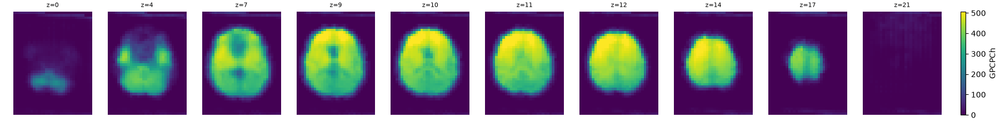

### Metabolite: GluGln


### Metabolite: Ins


### Metabolite: NAANAAG


## MRSI Raw QC

| metabolite | n_total_voxels | mean_snr | median_snr | mean_linewidth | median_linewidth | mean_crlb | median_crlb |
| --- | --- | --- | --- | --- | --- | --- | --- |
| NAANAAG | 20738 | 14.135942 | 15.0 | 0.038052 | 0.036 | 4.933007 | 4.0 |
| GPCPCh | 20738 | 14.228251 | 15.0 | 0.037878 | 0.036 | 6.853189 | 6.0 |
| CrPCr | 20738 | 14.257129 | 15.0 | 0.037799 | 0.036 | 6.431937 | 5.0 |
| GluGln | 20738 | 14.345459 | 15.0 | 0.037970 | 0.036 | 11.069957 | 11.0 |
| Ins | 20738 | 14.465190 | 15.0 | 0.037318 | 0.033 | 8.926435 | 8.0 |

### Ventricle visibility

detected ventricleMNI priornative MRSI space, pre-coregistration · all metabolites at z=10


**Dice with the subject's lateral ventricles** · median 0.13 (SynthSeg, moved to MRSI space by the MRSI→T1w transform; green from 0.15)

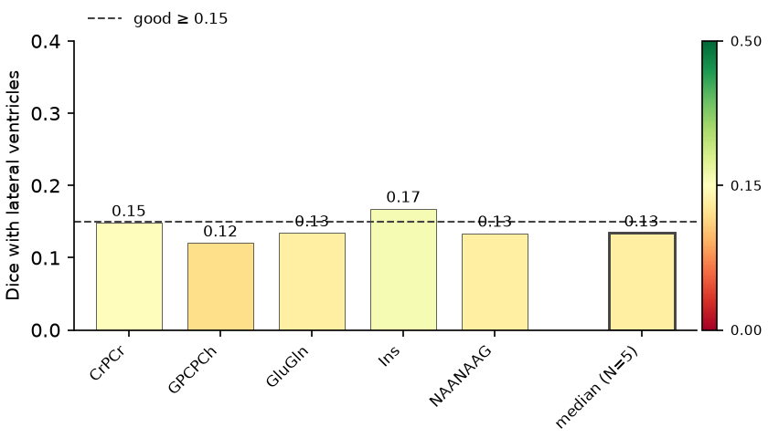

## MRSI PVC

### Partial-volume correction

Partial-volume-corrected metabolite maps, on the native MRSI grid, at the same slices as the MRSI Raw tab so the two can be compared directly.

### Metabolite: CrPCr

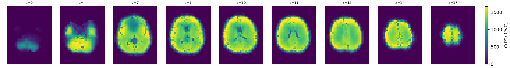

### Metabolite: GPCPCh


### Metabolite: GluGln


### Metabolite: Ins


### Metabolite: NAANAAG


## Spike Filter

### Filtering summary

| Metabolite | Spike voxels detected |
| --- | --- |
| NAANAAG | 0 |
| GPCPCh | 0 |
| CrPCr | 7 |
| GluGln | 25 |
| Ins | 20 |

### Metabolite: NAANAAG

Spike voxels detected: 0

Hover over the figure to flip between before and after spike filtering.


#### Whole image


#### Spike voxels only


### Metabolite: GPCPCh

Spike voxels detected: 0

Hover over the figure to flip between before and after spike filtering.


#### Whole image

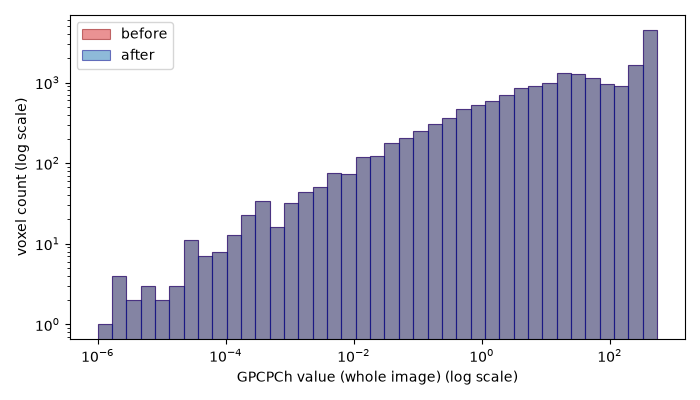

#### Spike voxels only


### Metabolite: CrPCr

Spike voxels detected: 7

Hover over the figure to flip between before and after spike filtering.


#### Whole image


#### Spike voxels only

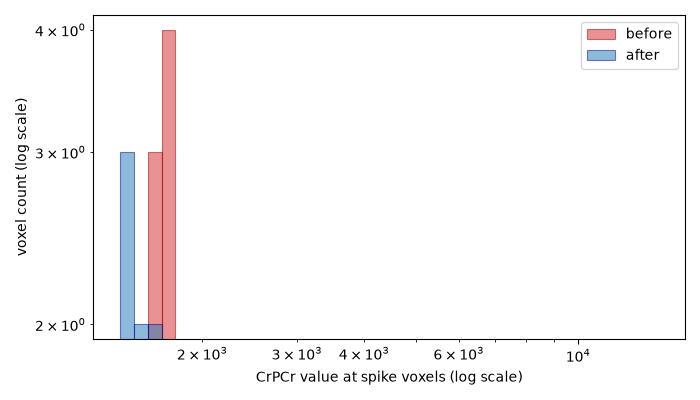

### Metabolite: GluGln

Spike voxels detected: 25

Hover over the figure to flip between before and after spike filtering.


#### Whole image

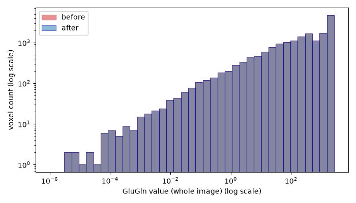

#### Spike voxels only

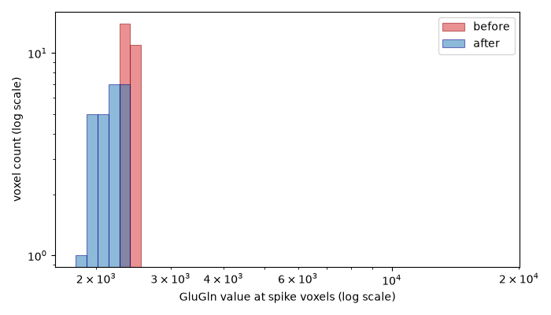

### Metabolite: Ins

Spike voxels detected: 20

Hover over the figure to flip between before and after spike filtering.


#### Whole image

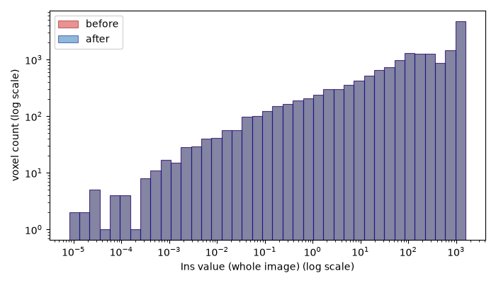

#### Spike voxels only

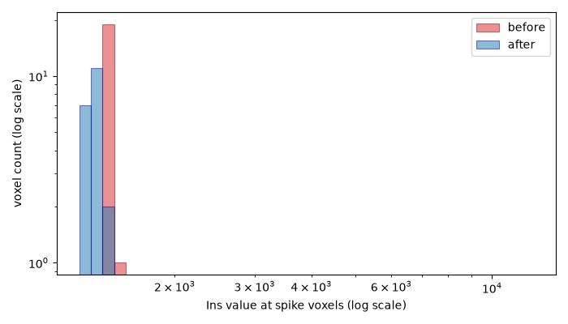

## Anatomical

### Tissue label outlines

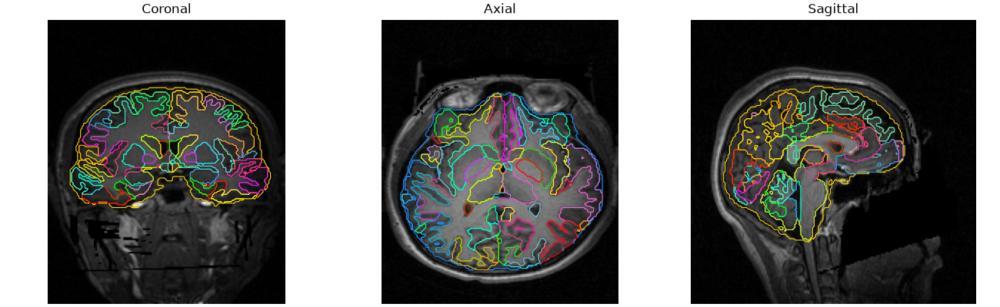

### Tissue probability maps

### GM

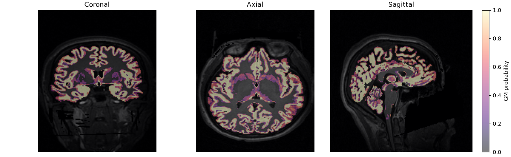

### WM


### CSF


## T1-space alignment

### T1w-space alignment

Reference metabolite map (`CrPCr`) overlaid on raw T1w, with the white-matter boundary outlined in light blue. Hover over the figure to cycle between the anatomy with the white-matter boundary, the same plus the metabolite overlay, and the overlay alone without the boundary.


### Signal-weighted leakage

| metabolite | n_quality_voxels | total_signal_mass | leakage_signal_mass | leakage_fraction | leakage_percent |
| --- | --- | --- | --- | --- | --- |
| CrPCr | 5809711 | 722465408.000 | 2160105.250 | 0.003 | 0.299 |
| GPCPCh | 5818717 | 201416912.000 | 704547.812 | 0.003 | 0.350 |
| GluGln | 5807540 | 989250752.000 | 3523168.500 | 0.004 | 0.356 |
| Ins | 5790999 | 613000640.000 | 2101226.750 | 0.003 | 0.343 |
| NAANAAG | 5841661 | 1129173120.000 | 3523994.750 | 0.003 | 0.312 |

## MRSI Space-T1

### Per-metabolite maps

Each metabolite's map resampled into T1w space, overlaid on the raw T1w, at equally-spaced axial slices.

### Metabolite: CrPCr


### Metabolite: GPCPCh

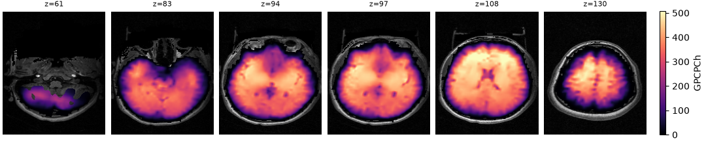

### Metabolite: GluGln


### Metabolite: Ins


### Metabolite: NAANAAG

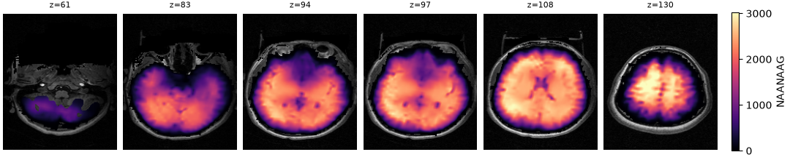

## Template-space alignment

### Template-space alignment

Reference metabolite map (`CrPCr`) overlaid on the full-head `MNI152NLin2009cAsym` template at 5 mm, with the white-matter boundary outlined in light blue. Hover over the figure to cycle between the anatomy with the white-matter boundary, the same plus the metabolite overlay, and the overlay alone without the boundary.


### Signal-weighted leakage

| metabolite | n_quality_voxels | total_signal_mass | leakage_signal_mass | leakage_fraction | leakage_percent |
| --- | --- | --- | --- | --- | --- |
| CrPCr | 73703 | 15057221.000 | 83688.992 | 0.006 | 0.556 |
| GPCPCh | 73838 | 4205009.500 | 27172.258 | 0.006 | 0.646 |
| GluGln | 73596 | 20450170.000 | 137083.219 | 0.007 | 0.670 |
| Ins | 73395 | 12782763.000 | 80954.000 | 0.006 | 0.633 |
| NAANAAG | 74255 | 23728228.000 | 137312.031 | 0.006 | 0.579 |

## MRSI Space-Template

### Per-metabolite maps

Each metabolite's map resampled into MNI152NLin2009cAsym space, overlaid on the full-head template at 5 mm, at equally-spaced axial slices.

### Metabolite: CrPCr


### Metabolite: GPCPCh

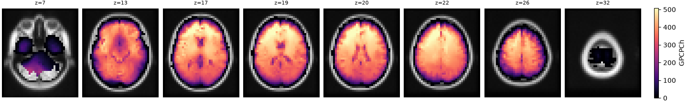

### Metabolite: GluGln


### Metabolite: Ins


### Metabolite: NAANAAG

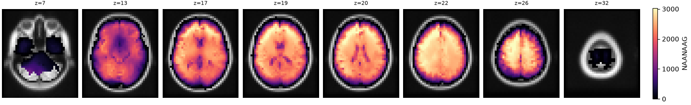

## Coverage

### MRSI anatomical coverage


### Parcelwise CRLB quality (green reliable / red unreliable)


`qc_valid_fraction` is the fraction of a parcel's MRSI voxels that passed every per-voxel quality threshold in force for this run (CRLB ≤ 20.0%, SNR ≥ 4.0, linewidth ≤ 0.1 Hz), averaged over metabolites. Rows are ordered worst first. Thresholds assume the lcmodel convention for CRLB/SNR/linewidth.

| parcel_id | parcel_name | hemisphere | mean_crlb | qc_valid_fraction |
| --- | --- | --- | --- | --- |
| 2033 | ctx-rh-temporalpole | R | 188.886 | 0.171 |
| 2032 | ctx-rh-frontalpole | R | 338.943 | 0.171 |
| 1006 | ctx-lh-entorhinal | L | 127.633 | 0.189 |
| 46 | Right-Cerebellum-White-Matter | R | 15.432 | 0.193 |
| 7 | Left-Cerebellum-White-Matter | L | 13.983 | 0.270 |
| 2006 | ctx-rh-entorhinal | R | 86.985 | 0.292 |
| 18 | Left-Amygdala | L | 20.277 | 0.369 |
| 8 | Left-Cerebellum-Cortex | L | 17.951 | 0.397 |
| 1033 | ctx-lh-temporalpole | L | 21.082 | 0.400 |
| 47 | Right-Cerebellum-Cortex | R | 48.415 | 0.403 |
| 2019 | ctx-rh-parsorbitalis | R | 37.845 | 0.418 |
| 1011 | ctx-lh-lateraloccipital | L | 8.728 | 0.448 |
| 26 | Left-Accumbens-area | L | 19.800 | 0.457 |
| 1009 | ctx-lh-inferiortemporal | L | 26.424 | 0.474 |
| 2011 | ctx-rh-lateraloccipital | R | 8.056 | 0.531 |
| 16 | Brain-Stem | NaN | 16.850 | 0.535 |
| 1027 | ctx-lh-rostralmiddlefrontal | L | 8.493 | 0.553 |
| 1032 | ctx-lh-frontalpole | L | 36.244 | 0.644 |
| 2009 | ctx-rh-inferiortemporal | R | 44.296 | 0.652 |
| 1007 | ctx-lh-fusiform | L | 21.821 | 0.703 |
| 2027 | ctx-rh-rostralmiddlefrontal | R | 11.154 | 0.724 |
| 1014 | ctx-lh-medialorbitofrontal | L | 27.619 | 0.725 |
| 1015 | ctx-lh-middletemporal | L | 22.754 | 0.746 |
| 1003 | ctx-lh-caudalmiddlefrontal | L | 6.560 | 0.769 |
| 1012 | ctx-lh-lateralorbitofrontal | L | 33.350 | 0.772 |
| 2007 | ctx-rh-fusiform | R | 15.497 | 0.791 |
| 2016 | ctx-rh-parahippocampal | R | 25.062 | 0.815 |
| 2012 | ctx-rh-lateralorbitofrontal | R | 22.938 | 0.820 |
| 58 | Right-Accumbens-area | R | 15.971 | 0.829 |
| 1028 | ctx-lh-superiorfrontal | L | 7.886 | 0.829 |
| 54 | Right-Amygdala | R | 12.367 | 0.833 |
| 1016 | ctx-lh-parahippocampal | L | 11.589 | 0.842 |
| 2002 | ctx-rh-caudalanteriorcingulate | R | 13.579 | 0.842 |
| 17 | Left-Hippocampus | L | 12.700 | 0.857 |
| 1022 | ctx-lh-postcentral | L | 6.707 | 0.866 |
| 2022 | ctx-rh-postcentral | R | 6.634 | 0.866 |
| 1031 | ctx-lh-supramarginal | L | 6.467 | 0.868 |
| 1026 | ctx-lh-rostralanteriorcingulate | L | 19.125 | 0.875 |
| 60 | Right-VentralDC | R | 10.800 | 0.889 |
| 1008 | ctx-lh-inferiorparietal | L | 6.929 | 0.894 |
| 2015 | ctx-rh-middletemporal | R | 23.000 | 0.895 |
| 1021 | ctx-lh-pericalcarine | L | 7.400 | 0.900 |
| 2014 | ctx-rh-medialorbitofrontal | R | 14.900 | 0.902 |
| 53 | Right-Hippocampus | R | 10.712 | 0.904 |
| 2029 | ctx-rh-superiorparietal | R | 6.810 | 0.908 |
| 2026 | ctx-rh-rostralanteriorcingulate | R | 12.635 | 0.913 |
| 1029 | ctx-lh-superiorparietal | L | 7.044 | 0.919 |
| 1030 | ctx-lh-superiortemporal | L | 8.002 | 0.924 |
| 2031 | ctx-rh-supramarginal | R | 6.229 | 0.928 |
| 2035 | ctx-rh-insula | R | 7.783 | 0.930 |
| 52 | Right-Pallidum | R | 10.111 | 0.933 |
| 50 | Right-Caudate | R | 9.211 | 0.935 |
| 1019 | ctx-lh-parsorbitalis | L | 8.238 | 0.941 |
| 2020 | ctx-rh-parstriangularis | R | 9.340 | 0.942 |
| 1013 | ctx-lh-lingual | L | 6.828 | 0.942 |
| 28 | Left-VentralDC | L | 12.048 | 0.945 |
| 1018 | ctx-lh-parsopercularis | L | 7.149 | 0.950 |
| 2028 | ctx-rh-superiorfrontal | R | 8.941 | 0.955 |
| 1002 | ctx-lh-caudalanteriorcingulate | L | 9.974 | 0.957 |
| 1020 | ctx-lh-parstriangularis | L | 7.927 | 0.960 |
| 2003 | ctx-rh-caudalmiddlefrontal | R | 7.752 | 0.962 |
| 2 | Left-Cerebral-White-Matter | L | 8.388 | 0.962 |
| 1024 | ctx-lh-precentral | L | 6.768 | 0.967 |
| 2005 | ctx-rh-cuneus | R | 6.850 | 0.969 |
| 1035 | ctx-lh-insula | L | 7.307 | 0.973 |
| 41 | Right-Cerebral-White-Matter | R | 7.920 | 0.974 |
| 1025 | ctx-lh-precuneus | L | 6.477 | 0.974 |
| 13 | Left-Pallidum | L | 10.444 | 0.978 |
| 51 | Right-Putamen | R | 7.969 | 0.979 |
| 49 | Right-Thalamus | R | 7.295 | 0.980 |
| 2030 | ctx-rh-superiortemporal | R | 7.105 | 0.984 |
| 2024 | ctx-rh-precentral | R | 6.688 | 0.987 |
| 2008 | ctx-rh-inferiorparietal | R | 6.312 | 0.988 |
| 10 | Left-Thalamus | L | 7.680 | 0.992 |
| 1017 | ctx-lh-paracentral | L | 6.811 | 0.994 |
| 12 | Left-Putamen | L | 6.917 | 0.994 |
| 2013 | ctx-rh-lingual | R | 7.296 | 0.996 |
| 11 | Left-Caudate | L | 7.370 | 1.000 |
| 1005 | ctx-lh-cuneus | L | 7.008 | 1.000 |
| 1001 | ctx-lh-bankssts | L | 5.757 | 1.000 |
| 2001 | ctx-rh-bankssts | R | 7.138 | 1.000 |
| 1034 | ctx-lh-transversetemporal | L | 5.575 | 1.000 |
| 1023 | ctx-lh-posteriorcingulate | L | 5.943 | 1.000 |
| 1010 | ctx-lh-isthmuscingulate | L | 5.837 | 1.000 |
| 2010 | ctx-rh-isthmuscingulate | R | 5.991 | 1.000 |
| 2021 | ctx-rh-pericalcarine | R | 6.667 | 1.000 |
| 2018 | ctx-rh-parsopercularis | R | 7.879 | 1.000 |
| 2017 | ctx-rh-paracentral | R | 6.547 | 1.000 |
| 2023 | ctx-rh-posteriorcingulate | R | 5.896 | 1.000 |
| 2025 | ctx-rh-precuneus | R | 5.861 | 1.000 |
| 2034 | ctx-rh-transversetemporal | R | 5.455 | 1.000 |

## Parcellation

Not available for this configuration.

### Regional metabolites: synthseg

| subject | session | atlas | scale | parcel_id | parcel_name | hemisphere | metabolite | mean | median | std | weighted_mean | n_voxels | coverage | mean_snr | mean_linewidth | mean_crlb | mean_gm_fraction | mean_wm_fraction | mean_csf_fraction |
| --- | --- | --- | --- | --- | --- | --- | --- | --- | --- | --- | --- | --- | --- | --- | --- | --- | --- | --- | --- |
| sub-01 | ses-01 | synthseg | NaN | 2 | Left-Cerebral-White-Matter | L | NAANAAG | 2389.594727 | 2513.228027 | 617.373779 | 2443.312012 | 1582 | 0.972940 | 15.891277 | 0.033497 | 4.271176 | 0.180780 | 0.812734 | 0.006486 |
| sub-01 | ses-01 | synthseg | NaN | 2 | Left-Cerebral-White-Matter | L | GPCPCh | 398.848267 | 408.955261 | 90.087097 | 400.103760 | 1576 | 0.969250 | 15.930838 | 0.033466 | 6.086295 | 0.179896 | 0.813598 | 0.006506 |
| sub-01 | ses-01 | synthseg | NaN | 2 | Left-Cerebral-White-Matter | L | CrPCr | 1361.200317 | 1384.360352 | 259.562927 | 1372.363403 | 1575 | 0.968635 | 15.939683 | 0.033392 | 5.697778 | 0.179842 | 0.813643 | 0.006515 |
| sub-01 | ses-01 | synthseg | NaN | 2 | Left-Cerebral-White-Matter | L | GluGln | 1839.166870 | 1859.584961 | 403.742615 | 1852.399658 | 1537 | 0.945264 | 15.981133 | 0.033617 | 11.167859 | 0.181013 | 0.813015 | 0.005972 |
| sub-01 | ses-01 | synthseg | NaN | 2 | Left-Cerebral-White-Matter | L | Ins | 1161.562256 | 1189.108643 | 228.500534 | 1171.211670 | 1555 | 0.956335 | 16.059807 | 0.033109 | 8.054019 | 0.178010 | 0.815390 | 0.006599 |
| sub-01 | ses-01 | synthseg | NaN | 7 | Left-Cerebellum-White-Matter | L | NAANAAG | 1476.902588 | 1452.224121 | 313.052277 | 1495.754150 | 21 | 0.283784 | 6.761905 | 0.045524 | 9.095238 | 0.191188 | 0.775428 | 0.033384 |
| sub-01 | ses-01 | synthseg | NaN | 7 | Left-Cerebellum-White-Matter | L | GPCPCh | 313.679779 | 319.638245 | 35.819817 | 315.487061 | 20 | 0.270270 | 6.850000 | 0.045700 | 9.300000 | 0.194867 | 0.770080 | 0.035054 |
| sub-01 | ses-01 | synthseg | NaN | 7 | Left-Cerebellum-White-Matter | L | CrPCr | 1244.500977 | 1259.722534 | 205.595428 | 1254.291260 | 21 | 0.283784 | 6.761905 | 0.045524 | 9.238095 | 0.191188 | 0.775428 | 0.033384 |
| sub-01 | ses-01 | synthseg | NaN | 7 | Left-Cerebellum-White-Matter | L | GluGln | 1699.479736 | 1736.282471 | 314.628662 | 1713.811768 | 18 | 0.243243 | 6.944445 | 0.045611 | 14.500000 | 0.217623 | 0.743429 | 0.038948 |
| sub-01 | ses-01 | synthseg | NaN | 7 | Left-Cerebellum-White-Matter | L | Ins | 1082.376343 | 1062.966064 | 173.658875 | 1092.556152 | 20 | 0.270270 | 6.850000 | 0.045700 | 11.300000 | 0.194867 | 0.770080 | 0.035054 |
| sub-01 | ses-01 | synthseg | NaN | 8 | Left-Cerebellum-Cortex | L | NAANAAG | 1807.001099 | 1893.734863 | 404.195740 | 1826.602173 | 86 | 0.407583 | 7.627907 | 0.039791 | 9.151163 | 0.663173 | 0.259236 | 0.077591 |
| sub-01 | ses-01 | synthseg | NaN | 8 | Left-Cerebellum-Cortex | L | GPCPCh | 344.612244 | 362.530670 | 60.590393 | 347.815735 | 86 | 0.407583 | 7.581395 | 0.038965 | 9.825582 | 0.665948 | 0.259236 | 0.074816 |
| sub-01 | ses-01 | synthseg | NaN | 8 | Left-Cerebellum-Cortex | L | CrPCr | 1439.521362 | 1507.518311 | 286.483948 | 1455.791016 | 85 | 0.402844 | 7.611765 | 0.038588 | 9.329412 | 0.665581 | 0.258723 | 0.075696 |
| sub-01 | ses-01 | synthseg | NaN | 8 | Left-Cerebellum-Cortex | L | GluGln | 1983.744507 | 2092.563477 | 418.291046 | 2007.040649 | 77 | 0.364929 | 7.740260 | 0.039675 | 13.376623 | 0.660964 | 0.252020 | 0.087016 |
| sub-01 | ses-01 | synthseg | NaN | 8 | Left-Cerebellum-Cortex | L | Ins | 1259.152344 | 1308.479248 | 224.456421 | 1267.975586 | 85 | 0.402844 | 7.670588 | 0.039424 | 11.494118 | 0.663824 | 0.255733 | 0.080443 |
| sub-01 | ses-01 | synthseg | NaN | 10 | Left-Thalamus | L | NAANAAG | 2010.389893 | 2007.723755 | 217.424545 | 2020.597900 | 50 | 1.000000 | 12.980000 | 0.028060 | 4.280000 | 0.261910 | 0.711306 | 0.026785 |
| sub-01 | ses-01 | synthseg | NaN | 10 | Left-Thalamus | L | GPCPCh | 376.564270 | 377.438751 | 44.393906 | 377.891754 | 50 | 1.000000 | 12.980000 | 0.028060 | 5.660000 | 0.261910 | 0.711306 | 0.026785 |
| sub-01 | ses-01 | synthseg | NaN | 10 | Left-Thalamus | L | CrPCr | 1217.723999 | 1240.404541 | 102.414536 | 1218.328857 | 50 | 1.000000 | 12.980000 | 0.028060 | 5.920000 | 0.261910 | 0.711306 | 0.026785 |
| sub-01 | ses-01 | synthseg | NaN | 10 | Left-Thalamus | L | GluGln | 1525.068726 | 1555.376221 | 120.042244 | 1524.492310 | 48 | 0.960000 | 12.979167 | 0.027417 | 12.187500 | 0.257348 | 0.714752 | 0.027901 |
| sub-01 | ses-01 | synthseg | NaN | 10 | Left-Thalamus | L | Ins | 991.270569 | 1004.015198 | 72.730141 | 991.831360 | 50 | 1.000000 | 12.980000 | 0.028060 | 9.660000 | 0.261910 | 0.711306 | 0.026785 |
| sub-01 | ses-01 | synthseg | NaN | 11 | Left-Caudate | L | NAANAAG | 2140.924316 | 2261.670410 | 300.083862 | 2174.870605 | 33 | 1.000000 | 13.515152 | 0.034242 | 3.969697 | 0.543437 | 0.435002 | 0.021561 |
| sub-01 | ses-01 | synthseg | NaN | 11 | Left-Caudate | L | GPCPCh | 417.059875 | 427.522919 | 37.042870 | 419.439789 | 33 | 1.000000 | 13.515152 | 0.034242 | 5.181818 | 0.543437 | 0.435002 | 0.021561 |
| sub-01 | ses-01 | synthseg | NaN | 11 | Left-Caudate | L | CrPCr | 1128.271484 | 1122.301880 | 81.987793 | 1132.536499 | 33 | 1.000000 | 13.515152 | 0.034242 | 5.575758 | 0.543437 | 0.435002 | 0.021561 |
| sub-01 | ses-01 | synthseg | NaN | 11 | Left-Caudate | L | GluGln | 1306.199951 | 1293.017700 | 109.379463 | 1311.064575 | 33 | 1.000000 | 13.515152 | 0.034242 | 12.909091 | 0.543437 | 0.435002 | 0.021561 |
| sub-01 | ses-01 | synthseg | NaN | 11 | Left-Caudate | L | Ins | 903.775879 | 902.198181 | 69.768425 | 908.407959 | 33 | 1.000000 | 13.515152 | 0.034242 | 9.212121 | 0.543437 | 0.435002 | 0.021561 |
| sub-01 | ses-01 | synthseg | NaN | 12 | Left-Putamen | L | NAANAAG | 2205.986572 | 2342.603271 | 341.619324 | 2279.329590 | 36 | 1.000000 | 13.555555 | 0.030889 | 4.083333 | 0.212306 | 0.787694 | 0.000000 |
| sub-01 | ses-01 | synthseg | NaN | 12 | Left-Putamen | L | GPCPCh | 439.381226 | 448.399323 | 32.831821 | 445.875885 | 36 | 1.000000 | 13.555555 | 0.030889 | 5.222222 | 0.212306 | 0.787694 | 0.000000 |
| sub-01 | ses-01 | synthseg | NaN | 12 | Left-Putamen | L | CrPCr | 1294.586914 | 1316.844482 | 113.570290 | 1312.484375 | 36 | 1.000000 | 13.555555 | 0.030889 | 5.055555 | 0.212306 | 0.787694 | 0.000000 |
| sub-01 | ses-01 | synthseg | NaN | 12 | Left-Putamen | L | GluGln | 1563.016846 | 1550.369141 | 181.155060 | 1584.133911 | 35 | 0.972222 | 13.600000 | 0.031086 | 11.028571 | 0.207148 | 0.792852 | 0.000000 |
| sub-01 | ses-01 | synthseg | NaN | 12 | Left-Putamen | L | Ins | 1027.011230 | 1022.055298 | 96.635811 | 1040.284302 | 36 | 1.000000 | 13.555555 | 0.030889 | 8.833333 | 0.212306 | 0.787694 | 0.000000 |
| sub-01 | ses-01 | synthseg | NaN | 13 | Left-Pallidum | L | NAANAAG | 2151.981445 | 2206.241455 | 214.303345 | 2189.707764 | 9 | 1.000000 | 11.444445 | 0.037778 | 7.777778 | 0.012995 | 0.987005 | 0.000000 |
| sub-01 | ses-01 | synthseg | NaN | 13 | Left-Pallidum | L | GPCPCh | 450.106659 | 457.107239 | 17.534655 | 452.446899 | 9 | 1.000000 | 11.444445 | 0.037778 | 9.000000 | 0.012995 | 0.987005 | 0.000000 |
| sub-01 | ses-01 | synthseg | NaN | 13 | Left-Pallidum | L | CrPCr | 1260.723267 | 1285.197266 | 46.339764 | 1267.594482 | 9 | 1.000000 | 11.444445 | 0.037778 | 9.000000 | 0.012995 | 0.987005 | 0.000000 |
| sub-01 | ses-01 | synthseg | NaN | 13 | Left-Pallidum | L | GluGln | 1468.949097 | 1483.323853 | 44.554699 | 1476.399536 | 9 | 1.000000 | 11.444445 | 0.037778 | 13.000000 | 0.012995 | 0.987005 | 0.000000 |
| sub-01 | ses-01 | synthseg | NaN | 13 | Left-Pallidum | L | Ins | 984.851868 | 993.260132 | 28.750288 | 987.216675 | 8 | 0.888889 | 12.125000 | 0.035875 | 11.875000 | 0.000000 | 1.000000 | 0.000000 |
| sub-01 | ses-01 | synthseg | NaN | 16 | Brain-Stem | NaN | NAANAAG | 1261.588135 | 1300.020630 | 612.207275 | 1393.156250 | 56 | 0.549020 | 9.339286 | 0.057250 | 8.375000 | 0.099110 | 0.751012 | 0.146301 |
| sub-01 | ses-01 | synthseg | NaN | 16 | Brain-Stem | NaN | GPCPCh | 279.761932 | 308.605286 | 100.718620 | 300.473419 | 55 | 0.539216 | 9.418181 | 0.057218 | 9.418181 | 0.098628 | 0.762297 | 0.135434 |
| sub-01 | ses-01 | synthseg | NaN | 16 | Brain-Stem | NaN | CrPCr | 998.125854 | 1084.379150 | 422.415863 | 1087.610107 | 56 | 0.549020 | 9.339286 | 0.057250 | 10.196428 | 0.099110 | 0.751012 | 0.146301 |
| sub-01 | ses-01 | synthseg | NaN | 16 | Brain-Stem | NaN | GluGln | 1312.870117 | 1376.568726 | 545.765320 | 1430.367188 | 54 | 0.529412 | 9.314815 | 0.057611 | 12.148149 | 0.094490 | 0.758575 | 0.143226 |
| sub-01 | ses-01 | synthseg | NaN | 16 | Brain-Stem | NaN | Ins | 895.689880 | 973.049072 | 305.978271 | 947.459412 | 52 | 0.509804 | 9.692307 | 0.056250 | 12.230769 | 0.104318 | 0.760172 | 0.131658 |
| sub-01 | ses-01 | synthseg | NaN | 17 | Left-Hippocampus | L | NAANAAG | 1430.951660 | 1495.025513 | 530.770569 | 1583.628906 | 26 | 0.928571 | 9.961538 | 0.047308 | 7.423077 | 0.780698 | 0.180102 | 0.039200 |
| sub-01 | ses-01 | synthseg | NaN | 17 | Left-Hippocampus | L | GPCPCh | 310.681366 | 315.786255 | 69.119102 | 326.752136 | 25 | 0.892857 | 10.160000 | 0.047520 | 8.560000 | 0.771926 | 0.187306 | 0.040768 |
| sub-01 | ses-01 | synthseg | NaN | 17 | Left-Hippocampus | L | CrPCr | 1110.726562 | 1130.111328 | 305.918427 | 1186.058472 | 24 | 0.857143 | 10.416667 | 0.046917 | 8.500000 | 0.762423 | 0.195110 | 0.042467 |
| sub-01 | ses-01 | synthseg | NaN | 17 | Left-Hippocampus | L | GluGln | 1415.523071 | 1439.429932 | 438.907654 | 1537.276733 | 24 | 0.857143 | 10.041667 | 0.047042 | 13.083333 | 0.786907 | 0.192355 | 0.020737 |
| sub-01 | ses-01 | synthseg | NaN | 17 | Left-Hippocampus | L | Ins | 977.162842 | 1009.650940 | 218.194382 | 1023.128479 | 21 | 0.750000 | 10.857142 | 0.044905 | 10.761905 | 0.771007 | 0.210082 | 0.018912 |
| sub-01 | ses-01 | synthseg | NaN | 18 | Left-Amygdala | L | NAANAAG | 1245.437012 | 1321.434082 | 300.684540 | 1267.805542 | 5 | 0.384615 | 8.600000 | 0.070600 | 7.400000 | 0.698852 | 0.254539 | 0.046609 |
| sub-01 | ses-01 | synthseg | NaN | 18 | Left-Amygdala | L | GPCPCh | 317.329895 | 317.772186 | 46.088924 | 320.121460 | 5 | 0.384615 | 8.600000 | 0.070600 | 8.600000 | 0.698852 | 0.254539 | 0.046609 |
| sub-01 | ses-01 | synthseg | NaN | 18 | Left-Amygdala | L | CrPCr | 939.380859 | 982.953064 | 122.948868 | 949.306702 | 5 | 0.384615 | 8.600000 | 0.070600 | 10.200000 | 0.698852 | 0.254539 | 0.046609 |
| sub-01 | ses-01 | synthseg | NaN | 18 | Left-Amygdala | L | GluGln | 1134.380615 | 1200.827271 | 141.512985 | 1147.497925 | 5 | 0.384615 | 8.600000 | 0.070600 | 12.600000 | 0.698852 | 0.254539 | 0.046609 |
| sub-01 | ses-01 | synthseg | NaN | 18 | Left-Amygdala | L | Ins | 805.552734 | 819.119751 | 71.905403 | 812.120789 | 4 | 0.307692 | 8.750000 | 0.066000 | 13.250000 | 0.716603 | 0.225136 | 0.058261 |

## Connectivity

### Connectivity matrix (spearman)


## MRSinMRS

| Parameter | Value | Unit |
| --- | --- | --- |
| AcquisitionDurationMS | 389 | ms |
| Averages | 1 |  |
| AveragingMode | N.A. |  |
| CoilElements | N.A. (synthetic) |  |
| CombinedMetabolites | tNAA (NAA+NAAG), tCr (Cr+PCr), Cho (GPC+PCh), Ins (mI), Glx (Glu+Gln) |  |
| CompressedSensingAccelerationFactor | N.A. (synthetic) |  |
| DataProcessing | Model-synthesized signal (3D U-Net trained on real template subjects); no k-space reconstruction |  |
| DeltaFrequencyPPM | 0.0 | ppm |
| Dimension | 3D |  |
| FIDPointsVectorSize | 512 |  |
| FOV | 220 x 220 x 130 | mm |
| FlipAngle | 45.0 | ° |
| MagneticFieldStrength | 3.0 | T |
| MatrixSize | 44 x 44 x 25 |  |
| Measurements | 1 |  |
| MetaboliteBasisSetLCModel | NAA, NAAG, Cr, PCr, GPC, PCh, mI, sI, Glu, Gln, Lac, GABA, GSH, Tau, Asp, Ala |  |
| Note | SynthMRSI-Project is a synthetic dataset: real T1w anatomicals paired with model-synthesized MRSI metabolite signal (3D U-Net; see MRSIPrep manuscript, Validation Datasets). No real MRSI acquisition underlies these values -- numeric geometry/timing fields (TE, RepetitionTime, FOV, resolution, matrix size, field strength, etc.) record the acquisition protocol the synthetic signal generation was matched to; fields describing a specific real pulse sequence, reconstruction, or hardware are marked N.A. since none was used. |  |
| Orientation | Transverse |  |
| PhaseEncoding | N.A. (synthetic) |  |
| PreparationScans | N.A. (synthetic) |  |
| QualityMetrics | SNR, CRLB, FWHM (synthesized, not derived from spectral fitting) |  |
| Quantification | N.A. (synthetic; not derived from spectral fitting) |  |
| RFCoils | N.A. (synthetic) |  |
| RemoveOversampling | N.A. |  |
| RepetitionTime | 0.457 | s |
| ResolutionMM3 | 5 x 5 x 5.2 | mm |
| RotationDeg | -0.79 | ° |
| SaturationBands | N.A. (synthetic) |  |
| Scanner | N.A. (synthetic; no scanner) |  |
| Sequence | N.A. (synthetic; not acquired with a real MRSI sequence) |  |
| ShimMode | N.A. (synthetic) |  |
| SlabThicknessMM | 95 | mm |
| Slabs | 1 |  |
| SpectralBandwidthHz | 1320 | Hz |
| SpectralSuppr | N.A. (synthetic) |  |
| TE | 0.78 | s |
| WaterReferenceFIDPoints | 512 |  |
| WaterReferenceFlipAngle | 45.0 | ° |
| WaterReferenceResolutionMM3 | 10.0 x 10.0 x 10.0 | mm |
| WaterReferenceTE | 0.72 | s |
| WaterReferenceTR | 0.46 | s |
| WaterSuppr | N.A. (synthetic) |  |
| WaterSupprBWHz | N.A. (synthetic) | Hz |

## Provenance

### Provenance file

Download provenance JSON

### Processing parameters

| Parameter | Value |
| --- | --- |
| Nucleus | 1H |
| Tissue backend | synthseg-fast |
| Registration backend | ants |
| Registration T1w target | brain |
| Normalization | simple |
| Output spaces | MNI152NLin2009cAsym |
| Parcellation mode | synthseg |
| Atlas | chimera-LFMIHIFIS_scale3 |
| SNR min | 4.0 |
| Linewidth max | 0.1 |
| CRLB max | 20.0 |
| Biharmonic spike filtering | True |
| Spike percentile | 99.0 |
| PVC disabled | False |
| T1 saturation correction | none |
| Connectivity | True |
| nproc x nthreads | 2 x 8 |

### Pipeline stages

Validate inputs → Tissue segmentation → Anatomical prep → MRSI loading → Spike filtering → T1 saturation correction → MRSI reference image → MRSI voxel-quality masking → Registration → Tissue probability maps → Tissue QC → Partial volume correction → Resampling → Leakage QC → SynthSeg parcellation QC → Parcellation → Regional extraction → Connectivity → Metabolite profiles → Reports

### MRSIPrep

If you use MRSIPrep, please cite: Lucchetti, F., Céléreau, E., Jenni, R., Ledoux, J.-B., Eliez, S., Delavari, F., Hagmann, P., Alemán-Gómez, Y., Klauser, A., & Klauser, P. (2026). MRSIPrep: A Standardized Post-Quantification Framework for Preprocessing Whole-Brain Magnetic Resonance Spectroscopic Imaging. bioRxiv. doi:10.64898/2026.09.11.750896. A downloadable BibTeX entry is in `CITATION.cff` in the MRSIPrep repository.

### MRSinMRS

MRSI acquisition reporting follows the MRSinMRS minimum reporting standard (Lin et al. 2021).

## Runtime

### Per-step duration

nproc: `2`  |  nthreads: `8`

Excludes this report-generation step's own duration (not yet known while it's still running) and any time spent before this recording's pipeline started (e.g. queued behind other recordings under `--nproc`).

| Step | Outcome | Duration | % of total |
| --- | --- | --- | --- |
| Tissue segmentation | PROC | 1m 00.0s | 24.2% |
| Anatomical preparation | PROC | 0.0s | 0.0% |
| MRSI loading | PROC | 0.0s | 0.0% |
| Spike filtering | PROC | 4.4s | 1.8% |
| T1 saturation correction | PROC | 0.0s | 0.0% |
| MRSI reference image | PROC | 0.0s | 0.0% |
| MRSI voxel-quality masks | PROC | 0.0s | 0.0% |
| MRSI-to-T1w registration | PROC | 1m 00.4s | 24.3% |
| T1w-to-template registration | PROC | 1m 38.9s | 39.8% |
| Tissue probability maps in MRSI space | PROC | 0.6s | 0.2% |
| Partial volume correction | PROC | 0.1s | 0.1% |
| Resampling MRSI maps to T1w/MNI space | PROC | 19.9s | 8.0% |
| Signal leakage QC | PROC | 0.7s | 0.3% |
| SynthSeg parcellation and QC | REUSED | 2.1s | 0.9% |
| Regional metabolite extraction | PROC | 0.6s | 0.2% |
| Regional metabolic profiles and connectivity | PROC | 0.6s | 0.2% |
| Parcellation (chimera/atlas) | N/A | - | - |
| **Total (through report generation)** |  | **4m 08.3s** | 100.0% |

## Outputs

```
ses-01/
├── anat/
│   └── synthseg/
│       ├── sub-01_ses-01_atlas-synthseg_desc-parcelqc.tsv
│       ├── sub-01_ses-01_atlas-synthseg_desc-robustGMWM.tsv
│       ├── sub-01_ses-01_space-mrsi_atlas-synthseg_desc-regional_metabolites.tsv
│       ├── sub-01_ses-01_space-mrsi_atlas-synthseg_desc-robustGMWM_dseg.nii.gz
│       ├── sub-01_ses-01_space-T1w_atlas-synthseg_desc-robustGMWM_dseg.nii.gz
│       ├── sub-01_ses-01_space-T1w_desc-synthsegBrain_mask.nii.gz
│       ├── sub-01_ses-01_space-T1w_desc-synthsegBrain_T1w.nii.gz
│       ├── sub-01_ses-01_space-T1w_desc-synthsegFastInput_T1w.nii.gz
│       └── sub-01_ses-01_space-T1w_desc-synthsegParcRobust_dseg.nii.gz
├── confounds/
│   ├── sub-01_ses-01_desc-leakageqc.tsv
│   ├── sub-01_ses-01_desc-mrsiqc.tsv
│   ├── sub-01_ses-01_desc-ventricleqc.tsv
│   ├── sub-01_ses-01_space-MNI152NLin2009cAsym_res-5_desc-fwhm_mrsi.nii.gz
│   ├── sub-01_ses-01_space-MNI152NLin2009cAsym_res-5_desc-snr_mrsi.nii.gz
│   ├── sub-01_ses-01_space-MNI152NLin2009cAsym_res-5_met-CrPCr_desc-crlb_mrsi.nii.gz
│   ├── sub-01_ses-01_space-MNI152NLin2009cAsym_res-5_met-GluGln_desc-crlb_mrsi.nii.gz
│   ├── sub-01_ses-01_space-MNI152NLin2009cAsym_res-5_met-GPCPCh_desc-crlb_mrsi.nii.gz
│   ├── sub-01_ses-01_space-MNI152NLin2009cAsym_res-5_met-Ins_desc-crlb_mrsi.nii.gz
│   ├── sub-01_ses-01_space-MNI152NLin2009cAsym_res-5_met-NAANAAG_desc-crlb_mrsi.nii.gz
│   ├── sub-01_ses-01_space-mrsi_desc-brain_mask.nii.gz
│   ├── sub-01_ses-01_space-mrsi_label-CSF_probseg.nii.gz
│   ├── sub-01_ses-01_space-mrsi_label-GM_probseg.nii.gz
│   ├── sub-01_ses-01_space-mrsi_label-latvent_mask.nii.gz
│   ├── sub-01_ses-01_space-mrsi_label-WM_probseg.nii.gz
│   ├── sub-01_ses-01_space-mrsi_met-CrPCr_desc-qcmask_mask.nii.gz
│   ├── sub-01_ses-01_space-mrsi_met-CrPCr_desc-spikemask_mask.nii.gz
│   ├── sub-01_ses-01_space-mrsi_met-GluGln_desc-qcmask_mask.nii.gz
│   ├── sub-01_ses-01_space-mrsi_met-GluGln_desc-spikemask_mask.nii.gz
│   ├── sub-01_ses-01_space-mrsi_met-GPCPCh_desc-qcmask_mask.nii.gz
│   ├── sub-01_ses-01_space-mrsi_met-GPCPCh_desc-spikemask_mask.nii.gz
│   ├── sub-01_ses-01_space-mrsi_met-Ins_desc-qcmask_mask.nii.gz
│   ├── sub-01_ses-01_space-mrsi_met-Ins_desc-spikemask_mask.nii.gz
│   ├── sub-01_ses-01_space-mrsi_met-NAANAAG_desc-qcmask_mask.nii.gz
│   ├── sub-01_ses-01_space-mrsi_met-NAANAAG_desc-spikemask_mask.nii.gz
│   ├── sub-01_ses-01_space-orig_desc-fwhm_mrsi.nii.gz
│   ├── sub-01_ses-01_space-orig_desc-snr_mrsi.nii.gz
│   ├── sub-01_ses-01_space-orig_met-CrPCr_desc-crlb_mrsi.nii.gz
│   ├── sub-01_ses-01_space-orig_met-GluGln_desc-crlb_mrsi.nii.gz
│   ├── sub-01_ses-01_space-orig_met-GPCPCh_desc-crlb_mrsi.nii.gz
│   ├── sub-01_ses-01_space-orig_met-Ins_desc-crlb_mrsi.nii.gz
│   ├── sub-01_ses-01_space-orig_met-NAANAAG_desc-crlb_mrsi.nii.gz
│   ├── sub-01_ses-01_space-T1w_desc-fwhm_mrsi.nii.gz
│   ├── sub-01_ses-01_space-T1w_desc-snr_mrsi.nii.gz
│   ├── sub-01_ses-01_space-T1w_label-CSF_probseg.nii.gz
│   ├── sub-01_ses-01_space-T1w_label-GM_probseg.nii.gz
│   ├── sub-01_ses-01_space-T1w_label-WM_probseg.nii.gz
│   ├── sub-01_ses-01_space-T1w_met-CrPCr_desc-crlb_mrsi.nii.gz
│   ├── sub-01_ses-01_space-T1w_met-GluGln_desc-crlb_mrsi.nii.gz
│   ├── sub-01_ses-01_space-T1w_met-GPCPCh_desc-crlb_mrsi.nii.gz
│   ├── sub-01_ses-01_space-T1w_met-Ins_desc-crlb_mrsi.nii.gz
│   └── sub-01_ses-01_space-T1w_met-NAANAAG_desc-crlb_mrsi.nii.gz
├── connectivity/
│   ├── sub-01_ses-01_atlas-synthseg_npert-50_filt-biharmonic_pvcorr_GM_desc-connectivity_mrsi.npz
│   ├── sub-01_ses-01_atlas-synthseg_npert-50_filt-biharmonic_pvcorr_GM_desc-connectivity_mrsi.tsv
│   ├── sub-01_ses-01_atlas-synthseg_npert-50_filt-biharmonic_pvcorr_GM_desc-edges_mrsi.tsv
│   ├── sub-01_ses-01_atlas-synthseg_npert-50_filt-biharmonic_pvcorr_GM_desc-metabolicprofiles_mrsi.npz
│   └── sub-01_ses-01_atlas-synthseg_npert-50_filt-biharmonic_pvcorr_GM_desc-nodes_mrsi.tsv
├── logs/
│   └── sub-01_ses-01_desc-mrsiprep_log.txt
├── mrsi/
│   ├── mni/
│   │   ├── sub-01_ses-01_space-MNI152NLin2009cAsym_res-5_met-CrPCr_desc-signal_mrsi.nii.gz
│   │   ├── sub-01_ses-01_space-MNI152NLin2009cAsym_res-5_met-GluGln_desc-signal_mrsi.nii.gz
│   │   ├── sub-01_ses-01_space-MNI152NLin2009cAsym_res-5_met-GPCPCh_desc-signal_mrsi.nii.gz
│   │   ├── sub-01_ses-01_space-MNI152NLin2009cAsym_res-5_met-Ins_desc-signal_mrsi.nii.gz
│   │   └── sub-01_ses-01_space-MNI152NLin2009cAsym_res-5_met-NAANAAG_desc-signal_mrsi.nii.gz
│   ├── orig/
│   │   ├── sub-01_ses-01_space-mrsi_desc-reference_mrsi.nii.gz
│   │   ├── sub-01_ses-01_space-mrsi_met-CrPCr_desc-signal_mrsi.nii.gz
│   │   ├── sub-01_ses-01_space-mrsi_met-CrPCr_desc-signalspikefilt_mrsi.nii.gz
│   │   ├── sub-01_ses-01_space-mrsi_met-GluGln_desc-signal_mrsi.nii.gz
│   │   ├── sub-01_ses-01_space-mrsi_met-GluGln_desc-signalspikefilt_mrsi.nii.gz
│   │   ├── sub-01_ses-01_space-mrsi_met-GPCPCh_desc-signal_mrsi.nii.gz
│   │   ├── sub-01_ses-01_space-mrsi_met-GPCPCh_desc-signalspikefilt_mrsi.nii.gz
│   │   ├── sub-01_ses-01_space-mrsi_met-Ins_desc-signal_mrsi.nii.gz
│   │   ├── sub-01_ses-01_space-mrsi_met-Ins_desc-signalspikefilt_mrsi.nii.gz
│   │   ├── sub-01_ses-01_space-mrsi_met-NAANAAG_desc-signal_mrsi.nii.gz
│   │   └── sub-01_ses-01_space-mrsi_met-NAANAAG_desc-signalspikefilt_mrsi.nii.gz
│   ├── orig-pvc/
│   │   ├── sub-01_ses-01_space-mrsi_met-CrPCr_desc-signalpvc_mrsi.nii.gz
│   │   ├── sub-01_ses-01_space-mrsi_met-GluGln_desc-signalpvc_mrsi.nii.gz
│   │   ├── sub-01_ses-01_space-mrsi_met-GPCPCh_desc-signalpvc_mrsi.nii.gz
│   │   ├── sub-01_ses-01_space-mrsi_met-Ins_desc-signalpvc_mrsi.nii.gz
│   │   └── sub-01_ses-01_space-mrsi_met-NAANAAG_desc-signalpvc_mrsi.nii.gz
│   ├── parcel/
│   │   └── sub-01_ses-01_atlas-synthseg_desc-GMmetprofiles_mrsi.npz
│   └── t1w/
│       ├── sub-01_ses-01_space-T1w_met-CrPCr_desc-signal_mrsi.nii.gz
│       ├── sub-01_ses-01_space-T1w_met-GluGln_desc-signal_mrsi.nii.gz
│       ├── sub-01_ses-01_space-T1w_met-GPCPCh_desc-signal_mrsi.nii.gz
│       ├── sub-01_ses-01_space-T1w_met-Ins_desc-signal_mrsi.nii.gz
│       └── sub-01_ses-01_space-T1w_met-NAANAAG_desc-signal_mrsi.nii.gz
└── transforms/
    ├── anat/
    │   ├── sub-01_ses-01_desc-t1w_to_mni.affine.mat
    │   ├── sub-01_ses-01_desc-t1w_to_mni.affine_inv.mat
    │   ├── sub-01_ses-01_desc-t1w_to_mni.syn.nii.gz
    │   └── sub-01_ses-01_desc-t1w_to_mni.syn_inv.nii.gz
    └── mrsi/
        ├── sub-01_ses-01_desc-mrsi_to_t1w.affine.mat
        ├── sub-01_ses-01_desc-mrsi_to_t1w.affine_inv.mat
        ├── sub-01_ses-01_desc-mrsi_to_t1w.syn.nii.gz
        └── sub-01_ses-01_desc-mrsi_to_t1w.syn_inv.nii.gz
```
