# MRSIPrep report: SynthMRSI-Project · sub-01 ses-01

## Inputs

BIDS directory: `/data`

Output directory: `/out/mrsiprep`

Parcellation mode: `synthseg`

Tissue backend: `synthseg-fast`

## MRSI Raw

### Raw metabolite maps (pre-pipeline)

### Metabolite: CrPCr

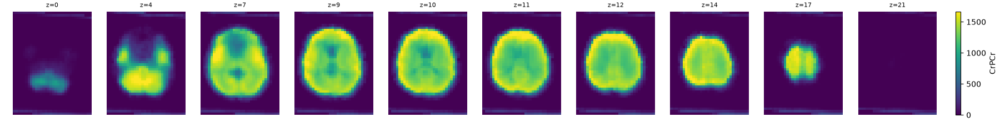

### Metabolite: GPCPCh

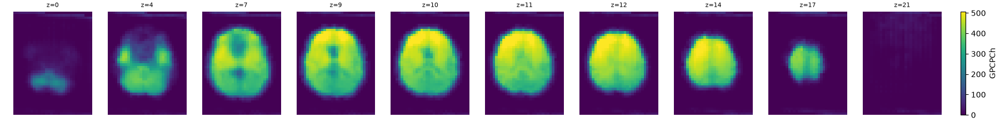

### Metabolite: GluGln

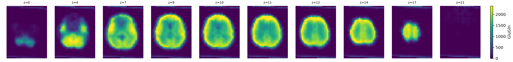

### Metabolite: Ins

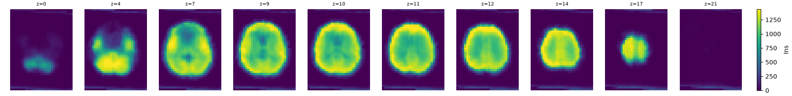

### Metabolite: NAANAAG

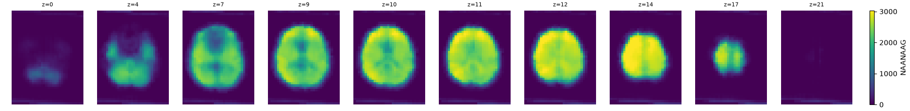

## MRSI Raw QC

| metabolite | n_total_voxels | mean_snr | median_snr | mean_linewidth | median_linewidth | mean_crlb | median_crlb |
| --- | --- | --- | --- | --- | --- | --- | --- |
| NAANAAG | 20738 | 14.135942 | 15.0 | 0.038052 | 0.036 | 4.933007 | 4.0 |
| GPCPCh | 20738 | 14.228251 | 15.0 | 0.037878 | 0.036 | 6.853189 | 6.0 |
| CrPCr | 20738 | 14.257129 | 15.0 | 0.037799 | 0.036 | 6.431937 | 5.0 |
| GluGln | 20738 | 14.345459 | 15.0 | 0.037970 | 0.036 | 11.069957 | 11.0 |
| Ins | 20738 | 14.465190 | 15.0 | 0.037318 | 0.033 | 8.926435 | 8.0 |

### Ventricle visibility

detected ventricleMNI priornative MRSI space, pre-coregistration · all metabolites at z=10

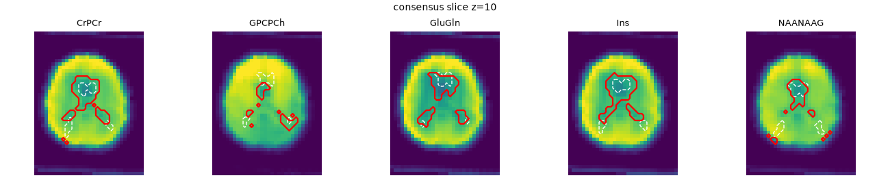

**Dice with the subject's lateral ventricles** · median 0.15 (SynthSeg, moved to MRSI space by the MRSI→T1w transform; green from 0.15)


## MRSI PVC

### Partial-volume correction

Partial-volume-corrected metabolite maps, on the native MRSI grid, at the same slices as the MRSI Raw tab so the two can be compared directly.

### Metabolite: CrPCr

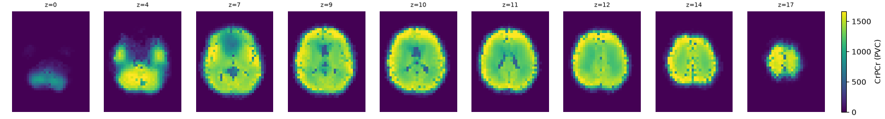

### Metabolite: GPCPCh

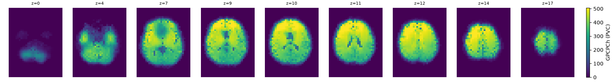

### Metabolite: GluGln

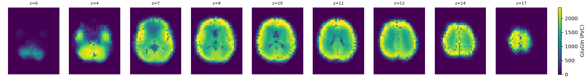

### Metabolite: Ins

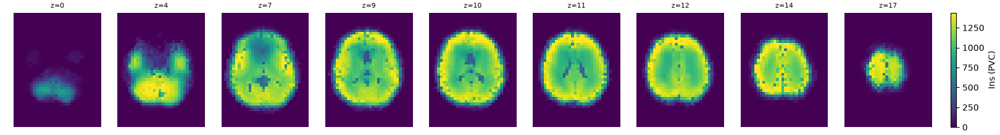

### Metabolite: NAANAAG

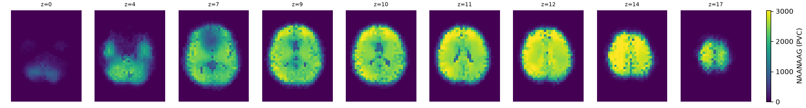

## Spike Filter

### Filtering summary

| Metabolite | Spike voxels detected |
| --- | --- |
| NAANAAG | 0 |
| GPCPCh | 0 |
| CrPCr | 7 |
| GluGln | 25 |
| Ins | 20 |

### Metabolite: NAANAAG

Spike voxels detected: 0

Hover over the figure to flip between before and after spike filtering.


#### Whole image

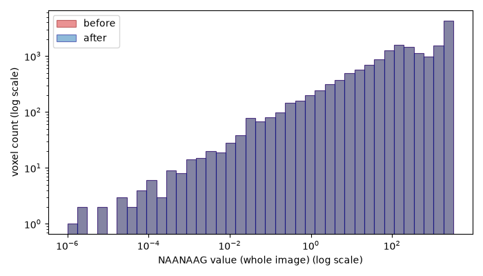

#### Spike voxels only

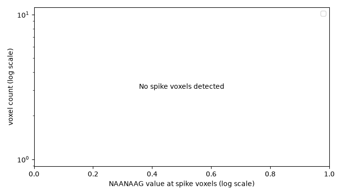

### Metabolite: GPCPCh

Spike voxels detected: 0

Hover over the figure to flip between before and after spike filtering.


#### Whole image

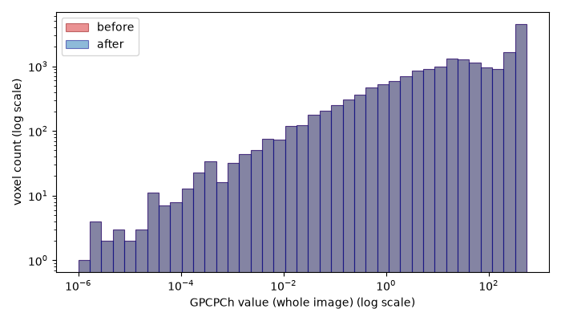

#### Spike voxels only

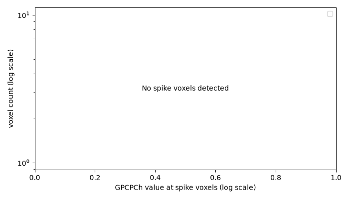

### Metabolite: CrPCr

Spike voxels detected: 7

Hover over the figure to flip between before and after spike filtering.


#### Whole image

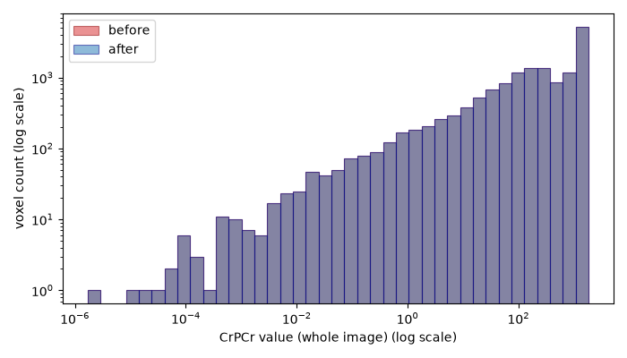

#### Spike voxels only

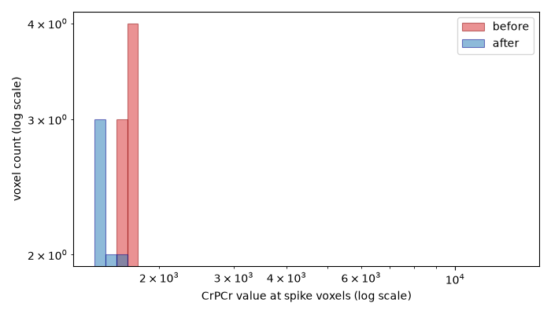

### Metabolite: GluGln

Spike voxels detected: 25

Hover over the figure to flip between before and after spike filtering.


#### Whole image

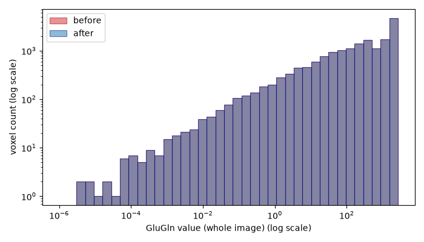

#### Spike voxels only

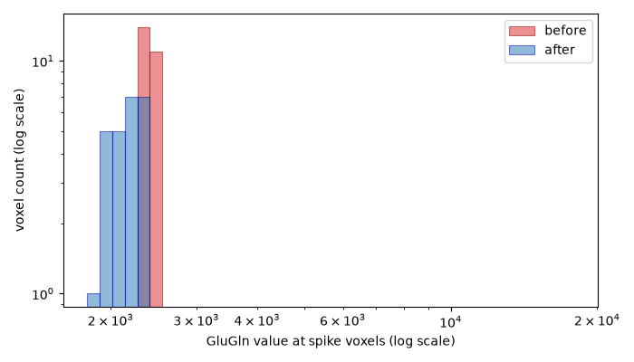

### Metabolite: Ins

Spike voxels detected: 20

Hover over the figure to flip between before and after spike filtering.


#### Whole image

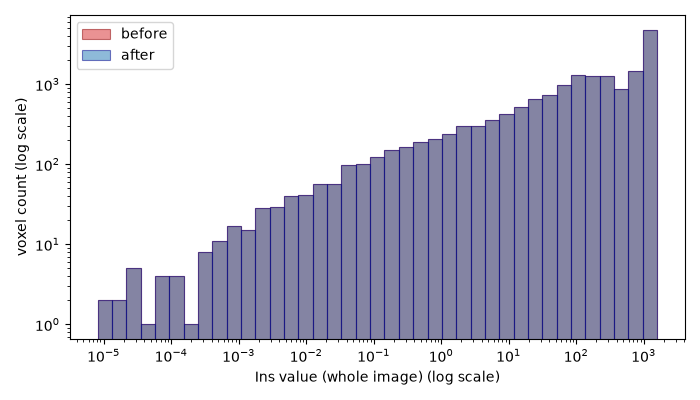

#### Spike voxels only

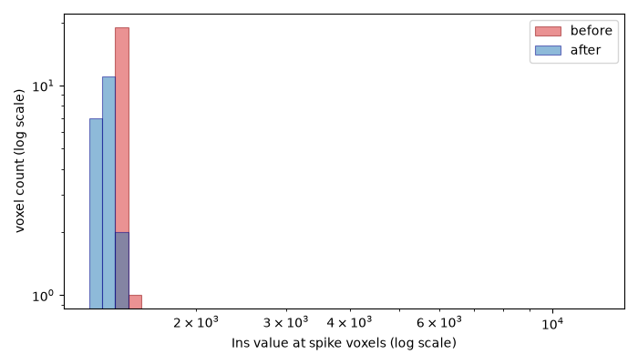

## Anatomical

### Tissue label outlines

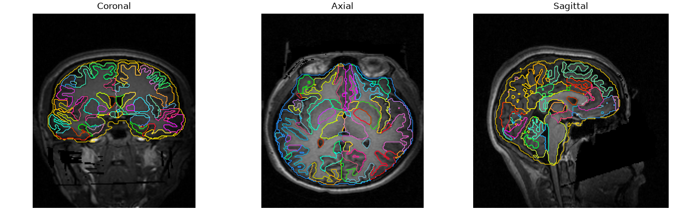

### Tissue probability maps

### GM

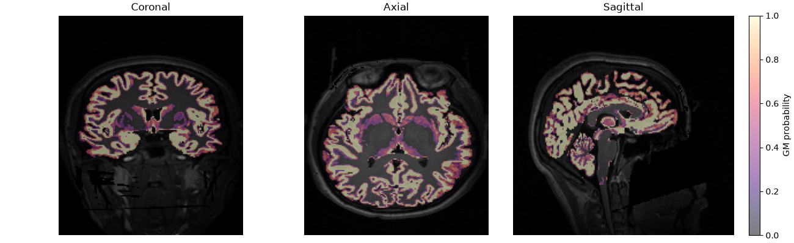

### WM

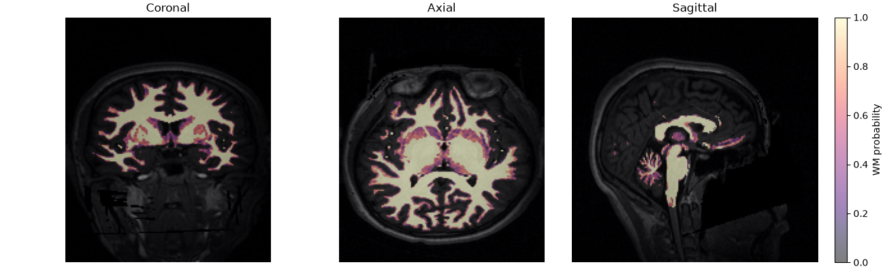

### CSF

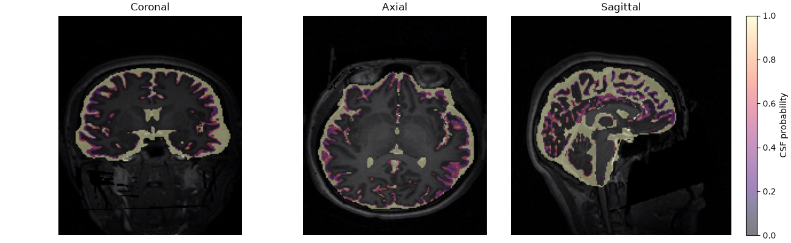

## T1-space alignment

### T1w-space alignment

Reference metabolite map (`CrPCr`) overlaid on raw T1w, with the white-matter boundary in green. Hover over the figure to flip between the two.


### Signal-weighted leakage

Not computed: T1w-space leakage requires the full T1w-space resampled metabolite maps (`--output-mrsi-t1w`), which weren't requested for this run. The alignment image above uses a separate, lightweight report-only resampling and doesn't imply this data is available.

## Template-space alignment

### Template-space alignment

Reference metabolite map (`CrPCr`) overlaid on the full-head `MNI152NLin2009cAsym` template at 5 mm, with the white-matter boundary in green. Hover over the figure to flip between the two.


### Signal-weighted leakage

| metabolite | n_quality_voxels | total_signal_mass | leakage_signal_mass | leakage_fraction | leakage_percent |
| --- | --- | --- | --- | --- | --- |
| CrPCr | 73723 | 15157284.000 | 77581.797 | 0.005 | 0.512 |
| GPCPCh | 73883 | 4231608.500 | 25804.670 | 0.006 | 0.610 |
| GluGln | 73608 | 20610924.000 | 127430.555 | 0.006 | 0.618 |
| Ins | 73366 | 12834889.000 | 76472.367 | 0.006 | 0.596 |
| NAANAAG | 74263 | 23854156.000 | 131025.789 | 0.005 | 0.549 |

## Coverage

### MRSI anatomical coverage

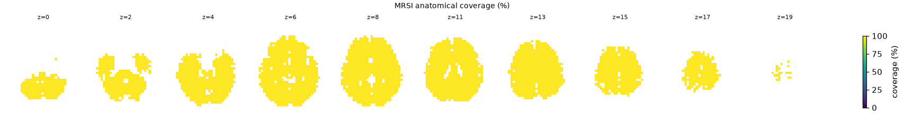

### Parcelwise CRLB quality (green reliable / red unreliable)

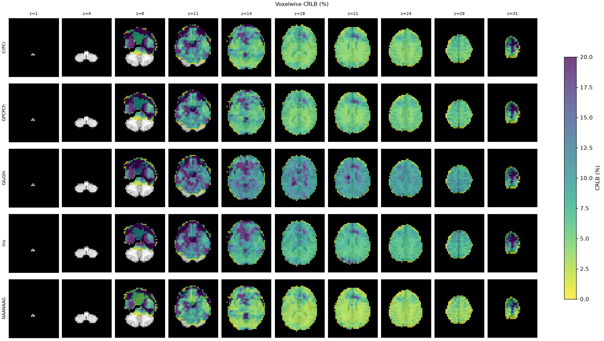

`qc_valid_fraction` is the fraction of a parcel's MRSI voxels that passed every per-voxel quality threshold in force for this run (CRLB ≤ 20.0%, SNR ≥ 4.0, linewidth ≤ 0.1), averaged over metabolites. Rows are ordered worst first.

| parcel_id | parcel_name | hemisphere | mean_crlb | qc_valid_fraction |
| --- | --- | --- | --- | --- |
| 1006 | ctx-lh-entorhinal | L | 112.650 | 0.150 |
| 46 | Right-Cerebellum-White-Matter | R | 22.233 | 0.270 |
| 18 | Left-Amygdala | L | 21.673 | 0.273 |
| 1032 | ctx-lh-frontalpole | L | 161.900 | 0.289 |
| 2006 | ctx-rh-entorhinal | R | 41.380 | 0.300 |
| 2032 | ctx-rh-frontalpole | R | 317.525 | 0.311 |
| 7 | Left-Cerebellum-White-Matter | L | 13.242 | 0.329 |
| 1033 | ctx-lh-temporalpole | L | 101.237 | 0.388 |
| 47 | Right-Cerebellum-Cortex | R | 29.372 | 0.405 |
| 1009 | ctx-lh-inferiortemporal | L | 37.039 | 0.422 |
| 8 | Left-Cerebellum-Cortex | L | 16.590 | 0.437 |
| 2033 | ctx-rh-temporalpole | R | 122.071 | 0.486 |
| 16 | Brain-Stem | NaN | 16.152 | 0.551 |
| 2019 | ctx-rh-parsorbitalis | R | 41.533 | 0.560 |
| 26 | Left-Accumbens-area | L | 94.300 | 0.567 |
| 1011 | ctx-lh-lateraloccipital | L | 8.468 | 0.578 |
| 1027 | ctx-lh-rostralmiddlefrontal | L | 8.896 | 0.639 |
| 2027 | ctx-rh-rostralmiddlefrontal | R | 24.775 | 0.690 |
| 2009 | ctx-rh-inferiortemporal | R | 42.380 | 0.705 |
| 1015 | ctx-lh-middletemporal | L | 21.457 | 0.705 |
| 2011 | ctx-rh-lateraloccipital | R | 7.613 | 0.731 |
| 58 | Right-Accumbens-area | R | 17.200 | 0.733 |
| 1007 | ctx-lh-fusiform | L | 33.067 | 0.756 |
| 2012 | ctx-rh-lateralorbitofrontal | R | 27.377 | 0.765 |
| 2002 | ctx-rh-caudalanteriorcingulate | R | 14.181 | 0.790 |
| 1012 | ctx-lh-lateralorbitofrontal | L | 23.344 | 0.808 |
| 1019 | ctx-lh-parsorbitalis | L | 11.787 | 0.812 |
| 1031 | ctx-lh-supramarginal | L | 6.535 | 0.816 |
| 17 | Left-Hippocampus | L | 12.923 | 0.838 |
| 1022 | ctx-lh-postcentral | L | 6.697 | 0.857 |
| 1028 | ctx-lh-superiorfrontal | L | 7.874 | 0.858 |
| 60 | Right-VentralDC | R | 10.807 | 0.869 |
| 1016 | ctx-lh-parahippocampal | L | 12.118 | 0.871 |
| 1003 | ctx-lh-caudalmiddlefrontal | L | 6.991 | 0.880 |
| 1002 | ctx-lh-caudalanteriorcingulate | L | 11.558 | 0.883 |
| 2014 | ctx-rh-medialorbitofrontal | R | 15.297 | 0.892 |
| 1029 | ctx-lh-superiorparietal | L | 6.991 | 0.896 |
| 11 | Left-Caudate | L | 9.455 | 0.897 |
| 54 | Right-Amygdala | R | 10.483 | 0.900 |
| 1014 | ctx-lh-medialorbitofrontal | L | 19.058 | 0.902 |
| 13 | Left-Pallidum | L | 10.956 | 0.911 |
| 2007 | ctx-rh-fusiform | R | 15.569 | 0.913 |
| 1008 | ctx-lh-inferiorparietal | L | 7.046 | 0.920 |
| 2029 | ctx-rh-superiorparietal | R | 6.856 | 0.920 |
| 53 | Right-Hippocampus | R | 10.333 | 0.924 |
| 1030 | ctx-lh-superiortemporal | L | 7.635 | 0.926 |
| 12 | Left-Putamen | L | 8.739 | 0.928 |
| 2026 | ctx-rh-rostralanteriorcingulate | R | 11.872 | 0.928 |
| 2016 | ctx-rh-parahippocampal | R | 10.188 | 0.929 |
| 2028 | ctx-rh-superiorfrontal | R | 7.397 | 0.930 |
| 2003 | ctx-rh-caudalmiddlefrontal | R | 7.837 | 0.931 |
| 2015 | ctx-rh-middletemporal | R | 14.442 | 0.933 |
| 2031 | ctx-rh-supramarginal | R | 6.279 | 0.934 |
| 50 | Right-Caudate | R | 9.443 | 0.935 |
| 28 | Left-VentralDC | L | 12.368 | 0.936 |
| 1024 | ctx-lh-precentral | L | 7.056 | 0.943 |
| 2035 | ctx-rh-insula | R | 7.328 | 0.947 |
| 2 | Left-Cerebral-White-Matter | L | 9.903 | 0.953 |
| 2024 | ctx-rh-precentral | R | 6.865 | 0.955 |
| 1026 | ctx-lh-rostralanteriorcingulate | L | 10.450 | 0.957 |
| 1035 | ctx-lh-insula | L | 7.397 | 0.965 |
| 2017 | ctx-rh-paracentral | R | 7.300 | 0.967 |
| 2022 | ctx-rh-postcentral | R | 6.707 | 0.967 |
| 2030 | ctx-rh-superiortemporal | R | 6.940 | 0.972 |
| 2020 | ctx-rh-parstriangularis | R | 9.964 | 0.973 |
| 1017 | ctx-lh-paracentral | L | 7.351 | 0.973 |
| 41 | Right-Cerebral-White-Matter | R | 7.787 | 0.977 |
| 52 | Right-Pallidum | R | 9.667 | 0.978 |
| 1013 | ctx-lh-lingual | L | 6.558 | 0.984 |
| 51 | Right-Putamen | R | 7.344 | 0.989 |
| 1018 | ctx-lh-parsopercularis | L | 7.663 | 0.990 |
| 10 | Left-Thalamus | L | 7.531 | 0.993 |
| 1020 | ctx-lh-parstriangularis | L | 8.022 | 0.994 |
| 2013 | ctx-rh-lingual | R | 6.992 | 0.996 |
| 49 | Right-Thalamus | R | 6.957 | 0.997 |
| 1025 | ctx-lh-precuneus | L | 5.997 | 0.997 |
| 1001 | ctx-lh-bankssts | L | 6.062 | 1.000 |
| 1023 | ctx-lh-posteriorcingulate | L | 6.032 | 1.000 |
| 1005 | ctx-lh-cuneus | L | 6.712 | 1.000 |
| 1010 | ctx-lh-isthmuscingulate | L | 5.926 | 1.000 |
| 2008 | ctx-rh-inferiorparietal | R | 6.301 | 1.000 |
| 2005 | ctx-rh-cuneus | R | 6.538 | 1.000 |
| 2001 | ctx-rh-bankssts | R | 6.214 | 1.000 |
| 1034 | ctx-lh-transversetemporal | L | 5.911 | 1.000 |
| 1021 | ctx-lh-pericalcarine | L | 7.150 | 1.000 |
| 2021 | ctx-rh-pericalcarine | R | 6.200 | 1.000 |
| 2018 | ctx-rh-parsopercularis | R | 7.855 | 1.000 |
| 2010 | ctx-rh-isthmuscingulate | R | 5.882 | 1.000 |
| 2023 | ctx-rh-posteriorcingulate | R | 6.000 | 1.000 |
| 2025 | ctx-rh-precuneus | R | 5.816 | 1.000 |
| 2034 | ctx-rh-transversetemporal | R | 5.717 | 1.000 |

## Parcellation

Not available for this configuration.

### Regional metabolites: synthseg

| subject | session | atlas | scale | parcel_id | parcel_name | hemisphere | metabolite | mean | median | std | weighted_mean | n_voxels | coverage | mean_snr | mean_linewidth | mean_crlb | mean_gm_fraction | mean_wm_fraction | mean_csf_fraction |
| --- | --- | --- | --- | --- | --- | --- | --- | --- | --- | --- | --- | --- | --- | --- | --- | --- | --- | --- | --- |
| sub-01 | ses-01 | synthseg | NaN | 2 | Left-Cerebral-White-Matter | L | NAANAAG | 2396.673584 | 2528.545898 | 633.721252 | 2462.376953 | 1536 | 0.962406 | 15.724609 | 0.034189 | 4.321615 | 0.173950 | 0.820830 | 0.005220 |
| sub-01 | ses-01 | synthseg | NaN | 2 | Left-Cerebral-White-Matter | L | GPCPCh | 403.141846 | 417.577026 | 90.989296 | 405.740936 | 1533 | 0.960526 | 15.742988 | 0.034182 | 6.144162 | 0.173716 | 0.821307 | 0.004977 |
| sub-01 | ses-01 | synthseg | NaN | 2 | Left-Cerebral-White-Matter | L | CrPCr | 1354.009033 | 1378.217407 | 268.945099 | 1370.252930 | 1529 | 0.958020 | 15.774363 | 0.034076 | 5.794637 | 0.173221 | 0.821635 | 0.005144 |
| sub-01 | ses-01 | synthseg | NaN | 2 | Left-Cerebral-White-Matter | L | GluGln | 1819.495483 | 1836.212646 | 418.186066 | 1841.236938 | 1496 | 0.937343 | 15.792112 | 0.034274 | 11.234626 | 0.176012 | 0.819338 | 0.004650 |
| sub-01 | ses-01 | synthseg | NaN | 2 | Left-Cerebral-White-Matter | L | Ins | 1155.218506 | 1178.524780 | 232.018356 | 1167.601807 | 1507 | 0.944236 | 15.911081 | 0.033776 | 8.214334 | 0.172057 | 0.822826 | 0.005116 |
| sub-01 | ses-01 | synthseg | NaN | 7 | Left-Cerebellum-White-Matter | L | NAANAAG | 1601.608154 | 1682.506104 | 352.608459 | 1600.009277 | 30 | 0.344828 | 6.966667 | 0.043067 | 9.533334 | 0.164775 | 0.833916 | 0.001310 |
| sub-01 | ses-01 | synthseg | NaN | 7 | Left-Cerebellum-White-Matter | L | GPCPCh | 327.797089 | 336.766632 | 40.411880 | 327.713379 | 29 | 0.333333 | 7.034483 | 0.043103 | 9.758620 | 0.170440 | 0.828205 | 0.001355 |
| sub-01 | ses-01 | synthseg | NaN | 7 | Left-Cerebellum-White-Matter | L | CrPCr | 1312.124390 | 1342.622314 | 230.455032 | 1310.596924 | 30 | 0.344828 | 6.966667 | 0.043067 | 9.633333 | 0.164775 | 0.833916 | 0.001310 |
| sub-01 | ses-01 | synthseg | NaN | 7 | Left-Cerebellum-White-Matter | L | GluGln | 1794.603149 | 1851.894897 | 346.419037 | 1789.484741 | 25 | 0.287356 | 7.120000 | 0.044000 | 14.120000 | 0.174182 | 0.824247 | 0.001571 |
| sub-01 | ses-01 | synthseg | NaN | 7 | Left-Cerebellum-White-Matter | L | Ins | 1147.921021 | 1193.803467 | 190.169586 | 1146.533203 | 29 | 0.333333 | 7.034483 | 0.043103 | 11.965517 | 0.170440 | 0.828205 | 0.001355 |
| sub-01 | ses-01 | synthseg | NaN | 8 | Left-Cerebellum-Cortex | L | NAANAAG | 1766.620361 | 1872.360352 | 459.101074 | 1805.566650 | 100 | 0.446429 | 8.010000 | 0.039640 | 8.540000 | 0.677368 | 0.223674 | 0.098958 |
| sub-01 | ses-01 | synthseg | NaN | 8 | Left-Cerebellum-Cortex | L | GPCPCh | 335.426758 | 359.033813 | 68.881439 | 340.346588 | 100 | 0.446429 | 7.970000 | 0.038930 | 9.350000 | 0.672232 | 0.221951 | 0.105454 |
| sub-01 | ses-01 | synthseg | NaN | 8 | Left-Cerebellum-Cortex | L | CrPCr | 1403.692261 | 1506.588135 | 324.494202 | 1433.088501 | 99 | 0.441964 | 8.000000 | 0.038606 | 8.868687 | 0.674701 | 0.218412 | 0.106519 |
| sub-01 | ses-01 | synthseg | NaN | 8 | Left-Cerebellum-Cortex | L | GluGln | 1939.174072 | 2087.803955 | 463.386749 | 1982.745483 | 93 | 0.415179 | 8.118279 | 0.039290 | 12.989247 | 0.677631 | 0.213603 | 0.108766 |
| sub-01 | ses-01 | synthseg | NaN | 8 | Left-Cerebellum-Cortex | L | Ins | 1243.190186 | 1309.930786 | 242.067902 | 1260.809570 | 97 | 0.433036 | 8.092784 | 0.039093 | 10.979382 | 0.683534 | 0.223302 | 0.093164 |
| sub-01 | ses-01 | synthseg | NaN | 10 | Left-Thalamus | L | NAANAAG | 2057.937256 | 2047.638550 | 210.116440 | 2059.058838 | 55 | 1.000000 | 12.909091 | 0.027545 | 4.090909 | 0.257208 | 0.719265 | 0.023527 |
| sub-01 | ses-01 | synthseg | NaN | 10 | Left-Thalamus | L | GPCPCh | 385.179779 | 388.949036 | 43.590355 | 384.806458 | 55 | 1.000000 | 12.909091 | 0.027545 | 5.490909 | 0.257208 | 0.719265 | 0.023527 |
| sub-01 | ses-01 | synthseg | NaN | 10 | Left-Thalamus | L | CrPCr | 1239.272705 | 1259.984741 | 96.799187 | 1237.261353 | 55 | 1.000000 | 12.909091 | 0.027545 | 5.745454 | 0.257208 | 0.719265 | 0.023527 |
| sub-01 | ses-01 | synthseg | NaN | 10 | Left-Thalamus | L | GluGln | 1544.851685 | 1563.124878 | 112.994614 | 1542.379883 | 53 | 0.963636 | 12.905661 | 0.026943 | 12.207547 | 0.245641 | 0.729944 | 0.024414 |
| sub-01 | ses-01 | synthseg | NaN | 10 | Left-Thalamus | L | Ins | 1005.802124 | 1018.390564 | 66.916145 | 1004.504028 | 55 | 1.000000 | 12.909091 | 0.027545 | 9.490909 | 0.257208 | 0.719265 | 0.023527 |
| sub-01 | ses-01 | synthseg | NaN | 11 | Left-Caudate | L | NAANAAG | 2010.669067 | 2090.767090 | 328.459320 | 2060.323242 | 30 | 0.909091 | 13.533334 | 0.035433 | 4.333333 | 0.604151 | 0.339725 | 0.056125 |
| sub-01 | ses-01 | synthseg | NaN | 11 | Left-Caudate | L | GPCPCh | 394.171906 | 404.902252 | 42.871990 | 399.732483 | 30 | 0.909091 | 13.533334 | 0.035433 | 5.466667 | 0.604151 | 0.339725 | 0.056125 |
| sub-01 | ses-01 | synthseg | NaN | 11 | Left-Caudate | L | CrPCr | 1076.567383 | 1079.396851 | 113.229401 | 1086.255493 | 29 | 0.878788 | 13.793103 | 0.034414 | 5.482759 | 0.598826 | 0.343114 | 0.058060 |
| sub-01 | ses-01 | synthseg | NaN | 11 | Left-Caudate | L | GluGln | 1236.602173 | 1232.643799 | 150.012558 | 1251.919922 | 30 | 0.909091 | 13.533334 | 0.035433 | 13.100000 | 0.604151 | 0.339725 | 0.056125 |
| sub-01 | ses-01 | synthseg | NaN | 11 | Left-Caudate | L | Ins | 864.418335 | 864.684570 | 93.727417 | 873.180603 | 29 | 0.878788 | 13.793103 | 0.034414 | 9.103448 | 0.598826 | 0.343114 | 0.058060 |
| sub-01 | ses-01 | synthseg | NaN | 12 | Left-Putamen | L | NAANAAG | 2136.725342 | 2309.810791 | 382.385590 | 2231.440430 | 34 | 0.944444 | 12.823529 | 0.032618 | 5.147059 | 0.196423 | 0.803577 | 0.000000 |
| sub-01 | ses-01 | synthseg | NaN | 12 | Left-Putamen | L | GPCPCh | 435.665131 | 448.210663 | 39.053650 | 444.412476 | 34 | 0.944444 | 12.823529 | 0.032618 | 6.205883 | 0.196423 | 0.803577 | 0.000000 |
| sub-01 | ses-01 | synthseg | NaN | 12 | Left-Putamen | L | CrPCr | 1267.678711 | 1296.022949 | 128.737793 | 1293.637451 | 34 | 0.944444 | 12.823529 | 0.032618 | 6.176471 | 0.196423 | 0.803577 | 0.000000 |
| sub-01 | ses-01 | synthseg | NaN | 12 | Left-Putamen | L | GluGln | 1530.674316 | 1528.963135 | 184.223709 | 1556.237183 | 32 | 0.888889 | 13.093750 | 0.032594 | 11.375000 | 0.205073 | 0.794927 | 0.000000 |
| sub-01 | ses-01 | synthseg | NaN | 12 | Left-Putamen | L | Ins | 1010.337097 | 1018.918762 | 98.640350 | 1026.011719 | 33 | 0.916667 | 13.060606 | 0.032333 | 9.575758 | 0.200100 | 0.799900 | 0.000000 |
| sub-01 | ses-01 | synthseg | NaN | 13 | Left-Pallidum | L | NAANAAG | 2034.484375 | 2078.768066 | 307.048096 | 2110.898438 | 9 | 1.000000 | 10.666667 | 0.040000 | 8.111111 | 0.000000 | 1.000000 | 0.000000 |
| sub-01 | ses-01 | synthseg | NaN | 13 | Left-Pallidum | L | GPCPCh | 447.618805 | 453.608521 | 17.511766 | 450.032379 | 8 | 0.888889 | 11.375000 | 0.037625 | 8.000000 | 0.000000 | 1.000000 | 0.000000 |
| sub-01 | ses-01 | synthseg | NaN | 13 | Left-Pallidum | L | CrPCr | 1254.361938 | 1273.921997 | 42.989773 | 1260.146484 | 8 | 0.888889 | 11.375000 | 0.037625 | 8.000000 | 0.000000 | 1.000000 | 0.000000 |
| sub-01 | ses-01 | synthseg | NaN | 13 | Left-Pallidum | L | GluGln | 1431.598999 | 1473.228882 | 101.604294 | 1454.999146 | 9 | 1.000000 | 10.666667 | 0.040000 | 13.666667 | 0.000000 | 1.000000 | 0.000000 |
| sub-01 | ses-01 | synthseg | NaN | 13 | Left-Pallidum | L | Ins | 982.183655 | 988.123108 | 26.691330 | 984.325012 | 7 | 0.777778 | 12.142858 | 0.035429 | 11.000000 | 0.000000 | 1.000000 | 0.000000 |
| sub-01 | ses-01 | synthseg | NaN | 16 | Brain-Stem | NaN | NAANAAG | 1321.301880 | 1364.280273 | 586.337402 | 1436.737305 | 58 | 0.563107 | 9.724138 | 0.055345 | 8.137931 | 0.099442 | 0.786558 | 0.114000 |
| sub-01 | ses-01 | synthseg | NaN | 16 | Brain-Stem | NaN | GPCPCh | 288.841522 | 312.781708 | 95.520370 | 305.960724 | 57 | 0.553398 | 9.807017 | 0.055281 | 9.245614 | 0.101186 | 0.782813 | 0.116000 |
| sub-01 | ses-01 | synthseg | NaN | 16 | Brain-Stem | NaN | CrPCr | 1038.990967 | 1105.085571 | 395.701111 | 1111.731323 | 58 | 0.563107 | 9.724138 | 0.055345 | 9.862069 | 0.099442 | 0.786558 | 0.114000 |
| sub-01 | ses-01 | synthseg | NaN | 16 | Brain-Stem | NaN | GluGln | 1367.851318 | 1422.908569 | 505.210144 | 1461.026367 | 56 | 0.543689 | 9.714286 | 0.055625 | 12.160714 | 0.089652 | 0.796628 | 0.113720 |
| sub-01 | ses-01 | synthseg | NaN | 16 | Brain-Stem | NaN | Ins | 916.017456 | 967.563965 | 289.037476 | 958.300476 | 55 | 0.533981 | 10.000000 | 0.054545 | 12.072727 | 0.104866 | 0.774916 | 0.120219 |
| sub-01 | ses-01 | synthseg | NaN | 17 | Left-Hippocampus | L | NAANAAG | 1376.004272 | 1448.197388 | 521.299988 | 1531.953247 | 24 | 0.923077 | 9.708333 | 0.049333 | 7.458333 | 0.813998 | 0.138527 | 0.047475 |
| sub-01 | ses-01 | synthseg | NaN | 17 | Left-Hippocampus | L | GPCPCh | 304.784271 | 305.012909 | 68.495049 | 322.132599 | 23 | 0.884615 | 9.913043 | 0.049652 | 8.565217 | 0.808570 | 0.141891 | 0.049539 |
| sub-01 | ses-01 | synthseg | NaN | 17 | Left-Hippocampus | L | CrPCr | 1072.939575 | 1193.332153 | 298.414612 | 1149.397095 | 22 | 0.846154 | 10.181818 | 0.049091 | 8.545455 | 0.799869 | 0.148341 | 0.051791 |
| sub-01 | ses-01 | synthseg | NaN | 17 | Left-Hippocampus | L | GluGln | 1323.309448 | 1350.020630 | 411.947845 | 1437.278931 | 21 | 0.807692 | 9.571428 | 0.050429 | 12.428572 | 0.787426 | 0.158317 | 0.054257 |
| sub-01 | ses-01 | synthseg | NaN | 17 | Left-Hippocampus | L | Ins | 934.981628 | 1010.880432 | 214.109146 | 982.094971 | 19 | 0.730769 | 10.631579 | 0.047211 | 10.842105 | 0.770011 | 0.170021 | 0.059968 |
| sub-01 | ses-01 | synthseg | NaN | 18 | Left-Amygdala | L | NAANAAG | 898.944275 | 1046.354980 | 475.616516 | 973.096069 | 3 | 0.272727 | 7.333333 | 0.067333 | 6.666667 | 0.798831 | 0.188603 | 0.012566 |
| sub-01 | ses-01 | synthseg | NaN | 18 | Left-Amygdala | L | GPCPCh | 260.297241 | 287.827789 | 85.536095 | 273.582123 | 3 | 0.272727 | 7.333333 | 0.067333 | 9.666667 | 0.798831 | 0.188603 | 0.012566 |
| sub-01 | ses-01 | synthseg | NaN | 18 | Left-Amygdala | L | CrPCr | 719.540283 | 832.746033 | 298.823395 | 765.050232 | 3 | 0.272727 | 7.333333 | 0.067333 | 9.000000 | 0.798831 | 0.188603 | 0.012566 |
| sub-01 | ses-01 | synthseg | NaN | 18 | Left-Amygdala | L | GluGln | 862.518555 | 984.120178 | 354.406158 | 917.175964 | 3 | 0.272727 | 7.333333 | 0.067333 | 10.333333 | 0.798831 | 0.188603 | 0.012566 |
| sub-01 | ses-01 | synthseg | NaN | 18 | Left-Amygdala | L | Ins | 620.236145 | 696.140686 | 224.480240 | 654.914246 | 3 | 0.272727 | 7.333333 | 0.067333 | 15.000000 | 0.798831 | 0.188603 | 0.012566 |

## Connectivity

### Connectivity matrix (spearman)

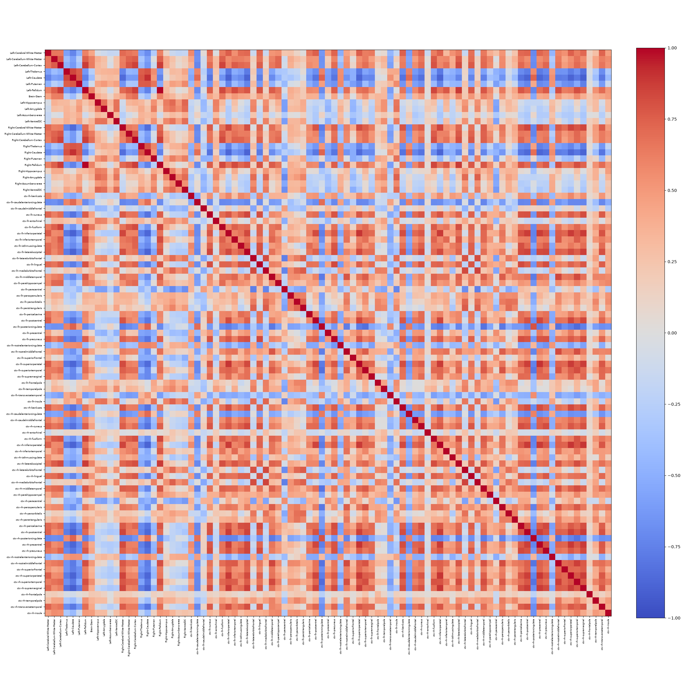

## MRSinMRS

| Parameter | Value | Unit |
| --- | --- | --- |
| AcquisitionDurationMS | 389 | ms |
| Averages | 1 |  |
| AveragingMode | N.A. |  |
| CoilElements | N.A. (synthetic) |  |
| CombinedMetabolites | tNAA (NAA+NAAG), tCr (Cr+PCr), Cho (GPC+PCh), Ins (mI), Glx (Glu+Gln) |  |
| CompressedSensingAccelerationFactor | N.A. (synthetic) |  |
| DataProcessing | Model-synthesized signal (3D U-Net trained on real template subjects); no k-space reconstruction |  |
| DeltaFrequencyPPM | 0.0 | ppm |
| Dimension | 3D |  |
| FIDPointsVectorSize | 512 |  |
| FOV | 220 x 220 x 130 | mm |
| FlipAngle | 45.0 | ° |
| MagneticFieldStrength | 3.0 | T |
| MatrixSize | 44 x 44 x 25 |  |
| Measurements | 1 |  |
| MetaboliteBasisSetLCModel | NAA, NAAG, Cr, PCr, GPC, PCh, mI, sI, Glu, Gln, Lac, GABA, GSH, Tau, Asp, Ala |  |
| Note | SynthMRSI-Project is a synthetic dataset: real T1w anatomicals paired with model-synthesized MRSI metabolite signal (3D U-Net; see MRSIPrep manuscript, Validation Datasets). No real MRSI acquisition underlies these values -- numeric geometry/timing fields (TE, RepetitionTime, FOV, resolution, matrix size, field strength, etc.) record the acquisition protocol the synthetic signal generation was matched to; fields describing a specific real pulse sequence, reconstruction, or hardware are marked N.A. since none was used. |  |
| Orientation | Transverse |  |
| PhaseEncoding | N.A. (synthetic) |  |
| PreparationScans | N.A. (synthetic) |  |
| QualityMetrics | SNR, CRLB, FWHM (synthesized, not derived from spectral fitting) |  |
| Quantification | N.A. (synthetic; not derived from spectral fitting) |  |
| RFCoils | N.A. (synthetic) |  |
| RemoveOversampling | N.A. |  |
| RepetitionTime | 0.457 | s |
| ResolutionMM3 | 5 x 5 x 5.2 | mm |
| RotationDeg | -0.79 | ° |
| SaturationBands | N.A. (synthetic) |  |
| Scanner | N.A. (synthetic; no scanner) |  |
| Sequence | N.A. (synthetic; not acquired with a real MRSI sequence) |  |
| ShimMode | N.A. (synthetic) |  |
| SlabThicknessMM | 95 | mm |
| Slabs | 1 |  |
| SpectralBandwidthHz | 1320 | Hz |
| SpectralSuppr | N.A. (synthetic) |  |
| TE | 0.78 | s |
| WaterReferenceFIDPoints | 512 |  |
| WaterReferenceFlipAngle | 45.0 | ° |
| WaterReferenceResolutionMM3 | 10.0 x 10.0 x 10.0 | mm |
| WaterReferenceTE | 0.72 | s |
| WaterReferenceTR | 0.46 | s |
| WaterSuppr | N.A. (synthetic) |  |
| WaterSupprBWHz | N.A. (synthetic) | Hz |

## PrepParams

### Processing parameters

| Parameter | Value |
| --- | --- |
| Nucleus | 1H |
| Tissue backend | synthseg-fast |
| Registration backend | ants |
| Registration T1w target | brain |
| Normalization | simple |
| Output spaces | MNI152NLin2009cAsym |
| Parcellation mode | synthseg |
| Atlas | chimera-LFMIHIFIS_scale3 |
| SNR min | 4.0 |
| Linewidth max | 0.1 |
| CRLB max | 20.0 |
| Biharmonic spike filtering | True |
| Spike percentile | 99.0 |
| PVC disabled | False |
| T1 saturation correction | none |
| Connectivity | True |
| nproc x nthreads | 1 x 16 |

### Pipeline stages

Validate inputs → Tissue segmentation → Anatomical prep → MRSI preprocessing → Registration → Tissue probability maps → Tissue QC → Partial volume correction → Resampling → Leakage QC → SynthSeg parcellation QC → Parcellation → Regional extraction → Connectivity → Metabolite profiles → Reports

## Runtime

### Per-step duration

nproc: `1`  |  nthreads: `16`

Excludes this report-generation step's own duration (not yet known while it's still running) and any time spent before this recording's pipeline started (e.g. queued behind other recordings under `--nproc`).

| Step | Outcome | Duration | % of total |
| --- | --- | --- | --- |
| Tissue segmentation | REUSED | 0.0s | 0.0% |
| Anatomical preparation | PROC | 0.0s | 0.0% |
| MRSI preprocessing | REUSED | 3.9s | 27.5% |
| MRSI-to-T1w registration | REUSED | 0.0s | 0.0% |
| T1w-to-template registration | REUSED | 1.5s | 10.7% |
| Tissue probability maps in MRSI space | REUSED | 0.0s | 0.0% |
| Partial volume correction | REUSED | 0.0s | 0.0% |
| Resampling MRSI maps to T1w/MNI space | REUSED | 5.4s | 38.5% |
| Signal leakage QC | PROC | 0.0s | 0.1% |
| SynthSeg parcellation and QC | REUSED | 2.0s | 14.4% |
| Regional metabolite extraction | PROC | 0.6s | 4.4% |
| Regional metabolic profiles and connectivity | PROC | 0.6s | 4.4% |
| T1 saturation correction | N/A | - | - |
| Parcellation (chimera/atlas) | N/A | - | - |
| **Total (through report generation)** |  | **14.1s** | 100.0% |

## Outputs

```
ses-01/
├── anat/
│   └── synthseg/
│       ├── sub-01_ses-01_atlas-synthseg_desc-parcelqc.tsv
│       ├── sub-01_ses-01_atlas-synthseg_desc-robustGMWM.tsv
│       ├── sub-01_ses-01_space-mrsi_atlas-synthseg_desc-regional_metabolites.tsv
│       ├── sub-01_ses-01_space-mrsi_atlas-synthseg_desc-robustGMWM_dseg.nii.gz
│       ├── sub-01_ses-01_space-T1w_atlas-synthseg_desc-robustGMWM_dseg.nii.gz
│       ├── sub-01_ses-01_space-T1w_desc-brainCSF_T1w.nii.gz
│       ├── sub-01_ses-01_space-T1w_desc-brainCSFmask_mask.nii.gz
│       ├── sub-01_ses-01_space-T1w_desc-synthsegBrain_mask.nii.gz
│       ├── sub-01_ses-01_space-T1w_desc-synthsegBrain_T1w.nii.gz
│       ├── sub-01_ses-01_space-T1w_desc-synthsegFastInput_T1w.nii.gz
│       └── sub-01_ses-01_space-T1w_desc-synthsegParcRobust_dseg.nii.gz
├── confounds/
│   ├── sub-01_ses-01_desc-leakageqc.tsv
│   ├── sub-01_ses-01_desc-mrsiqc.tsv
│   ├── sub-01_ses-01_desc-ventricleqc.tsv
│   ├── sub-01_ses-01_space-MNI152NLin2009cAsym_res-5_desc-fwhm_mrsi.nii.gz
│   ├── sub-01_ses-01_space-MNI152NLin2009cAsym_res-5_desc-snr_mrsi.nii.gz
│   ├── sub-01_ses-01_space-MNI152NLin2009cAsym_res-5_met-CrPCr_desc-crlb_mrsi.nii.gz
│   ├── sub-01_ses-01_space-MNI152NLin2009cAsym_res-5_met-GluGln_desc-crlb_mrsi.nii.gz
│   ├── sub-01_ses-01_space-MNI152NLin2009cAsym_res-5_met-GPCPCh_desc-crlb_mrsi.nii.gz
│   ├── sub-01_ses-01_space-MNI152NLin2009cAsym_res-5_met-Ins_desc-crlb_mrsi.nii.gz
│   ├── sub-01_ses-01_space-MNI152NLin2009cAsym_res-5_met-NAANAAG_desc-crlb_mrsi.nii.gz
│   ├── sub-01_ses-01_space-mrsi_desc-brain_mask.nii.gz
│   ├── sub-01_ses-01_space-mrsi_label-CSF_probseg.nii.gz
│   ├── sub-01_ses-01_space-mrsi_label-GM_probseg.nii.gz
│   ├── sub-01_ses-01_space-mrsi_label-latvent_mask.nii.gz
│   ├── sub-01_ses-01_space-mrsi_label-WM_probseg.nii.gz
│   ├── sub-01_ses-01_space-mrsi_met-CrPCr_desc-qcmask_mask.nii.gz
│   ├── sub-01_ses-01_space-mrsi_met-CrPCr_desc-spikemask_mask.nii.gz
│   ├── sub-01_ses-01_space-mrsi_met-GluGln_desc-qcmask_mask.nii.gz
│   ├── sub-01_ses-01_space-mrsi_met-GluGln_desc-spikemask_mask.nii.gz
│   ├── sub-01_ses-01_space-mrsi_met-GPCPCh_desc-qcmask_mask.nii.gz
│   ├── sub-01_ses-01_space-mrsi_met-GPCPCh_desc-spikemask_mask.nii.gz
│   ├── sub-01_ses-01_space-mrsi_met-Ins_desc-qcmask_mask.nii.gz
│   ├── sub-01_ses-01_space-mrsi_met-Ins_desc-spikemask_mask.nii.gz
│   ├── sub-01_ses-01_space-mrsi_met-NAANAAG_desc-qcmask_mask.nii.gz
│   ├── sub-01_ses-01_space-mrsi_met-NAANAAG_desc-spikemask_mask.nii.gz
│   ├── sub-01_ses-01_space-orig_desc-fwhm_mrsi.nii.gz
│   ├── sub-01_ses-01_space-orig_desc-snr_mrsi.nii.gz
│   ├── sub-01_ses-01_space-orig_met-CrPCr_desc-crlb_mrsi.nii.gz
│   ├── sub-01_ses-01_space-orig_met-GluGln_desc-crlb_mrsi.nii.gz
│   ├── sub-01_ses-01_space-orig_met-GPCPCh_desc-crlb_mrsi.nii.gz
│   ├── sub-01_ses-01_space-orig_met-Ins_desc-crlb_mrsi.nii.gz
│   ├── sub-01_ses-01_space-orig_met-NAANAAG_desc-crlb_mrsi.nii.gz
│   ├── sub-01_ses-01_space-T1w_label-CSF_probseg.nii.gz
│   ├── sub-01_ses-01_space-T1w_label-GM_probseg.nii.gz
│   └── sub-01_ses-01_space-T1w_label-WM_probseg.nii.gz
├── connectivity/
│   ├── sub-01_ses-01_atlas-synthseg_npert-50_filt-biharmonic_pvcorr_GM_desc-connectivity_mrsi.npz
│   ├── sub-01_ses-01_atlas-synthseg_npert-50_filt-biharmonic_pvcorr_GM_desc-connectivity_mrsi.tsv
│   ├── sub-01_ses-01_atlas-synthseg_npert-50_filt-biharmonic_pvcorr_GM_desc-edges_mrsi.tsv
│   ├── sub-01_ses-01_atlas-synthseg_npert-50_filt-biharmonic_pvcorr_GM_desc-metabolicprofiles_mrsi.npz
│   └── sub-01_ses-01_atlas-synthseg_npert-50_filt-biharmonic_pvcorr_GM_desc-nodes_mrsi.tsv
├── logs/
│   └── sub-01_ses-01_desc-mrsiprep_log.txt
├── mrsi/
│   ├── mni/
│   │   ├── sub-01_ses-01_space-MNI152NLin2009cAsym_res-5_met-CrPCr_desc-signal_mrsi.nii.gz
│   │   ├── sub-01_ses-01_space-MNI152NLin2009cAsym_res-5_met-GluGln_desc-signal_mrsi.nii.gz
│   │   ├── sub-01_ses-01_space-MNI152NLin2009cAsym_res-5_met-GPCPCh_desc-signal_mrsi.nii.gz
│   │   ├── sub-01_ses-01_space-MNI152NLin2009cAsym_res-5_met-Ins_desc-signal_mrsi.nii.gz
│   │   └── sub-01_ses-01_space-MNI152NLin2009cAsym_res-5_met-NAANAAG_desc-signal_mrsi.nii.gz
│   ├── orig/
│   │   ├── sub-01_ses-01_space-mrsi_desc-reference_mrsi.nii.gz
│   │   ├── sub-01_ses-01_space-mrsi_met-CrPCr_desc-signal_mrsi.nii.gz
│   │   ├── sub-01_ses-01_space-mrsi_met-CrPCr_desc-signalspikefilt_mrsi.nii.gz
│   │   ├── sub-01_ses-01_space-mrsi_met-GluGln_desc-signal_mrsi.nii.gz
│   │   ├── sub-01_ses-01_space-mrsi_met-GluGln_desc-signalspikefilt_mrsi.nii.gz
│   │   ├── sub-01_ses-01_space-mrsi_met-GPCPCh_desc-signal_mrsi.nii.gz
│   │   ├── sub-01_ses-01_space-mrsi_met-GPCPCh_desc-signalspikefilt_mrsi.nii.gz
│   │   ├── sub-01_ses-01_space-mrsi_met-Ins_desc-signal_mrsi.nii.gz
│   │   ├── sub-01_ses-01_space-mrsi_met-Ins_desc-signalspikefilt_mrsi.nii.gz
│   │   ├── sub-01_ses-01_space-mrsi_met-NAANAAG_desc-signal_mrsi.nii.gz
│   │   └── sub-01_ses-01_space-mrsi_met-NAANAAG_desc-signalspikefilt_mrsi.nii.gz
│   ├── orig-pvc/
│   │   ├── sub-01_ses-01_space-mrsi_met-CrPCr_desc-signalpvc_mrsi.nii.gz
│   │   ├── sub-01_ses-01_space-mrsi_met-GluGln_desc-signalpvc_mrsi.nii.gz
│   │   ├── sub-01_ses-01_space-mrsi_met-GPCPCh_desc-signalpvc_mrsi.nii.gz
│   │   ├── sub-01_ses-01_space-mrsi_met-Ins_desc-signalpvc_mrsi.nii.gz
│   │   └── sub-01_ses-01_space-mrsi_met-NAANAAG_desc-signalpvc_mrsi.nii.gz
│   └── parcel/
│       └── sub-01_ses-01_atlas-synthseg_desc-GMmetprofiles_mrsi.npz
└── transforms/
    ├── anat/
    │   ├── sub-01_ses-01_desc-t1w_to_mni.affine.mat
    │   ├── sub-01_ses-01_desc-t1w_to_mni.affine_inv.mat
    │   ├── sub-01_ses-01_desc-t1w_to_mni.syn.nii.gz
    │   └── sub-01_ses-01_desc-t1w_to_mni.syn_inv.nii.gz
    └── mrsi/
        ├── sub-01_ses-01_desc-mrsi_to_t1w.affine.mat
        ├── sub-01_ses-01_desc-mrsi_to_t1w.affine_inv.mat
        ├── sub-01_ses-01_desc-mrsi_to_t1w.syn.nii.gz
        └── sub-01_ses-01_desc-mrsi_to_t1w.syn_inv.nii.gz
```

## Citations

If you use MRSIPrep, please cite: Lucchetti, F., Céléreau, E., Jenni, R., Ledoux, J.-B., Eliez, S., Delavari, F., Hagmann, P., Alemán-Gómez, Y., Klauser, A., & Klauser, P. (2026). MRSIPrep: A Standardized Post-Quantification Framework for Preprocessing Whole-Brain Magnetic Resonance Spectroscopic Imaging. bioRxiv. doi:10.64898/2026.09.11.750896. A downloadable BibTeX entry is in `CITATION.cff` in the MRSIPrep repository.

MRSI acquisition reporting follows the MRSinMRS minimum reporting standard (Lin et al. 2021).
