# MRSIPrep report: SynthMRSI-Project · sub-01 ses-01

MRSIPrep version: `2.2.2`

## Inputs

BIDS directory: `/data`

Output directory: `/out/mrsiprep`

Parcellation mode: `synthseg`

Tissue backend: `synthseg-fast`

## MRSI QC

| metabolite | n_total_voxels | mean_snr | median_snr | mean_linewidth | median_linewidth | mean_crlb | median_crlb |
| --- | --- | --- | --- | --- | --- | --- | --- |
| NAANAAG | 20738 | 14.135942 | 15.0 | 0.038052 | 0.036 | 4.933007 | 4.0 |
| GPCPCh | 20738 | 14.228251 | 15.0 | 0.037878 | 0.036 | 6.853189 | 6.0 |
| CrPCr | 20738 | 14.257129 | 15.0 | 0.037799 | 0.036 | 6.431937 | 5.0 |
| GluGln | 20738 | 14.345459 | 15.0 | 0.037970 | 0.036 | 11.069957 | 11.0 |
| Ins | 20738 | 14.465190 | 15.0 | 0.037318 | 0.033 | 8.926435 | 8.0 |

### Ventricle visibility

detected ventricleMNI priornative MRSI space, pre-coregistration · all metabolites at z=10

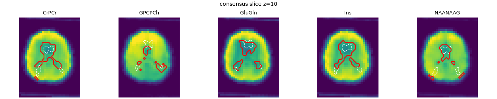

**Dice with the subject's lateral ventricles** · median 0.14 (SynthSeg, moved to MRSI space by the MRSI→T1w transform; green from 0.15)


## MRSI Raw

### Raw metabolite maps (pre-pipeline)

### Metabolite: CrPCr

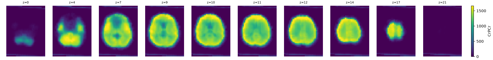

### Metabolite: GPCPCh


### Metabolite: GluGln

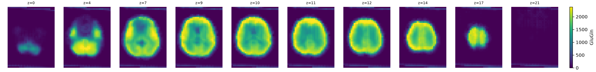

### Metabolite: Ins

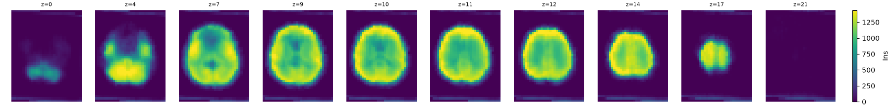

### Metabolite: NAANAAG

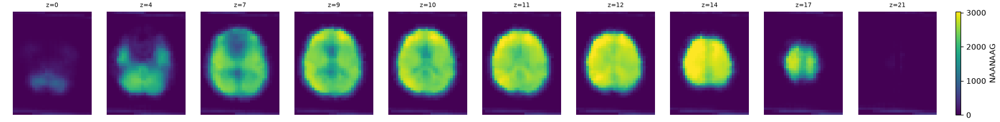

## MRSI PVC

### Partial-volume correction

Partial-volume-corrected metabolite maps, on the native MRSI grid, at the same slices as the MRSI Raw tab so the two can be compared directly.

### Metabolite: CrPCr


### Metabolite: GPCPCh

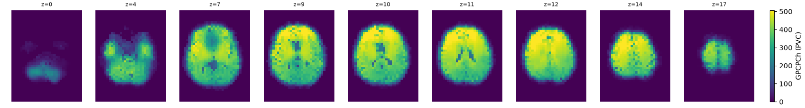

### Metabolite: GluGln

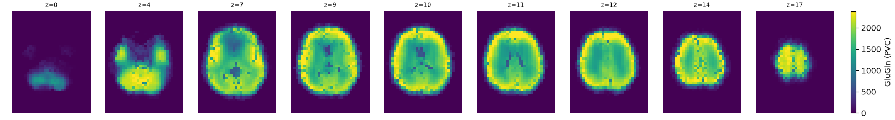

### Metabolite: Ins


### Metabolite: NAANAAG

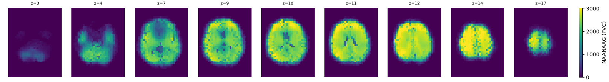

## MRSI Space-T1

### Per-metabolite maps

Each metabolite's map resampled into T1w space, overlaid on the raw T1w, at equally-spaced axial slices.

### Metabolite: CrPCr

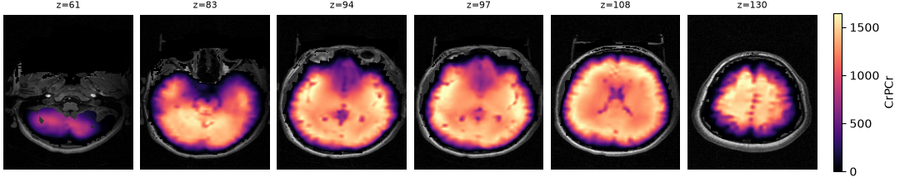

### Metabolite: GPCPCh


### Metabolite: GluGln


### Metabolite: Ins

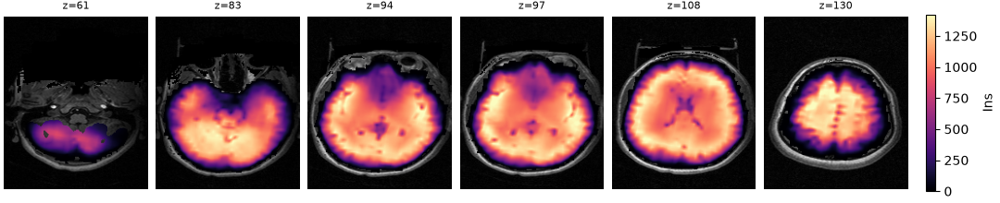

### Metabolite: NAANAAG


## MRSI Space-Template

### Per-metabolite maps

Each metabolite's map resampled into MNI152NLin2009cAsym space, overlaid on the full-head template at 5 mm, at equally-spaced axial slices.

### Metabolite: CrPCr

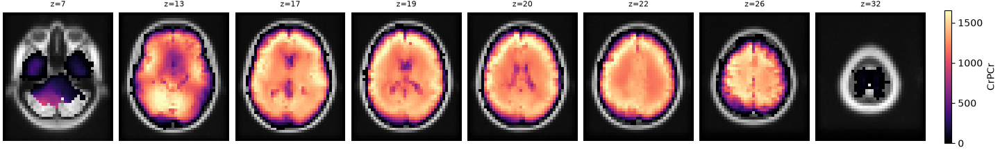

### Metabolite: GPCPCh


### Metabolite: GluGln


### Metabolite: Ins

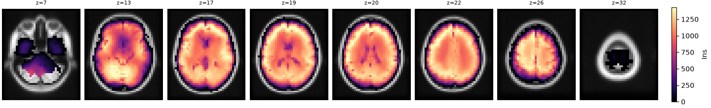

### Metabolite: NAANAAG


## Spike Filter

### Filtering summary

| Metabolite | Spike voxels detected |
| --- | --- |
| NAANAAG | 0 |
| GPCPCh | 0 |
| CrPCr | 7 |
| GluGln | 25 |
| Ins | 20 |

### Metabolite: NAANAAG

Spike voxels detected: 0

Hover over the figure to flip between before and after spike filtering.


#### Whole image


#### Spike voxels only


### Metabolite: GPCPCh

Spike voxels detected: 0

Hover over the figure to flip between before and after spike filtering.


#### Whole image


#### Spike voxels only

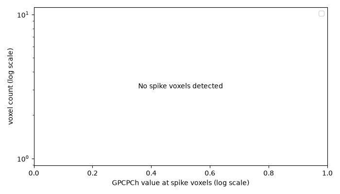

### Metabolite: CrPCr

Spike voxels detected: 7

Hover over the figure to flip between before and after spike filtering.


#### Whole image


#### Spike voxels only


### Metabolite: GluGln

Spike voxels detected: 25

Hover over the figure to flip between before and after spike filtering.


#### Whole image


#### Spike voxels only


### Metabolite: Ins

Spike voxels detected: 20

Hover over the figure to flip between before and after spike filtering.


#### Whole image


#### Spike voxels only


## Anatomical

### Tissue label outlines


### Tissue probability maps

### GM


### WM


### CSF

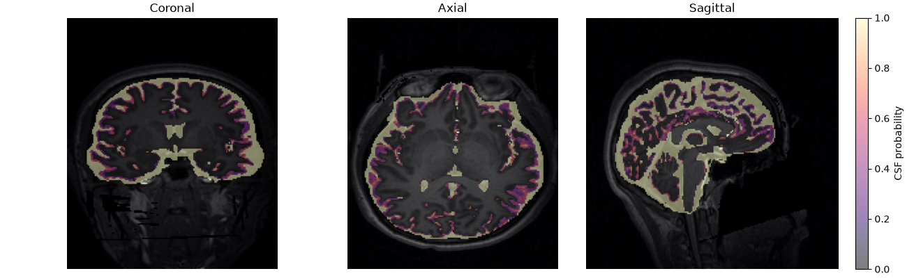

## T1-space alignment

### T1w-space alignment

Reference metabolite map (`CrPCr`) overlaid on raw T1w, with the white-matter boundary outlined in light blue. Hover over the figure to cycle between the anatomy with the white-matter boundary, the same plus the metabolite overlay, and the overlay alone without the boundary.


### Signal-weighted leakage

| metabolite | n_quality_voxels | total_signal_mass | leakage_signal_mass | leakage_fraction | leakage_percent |
| --- | --- | --- | --- | --- | --- |
| CrPCr | 5810351 | 723407296.000 | 2119581.000 | 0.003 | 0.293 |
| GPCPCh | 5819232 | 201722272.000 | 697108.500 | 0.003 | 0.346 |
| GluGln | 5808236 | 990958592.000 | 3478810.000 | 0.004 | 0.351 |
| Ins | 5791442 | 613752896.000 | 2071757.250 | 0.003 | 0.338 |
| NAANAAG | 5842028 | 1130686080.000 | 3479597.000 | 0.003 | 0.308 |

## Template-space alignment

### Template-space alignment

Reference metabolite map (`CrPCr`) overlaid on the full-head `MNI152NLin2009cAsym` template at 5 mm, with the white-matter boundary outlined in light blue. Hover over the figure to cycle between the anatomy with the white-matter boundary, the same plus the metabolite overlay, and the overlay alone without the boundary.


### Signal-weighted leakage

| metabolite | n_quality_voxels | total_signal_mass | leakage_signal_mass | leakage_fraction | leakage_percent |
| --- | --- | --- | --- | --- | --- |
| CrPCr | 73721 | 15107852.000 | 81973.117 | 0.005 | 0.543 |
| GPCPCh | 73853 | 4215385.000 | 26840.676 | 0.006 | 0.637 |
| GluGln | 73592 | 20525086.000 | 132150.875 | 0.006 | 0.644 |
| Ins | 73367 | 12787356.000 | 79662.133 | 0.006 | 0.623 |
| NAANAAG | 74259 | 23781918.000 | 135648.438 | 0.006 | 0.570 |

## Coverage

### MRSI anatomical coverage


### Parcelwise CRLB quality (green reliable / red unreliable)


`qc_valid_fraction` is the fraction of a parcel's MRSI voxels that passed every per-voxel quality threshold in force for this run (CRLB ≤ 20.0%, SNR ≥ 4.0, linewidth ≤ 0.1 Hz), averaged over metabolites. Rows are ordered worst first. Thresholds assume the lcmodel convention for CRLB/SNR/linewidth.

| parcel_id | parcel_name | hemisphere | mean_crlb | qc_valid_fraction |
| --- | --- | --- | --- | --- |
| 2032 | ctx-rh-frontalpole | R | 332.378 | 0.140 |
| 2006 | ctx-rh-entorhinal | R | 39.217 | 0.167 |
| 46 | Right-Cerebellum-White-Matter | R | 16.200 | 0.222 |
| 18 | Left-Amygdala | L | 22.309 | 0.255 |
| 7 | Left-Cerebellum-White-Matter | L | 12.917 | 0.273 |
| 2033 | ctx-rh-temporalpole | R | 141.957 | 0.300 |
| 2019 | ctx-rh-parsorbitalis | R | 55.024 | 0.306 |
| 1032 | ctx-lh-frontalpole | L | 20.200 | 0.325 |
| 1006 | ctx-lh-entorhinal | L | 124.678 | 0.356 |
| 47 | Right-Cerebellum-Cortex | R | 32.305 | 0.397 |
| 1009 | ctx-lh-inferiortemporal | L | 30.496 | 0.422 |
| 8 | Left-Cerebellum-Cortex | L | 17.396 | 0.423 |
| 1011 | ctx-lh-lateraloccipital | L | 8.900 | 0.454 |
| 16 | Brain-Stem | NaN | 16.260 | 0.550 |
| 1033 | ctx-lh-temporalpole | L | 19.741 | 0.565 |
| 2011 | ctx-rh-lateraloccipital | R | 7.810 | 0.584 |
| 1027 | ctx-lh-rostralmiddlefrontal | L | 8.233 | 0.596 |
| 2009 | ctx-rh-inferiortemporal | R | 38.455 | 0.680 |
| 1007 | ctx-lh-fusiform | L | 23.423 | 0.700 |
| 26 | Left-Accumbens-area | L | 14.080 | 0.720 |
| 2027 | ctx-rh-rostralmiddlefrontal | R | 18.272 | 0.723 |
| 2012 | ctx-rh-lateralorbitofrontal | R | 25.298 | 0.770 |
| 1012 | ctx-lh-lateralorbitofrontal | L | 33.986 | 0.771 |
| 1015 | ctx-lh-middletemporal | L | 22.098 | 0.778 |
| 58 | Right-Accumbens-area | R | 17.520 | 0.800 |
| 2002 | ctx-rh-caudalanteriorcingulate | R | 14.895 | 0.800 |
| 1003 | ctx-lh-caudalmiddlefrontal | L | 6.790 | 0.800 |
| 1014 | ctx-lh-medialorbitofrontal | L | 32.945 | 0.810 |
| 54 | Right-Amygdala | R | 12.145 | 0.818 |
| 1022 | ctx-lh-postcentral | L | 6.664 | 0.841 |
| 2007 | ctx-rh-fusiform | R | 17.164 | 0.847 |
| 17 | Left-Hippocampus | L | 12.586 | 0.855 |
| 1031 | ctx-lh-supramarginal | L | 6.667 | 0.863 |
| 1028 | ctx-lh-superiorfrontal | L | 8.056 | 0.863 |
| 1016 | ctx-lh-parahippocampal | L | 11.578 | 0.878 |
| 2022 | ctx-rh-postcentral | R | 6.634 | 0.890 |
| 2026 | ctx-rh-rostralanteriorcingulate | R | 12.752 | 0.895 |
| 53 | Right-Hippocampus | R | 10.965 | 0.896 |
| 2003 | ctx-rh-caudalmiddlefrontal | R | 7.679 | 0.903 |
| 60 | Right-VentralDC | R | 10.200 | 0.903 |
| 50 | Right-Caudate | R | 9.972 | 0.906 |
| 1008 | ctx-lh-inferiorparietal | L | 7.119 | 0.908 |
| 2029 | ctx-rh-superiorparietal | R | 6.919 | 0.911 |
| 2016 | ctx-rh-parahippocampal | R | 20.753 | 0.918 |
| 2015 | ctx-rh-middletemporal | R | 9.535 | 0.921 |
| 2031 | ctx-rh-supramarginal | R | 6.042 | 0.923 |
| 1026 | ctx-lh-rostralanteriorcingulate | L | 17.015 | 0.926 |
| 1029 | ctx-lh-superiorparietal | L | 7.112 | 0.927 |
| 2014 | ctx-rh-medialorbitofrontal | R | 14.456 | 0.927 |
| 11 | Left-Caudate | L | 9.333 | 0.928 |
| 2035 | ctx-rh-insula | R | 7.490 | 0.930 |
| 2028 | ctx-rh-superiorfrontal | R | 7.465 | 0.932 |
| 2020 | ctx-rh-parstriangularis | R | 9.988 | 0.935 |
| 1024 | ctx-lh-precentral | L | 6.746 | 0.937 |
| 1019 | ctx-lh-parsorbitalis | L | 7.612 | 0.941 |
| 28 | Left-VentralDC | L | 12.055 | 0.945 |
| 1030 | ctx-lh-superiortemporal | L | 7.583 | 0.949 |
| 1021 | ctx-lh-pericalcarine | L | 9.600 | 0.950 |
| 1002 | ctx-lh-caudalanteriorcingulate | L | 9.686 | 0.952 |
| 52 | Right-Pallidum | R | 9.778 | 0.956 |
| 2 | Left-Cerebral-White-Matter | L | 8.798 | 0.959 |
| 1020 | ctx-lh-parstriangularis | L | 8.074 | 0.966 |
| 12 | Left-Putamen | L | 7.541 | 0.968 |
| 1013 | ctx-lh-lingual | L | 6.770 | 0.968 |
| 1035 | ctx-lh-insula | L | 7.448 | 0.971 |
| 2005 | ctx-rh-cuneus | R | 6.789 | 0.971 |
| 2024 | ctx-rh-precentral | R | 6.928 | 0.974 |
| 41 | Right-Cerebral-White-Matter | R | 7.992 | 0.975 |
| 13 | Left-Pallidum | L | 10.689 | 0.978 |
| 51 | Right-Putamen | R | 7.622 | 0.978 |
| 1025 | ctx-lh-precuneus | L | 6.293 | 0.984 |
| 10 | Left-Thalamus | L | 7.688 | 0.992 |
| 1017 | ctx-lh-paracentral | L | 6.654 | 0.995 |
| 2013 | ctx-rh-lingual | R | 7.100 | 0.996 |
| 49 | Right-Thalamus | R | 6.915 | 0.997 |
| 2030 | ctx-rh-superiortemporal | R | 6.685 | 0.998 |
| 2008 | ctx-rh-inferiorparietal | R | 6.400 | 0.998 |
| 1005 | ctx-lh-cuneus | L | 6.708 | 1.000 |
| 1010 | ctx-lh-isthmuscingulate | L | 5.770 | 1.000 |
| 1001 | ctx-lh-bankssts | L | 5.729 | 1.000 |
| 2001 | ctx-rh-bankssts | R | 6.947 | 1.000 |
| 1034 | ctx-lh-transversetemporal | L | 5.933 | 1.000 |
| 1018 | ctx-lh-parsopercularis | L | 6.578 | 1.000 |
| 1023 | ctx-lh-posteriorcingulate | L | 5.914 | 1.000 |
| 2010 | ctx-rh-isthmuscingulate | R | 5.870 | 1.000 |
| 2021 | ctx-rh-pericalcarine | R | 6.214 | 1.000 |
| 2018 | ctx-rh-parsopercularis | R | 7.600 | 1.000 |
| 2017 | ctx-rh-paracentral | R | 6.594 | 1.000 |
| 2023 | ctx-rh-posteriorcingulate | R | 5.921 | 1.000 |
| 2025 | ctx-rh-precuneus | R | 5.876 | 1.000 |
| 2034 | ctx-rh-transversetemporal | R | 5.500 | 1.000 |

## Parcellation

Not available for this configuration.

### Regional metabolites: synthseg

| subject | session | atlas | scale | parcel_id | parcel_name | hemisphere | metabolite | mean | median | std | weighted_mean | n_voxels | coverage | mean_snr | mean_linewidth | mean_crlb | mean_gm_fraction | mean_wm_fraction | mean_csf_fraction |
| --- | --- | --- | --- | --- | --- | --- | --- | --- | --- | --- | --- | --- | --- | --- | --- | --- | --- | --- | --- |
| sub-01 | ses-01 | synthseg | NaN | 2 | Left-Cerebral-White-Matter | L | NAANAAG | 2405.072998 | 2514.481934 | 608.875427 | 2459.351807 | 1553 | 0.966999 | 15.908564 | 0.033428 | 4.269156 | 0.173511 | 0.821026 | 0.005463 |
| sub-01 | ses-01 | synthseg | NaN | 2 | Left-Cerebral-White-Matter | L | GPCPCh | 401.125763 | 411.021118 | 89.340561 | 402.679504 | 1551 | 0.965753 | 15.918118 | 0.033414 | 6.105093 | 0.173516 | 0.821014 | 0.005470 |
| sub-01 | ses-01 | synthseg | NaN | 2 | Left-Cerebral-White-Matter | L | CrPCr | 1361.433105 | 1384.407227 | 257.064362 | 1373.768066 | 1550 | 0.965131 | 15.930967 | 0.033382 | 5.718064 | 0.173184 | 0.821343 | 0.005473 |
| sub-01 | ses-01 | synthseg | NaN | 2 | Left-Cerebral-White-Matter | L | GluGln | 1835.884033 | 1852.304321 | 400.541473 | 1850.548584 | 1515 | 0.943337 | 15.962377 | 0.033534 | 11.215841 | 0.174955 | 0.819901 | 0.005144 |
| sub-01 | ses-01 | synthseg | NaN | 2 | Left-Cerebral-White-Matter | L | Ins | 1161.883545 | 1191.417969 | 225.832031 | 1172.219727 | 1530 | 0.952677 | 16.046406 | 0.033047 | 8.086274 | 0.171359 | 0.823193 | 0.005448 |
| sub-01 | ses-01 | synthseg | NaN | 7 | Left-Cerebellum-White-Matter | L | NAANAAG | 1529.905151 | 1506.990845 | 315.812469 | 1543.254272 | 22 | 0.285714 | 7.090909 | 0.043682 | 8.681818 | 0.159167 | 0.833624 | 0.007208 |
| sub-01 | ses-01 | synthseg | NaN | 7 | Left-Cerebellum-White-Matter | L | GPCPCh | 319.506592 | 322.610901 | 34.560135 | 320.963684 | 21 | 0.272727 | 7.190476 | 0.043762 | 8.714286 | 0.163221 | 0.829227 | 0.007552 |
| sub-01 | ses-01 | synthseg | NaN | 7 | Left-Cerebellum-White-Matter | L | CrPCr | 1273.028320 | 1274.551270 | 206.731216 | 1279.472046 | 22 | 0.285714 | 7.090909 | 0.043682 | 8.681818 | 0.159167 | 0.833624 | 0.007208 |
| sub-01 | ses-01 | synthseg | NaN | 7 | Left-Cerebellum-White-Matter | L | GluGln | 1754.887329 | 1772.791504 | 320.330139 | 1763.257446 | 19 | 0.246753 | 7.315790 | 0.043474 | 13.684211 | 0.179513 | 0.812140 | 0.008347 |
| sub-01 | ses-01 | synthseg | NaN | 7 | Left-Cerebellum-White-Matter | L | Ins | 1112.939331 | 1122.062134 | 175.737152 | 1119.588623 | 21 | 0.272727 | 7.190476 | 0.043762 | 10.904762 | 0.163221 | 0.829227 | 0.007552 |
| sub-01 | ses-01 | synthseg | NaN | 8 | Left-Cerebellum-Cortex | L | NAANAAG | 1785.814941 | 1904.429199 | 455.853241 | 1818.313599 | 94 | 0.435185 | 7.691489 | 0.039447 | 9.053191 | 0.660353 | 0.247128 | 0.092520 |
| sub-01 | ses-01 | synthseg | NaN | 8 | Left-Cerebellum-Cortex | L | GPCPCh | 339.635315 | 362.357849 | 68.567444 | 343.935730 | 94 | 0.435185 | 7.648936 | 0.038691 | 9.776596 | 0.658860 | 0.247128 | 0.093023 |
| sub-01 | ses-01 | synthseg | NaN | 8 | Left-Cerebellum-Cortex | L | CrPCr | 1419.427734 | 1520.305420 | 322.724915 | 1444.259399 | 93 | 0.430556 | 7.677419 | 0.038344 | 9.333333 | 0.659698 | 0.245279 | 0.094023 |
| sub-01 | ses-01 | synthseg | NaN | 8 | Left-Cerebellum-Cortex | L | GluGln | 1954.260132 | 2091.227051 | 466.735779 | 1991.719482 | 85 | 0.393519 | 7.800000 | 0.039306 | 13.211764 | 0.665637 | 0.231947 | 0.102416 |
| sub-01 | ses-01 | synthseg | NaN | 8 | Left-Cerebellum-Cortex | L | Ins | 1256.687622 | 1319.519409 | 238.630630 | 1270.314819 | 91 | 0.421296 | 7.769231 | 0.038857 | 11.340659 | 0.673787 | 0.246730 | 0.079484 |
| sub-01 | ses-01 | synthseg | NaN | 10 | Left-Thalamus | L | NAANAAG | 2031.003174 | 2023.983887 | 213.031311 | 2036.407959 | 52 | 1.000000 | 12.903846 | 0.027904 | 4.269231 | 0.278510 | 0.705043 | 0.016447 |
| sub-01 | ses-01 | synthseg | NaN | 10 | Left-Thalamus | L | GPCPCh | 379.981720 | 381.655945 | 43.041924 | 380.540466 | 52 | 1.000000 | 12.903846 | 0.027904 | 5.653846 | 0.278510 | 0.705043 | 0.016447 |
| sub-01 | ses-01 | synthseg | NaN | 10 | Left-Thalamus | L | CrPCr | 1227.456787 | 1252.215088 | 93.096054 | 1226.846680 | 52 | 1.000000 | 12.903846 | 0.027904 | 5.923077 | 0.278510 | 0.705043 | 0.016447 |
| sub-01 | ses-01 | synthseg | NaN | 10 | Left-Thalamus | L | GluGln | 1535.228271 | 1555.681519 | 106.864151 | 1533.811646 | 50 | 0.961538 | 12.900000 | 0.027280 | 12.300000 | 0.269941 | 0.712954 | 0.017105 |
| sub-01 | ses-01 | synthseg | NaN | 10 | Left-Thalamus | L | Ins | 998.791931 | 1008.242554 | 65.552963 | 998.377441 | 52 | 1.000000 | 12.903846 | 0.027904 | 9.634615 | 0.278510 | 0.705043 | 0.016447 |
| sub-01 | ses-01 | synthseg | NaN | 11 | Left-Caudate | L | NAANAAG | 2008.129272 | 2124.147705 | 361.405212 | 2067.381348 | 35 | 0.972222 | 12.857142 | 0.036343 | 5.285714 | 0.554391 | 0.383587 | 0.062022 |
| sub-01 | ses-01 | synthseg | NaN | 11 | Left-Caudate | L | GPCPCh | 399.914825 | 416.658569 | 48.427959 | 403.458740 | 34 | 0.944444 | 13.117647 | 0.036176 | 6.029412 | 0.548466 | 0.387688 | 0.063846 |
| sub-01 | ses-01 | synthseg | NaN | 11 | Left-Caudate | L | CrPCr | 1098.488647 | 1105.305664 | 112.596794 | 1101.031616 | 33 | 0.916667 | 13.333333 | 0.035303 | 6.030303 | 0.534783 | 0.399436 | 0.065781 |
| sub-01 | ses-01 | synthseg | NaN | 11 | Left-Caudate | L | GluGln | 1270.068237 | 1272.776367 | 145.173645 | 1273.978149 | 33 | 0.916667 | 13.363636 | 0.036000 | 13.303030 | 0.550069 | 0.384150 | 0.065781 |
| sub-01 | ses-01 | synthseg | NaN | 11 | Left-Caudate | L | Ins | 884.747559 | 890.288452 | 88.075577 | 885.871277 | 32 | 0.888889 | 13.593750 | 0.035094 | 9.187500 | 0.536009 | 0.396155 | 0.067836 |
| sub-01 | ses-01 | synthseg | NaN | 12 | Left-Putamen | L | NAANAAG | 2186.463135 | 2343.095703 | 349.942474 | 2261.907715 | 36 | 0.972973 | 13.361111 | 0.031222 | 4.222222 | 0.213723 | 0.786277 | 0.000000 |
| sub-01 | ses-01 | synthseg | NaN | 12 | Left-Putamen | L | GPCPCh | 438.655975 | 448.648193 | 34.764202 | 445.562683 | 36 | 0.972973 | 13.361111 | 0.031222 | 5.388889 | 0.213723 | 0.786277 | 0.000000 |
| sub-01 | ses-01 | synthseg | NaN | 12 | Left-Putamen | L | CrPCr | 1288.945801 | 1309.382080 | 118.985596 | 1308.302490 | 36 | 0.972973 | 13.361111 | 0.031222 | 5.250000 | 0.213723 | 0.786277 | 0.000000 |
| sub-01 | ses-01 | synthseg | NaN | 12 | Left-Putamen | L | GluGln | 1555.632812 | 1545.338379 | 187.287109 | 1579.040161 | 35 | 0.945946 | 13.400000 | 0.031429 | 11.085714 | 0.209255 | 0.790745 | 0.000000 |
| sub-01 | ses-01 | synthseg | NaN | 12 | Left-Putamen | L | Ins | 1023.065125 | 1021.740845 | 100.774117 | 1037.673096 | 36 | 0.972973 | 13.361111 | 0.031222 | 9.027778 | 0.213723 | 0.786277 | 0.000000 |
| sub-01 | ses-01 | synthseg | NaN | 13 | Left-Pallidum | L | NAANAAG | 2119.856445 | 2195.292969 | 211.894760 | 2150.090820 | 9 | 1.000000 | 11.000000 | 0.037778 | 7.888889 | 0.004271 | 0.995729 | 0.000000 |
| sub-01 | ses-01 | synthseg | NaN | 13 | Left-Pallidum | L | GPCPCh | 447.858887 | 457.170990 | 17.944355 | 449.807800 | 9 | 1.000000 | 11.000000 | 0.037778 | 9.222222 | 0.004271 | 0.995729 | 0.000000 |
| sub-01 | ses-01 | synthseg | NaN | 13 | Left-Pallidum | L | CrPCr | 1253.348877 | 1271.510498 | 45.064365 | 1258.110107 | 9 | 1.000000 | 11.000000 | 0.037778 | 9.111111 | 0.004271 | 0.995729 | 0.000000 |
| sub-01 | ses-01 | synthseg | NaN | 13 | Left-Pallidum | L | GluGln | 1460.001221 | 1474.265015 | 42.173962 | 1464.848633 | 9 | 1.000000 | 11.000000 | 0.037778 | 13.555555 | 0.004271 | 0.995729 | 0.000000 |
| sub-01 | ses-01 | synthseg | NaN | 13 | Left-Pallidum | L | Ins | 978.788086 | 989.873108 | 30.208830 | 980.425842 | 8 | 0.888889 | 11.625000 | 0.035875 | 12.125000 | 0.000000 | 1.000000 | 0.000000 |
| sub-01 | ses-01 | synthseg | NaN | 16 | Brain-Stem | NaN | NAANAAG | 1272.587036 | 1263.411499 | 604.559875 | 1397.715210 | 59 | 0.561905 | 9.491526 | 0.056593 | 8.237288 | 0.106810 | 0.744611 | 0.146578 |
| sub-01 | ses-01 | synthseg | NaN | 16 | Brain-Stem | NaN | GPCPCh | 280.497192 | 303.429138 | 99.606674 | 299.541962 | 58 | 0.552381 | 9.568966 | 0.056552 | 9.327586 | 0.107306 | 0.748403 | 0.142255 |
| sub-01 | ses-01 | synthseg | NaN | 16 | Brain-Stem | NaN | CrPCr | 1006.040527 | 1099.638428 | 413.640747 | 1087.141235 | 59 | 0.561905 | 9.491526 | 0.056593 | 10.000000 | 0.106810 | 0.744611 | 0.146578 |
| sub-01 | ses-01 | synthseg | NaN | 16 | Brain-Stem | NaN | GluGln | 1325.765137 | 1438.702515 | 528.927368 | 1430.138184 | 57 | 0.542857 | 9.473684 | 0.056912 | 12.087719 | 0.099831 | 0.751767 | 0.146330 |
| sub-01 | ses-01 | synthseg | NaN | 16 | Brain-Stem | NaN | Ins | 890.402222 | 968.027466 | 304.934326 | 939.789246 | 56 | 0.533333 | 9.750000 | 0.055875 | 12.267858 | 0.111138 | 0.739417 | 0.147336 |
| sub-01 | ses-01 | synthseg | NaN | 17 | Left-Hippocampus | L | NAANAAG | 1392.455933 | 1385.533447 | 500.551117 | 1531.515991 | 27 | 0.931034 | 9.925926 | 0.048185 | 7.296296 | 0.814024 | 0.142858 | 0.043117 |
| sub-01 | ses-01 | synthseg | NaN | 17 | Left-Hippocampus | L | GPCPCh | 308.581512 | 315.562378 | 67.197762 | 323.734528 | 26 | 0.896552 | 10.115385 | 0.048423 | 8.423077 | 0.806872 | 0.148353 | 0.044775 |
| sub-01 | ses-01 | synthseg | NaN | 17 | Left-Hippocampus | L | CrPCr | 1084.453857 | 1104.513672 | 288.290985 | 1152.744751 | 25 | 0.862069 | 10.360000 | 0.047880 | 8.440000 | 0.799150 | 0.154287 | 0.046563 |
| sub-01 | ses-01 | synthseg | NaN | 17 | Left-Hippocampus | L | GluGln | 1356.092163 | 1403.780151 | 409.033020 | 1463.351196 | 24 | 0.827586 | 9.833333 | 0.049000 | 13.041667 | 0.799001 | 0.159086 | 0.041914 |
| sub-01 | ses-01 | synthseg | NaN | 17 | Left-Hippocampus | L | Ins | 946.155029 | 942.221069 | 205.644196 | 987.438293 | 22 | 0.758621 | 10.772727 | 0.046091 | 10.727273 | 0.786831 | 0.175282 | 0.037886 |
| sub-01 | ses-01 | synthseg | NaN | 18 | Left-Amygdala | L | NAANAAG | 1056.460205 | 1045.339233 | 225.418823 | 1068.651611 | 3 | 0.272727 | 8.000000 | 0.080000 | 9.000000 | 0.789930 | 0.210070 | 0.000000 |
| sub-01 | ses-01 | synthseg | NaN | 18 | Left-Amygdala | L | GPCPCh | 291.843292 | 287.106323 | 34.832756 | 293.908661 | 3 | 0.272727 | 8.000000 | 0.080000 | 8.666667 | 0.789930 | 0.210070 | 0.000000 |
| sub-01 | ses-01 | synthseg | NaN | 18 | Left-Amygdala | L | CrPCr | 863.997131 | 826.112244 | 96.292038 | 871.084900 | 3 | 0.272727 | 8.000000 | 0.080000 | 12.000000 | 0.789930 | 0.210070 | 0.000000 |
| sub-01 | ses-01 | synthseg | NaN | 18 | Left-Amygdala | L | GluGln | 1045.902588 | 974.249817 | 115.415565 | 1055.672729 | 3 | 0.272727 | 8.000000 | 0.080000 | 12.666667 | 0.789930 | 0.210070 | 0.000000 |
| sub-01 | ses-01 | synthseg | NaN | 18 | Left-Amygdala | L | Ins | 762.616211 | 762.616211 | 72.349640 | 771.659912 | 2 | 0.181818 | 8.000000 | 0.075500 | 14.500000 | 0.870083 | 0.129917 | 0.000000 |

## Connectivity

### Connectivity matrix (spearman)

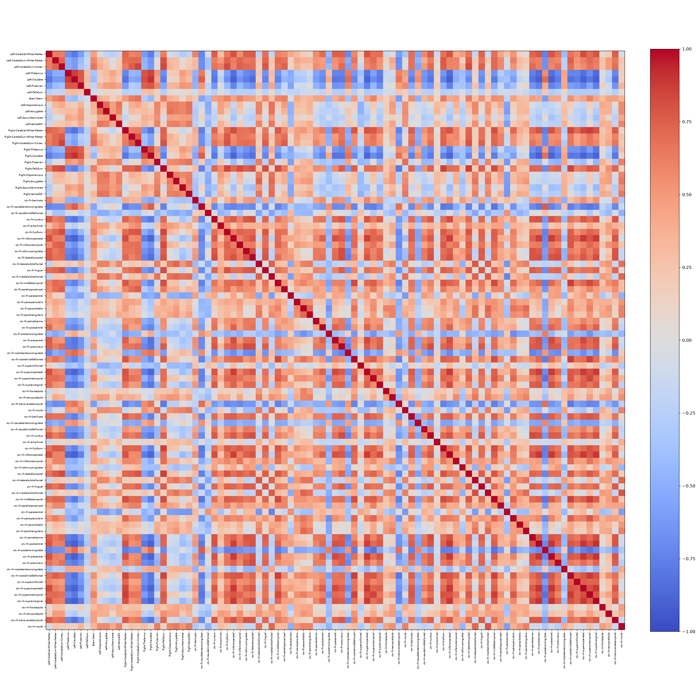

## MRSinMRS

| Parameter | Value | Unit |
| --- | --- | --- |
| AcquisitionDurationMS | 389 | ms |
| Averages | 1 |  |
| AveragingMode | N.A. |  |
| CoilElements | N.A. (synthetic) |  |
| CombinedMetabolites | tNAA (NAA+NAAG), tCr (Cr+PCr), Cho (GPC+PCh), Ins (mI), Glx (Glu+Gln) |  |
| CompressedSensingAccelerationFactor | N.A. (synthetic) |  |
| DataProcessing | Model-synthesized signal (3D U-Net trained on real template subjects); no k-space reconstruction |  |
| DeltaFrequencyPPM | 0.0 | ppm |
| Dimension | 3D |  |
| FIDPointsVectorSize | 512 |  |
| FOV | 220 x 220 x 130 | mm |
| FlipAngle | 45.0 | ° |
| MagneticFieldStrength | 3.0 | T |
| MatrixSize | 44 x 44 x 25 |  |
| Measurements | 1 |  |
| MetaboliteBasisSetLCModel | NAA, NAAG, Cr, PCr, GPC, PCh, mI, sI, Glu, Gln, Lac, GABA, GSH, Tau, Asp, Ala |  |
| Note | SynthMRSI-Project is a synthetic dataset: real T1w anatomicals paired with model-synthesized MRSI metabolite signal (3D U-Net; see MRSIPrep manuscript, Validation Datasets). No real MRSI acquisition underlies these values -- numeric geometry/timing fields (TE, RepetitionTime, FOV, resolution, matrix size, field strength, etc.) record the acquisition protocol the synthetic signal generation was matched to; fields describing a specific real pulse sequence, reconstruction, or hardware are marked N.A. since none was used. |  |
| Orientation | Transverse |  |
| PhaseEncoding | N.A. (synthetic) |  |
| PreparationScans | N.A. (synthetic) |  |
| QualityMetrics | SNR, CRLB, FWHM (synthesized, not derived from spectral fitting) |  |
| Quantification | N.A. (synthetic; not derived from spectral fitting) |  |
| RFCoils | N.A. (synthetic) |  |
| RemoveOversampling | N.A. |  |
| RepetitionTime | 0.457 | s |
| ResolutionMM3 | 5 x 5 x 5.2 | mm |
| RotationDeg | -0.79 | ° |
| SaturationBands | N.A. (synthetic) |  |
| Scanner | N.A. (synthetic; no scanner) |  |
| Sequence | N.A. (synthetic; not acquired with a real MRSI sequence) |  |
| ShimMode | N.A. (synthetic) |  |
| SlabThicknessMM | 95 | mm |
| Slabs | 1 |  |
| SpectralBandwidthHz | 1320 | Hz |
| SpectralSuppr | N.A. (synthetic) |  |
| TE | 0.78 | s |
| WaterReferenceFIDPoints | 512 |  |
| WaterReferenceFlipAngle | 45.0 | ° |
| WaterReferenceResolutionMM3 | 10.0 x 10.0 x 10.0 | mm |
| WaterReferenceTE | 0.72 | s |
| WaterReferenceTR | 0.46 | s |
| WaterSuppr | N.A. (synthetic) |  |
| WaterSupprBWHz | N.A. (synthetic) | Hz |

## Provenance

### Provenance file

Download provenance JSON

### Processing parameters

| Parameter | Value |
| --- | --- |
| Nucleus | 1H |
| Tissue backend | synthseg-fast |
| Registration backend | ants |
| Registration T1w target | brain |
| Normalization | simple |
| Output spaces | MNI152NLin2009cAsym |
| Parcellation mode | synthseg |
| Atlas | chimera-LFMIHIFIS_scale3 |
| SNR min | 4.0 |
| Linewidth max | 0.1 |
| CRLB max | 20.0 |
| Biharmonic spike filtering | True |
| Spike percentile | 99.0 |
| PVC disabled | False |
| T1 saturation correction | none |
| Connectivity | True |
| nproc x nthreads | 2 x 8 |

### Pipeline stages

Validate inputs → Tissue segmentation → Anatomical prep → MRSI loading → Spike filtering → T1 saturation correction → MRSI reference image → MRSI voxel-quality masking → Registration → Tissue probability maps → Tissue QC → Partial volume correction → Resampling → Leakage QC → SynthSeg parcellation QC → Parcellation → Regional extraction → Connectivity → Metabolite profiles → Reports

### MRSIPrep

If you use MRSIPrep, please cite: Lucchetti, F., Céléreau, E., Jenni, R., Ledoux, J.-B., Eliez, S., Delavari, F., Hagmann, P., Alemán-Gómez, Y., Klauser, A., & Klauser, P. (2026). MRSIPrep: A Standardized Post-Quantification Framework for Preprocessing Whole-Brain Magnetic Resonance Spectroscopic Imaging. bioRxiv. doi:10.64898/2026.09.11.750896. A downloadable BibTeX entry is in `CITATION.cff` in the MRSIPrep repository.

### MRSinMRS

MRSI acquisition reporting follows the MRSinMRS minimum reporting standard (Lin et al. 2021).

## Runtime

### Per-step duration

nproc: `2`  |  nthreads: `8`

Excludes this report-generation step's own duration (not yet known while it's still running) and any time spent before this recording's pipeline started (e.g. queued behind other recordings under `--nproc`).

| Step | Outcome | Duration | % of total |
| --- | --- | --- | --- |
| Tissue segmentation | PROC | 1m 02.2s | 24.7% |
| Anatomical preparation | PROC | 0.0s | 0.0% |
| MRSI loading | PROC | 0.0s | 0.0% |
| Spike filtering | PROC | 4.6s | 1.8% |
| T1 saturation correction | PROC | 0.0s | 0.0% |
| MRSI reference image | PROC | 0.0s | 0.0% |
| MRSI voxel-quality masks | PROC | 0.0s | 0.0% |
| MRSI-to-T1w registration | PROC | 1m 01.1s | 24.3% |
| T1w-to-template registration | PROC | 1m 39.4s | 39.5% |
| Tissue probability maps in MRSI space | PROC | 0.6s | 0.2% |
| Partial volume correction | PROC | 0.1s | 0.1% |
| Resampling MRSI maps to T1w/MNI space | PROC | 19.5s | 7.8% |
| Signal leakage QC | PROC | 0.7s | 0.3% |
| SynthSeg parcellation and QC | REUSED | 2.2s | 0.9% |
| Regional metabolite extraction | PROC | 0.6s | 0.2% |
| Regional metabolic profiles and connectivity | PROC | 0.6s | 0.2% |
| Parcellation (chimera/atlas) | N/A | - | - |
| **Total (through report generation)** |  | **4m 11.6s** | 100.0% |

## Outputs

```
ses-01/
├── anat/
│   └── synthseg/
│       ├── sub-01_ses-01_atlas-synthseg_desc-parcelqc.tsv
│       ├── sub-01_ses-01_atlas-synthseg_desc-robustGMWM.tsv
│       ├── sub-01_ses-01_space-mrsi_atlas-synthseg_desc-regional_metabolites.tsv
│       ├── sub-01_ses-01_space-mrsi_atlas-synthseg_desc-robustGMWM_dseg.nii.gz
│       ├── sub-01_ses-01_space-T1w_atlas-synthseg_desc-robustGMWM_dseg.nii.gz
│       ├── sub-01_ses-01_space-T1w_desc-synthsegBrain_mask.nii.gz
│       ├── sub-01_ses-01_space-T1w_desc-synthsegBrain_T1w.nii.gz
│       ├── sub-01_ses-01_space-T1w_desc-synthsegFastInput_T1w.nii.gz
│       └── sub-01_ses-01_space-T1w_desc-synthsegParcRobust_dseg.nii.gz
├── confounds/
│   ├── sub-01_ses-01_desc-leakageqc.tsv
│   ├── sub-01_ses-01_desc-mrsiqc.tsv
│   ├── sub-01_ses-01_desc-ventricleqc.tsv
│   ├── sub-01_ses-01_space-MNI152NLin2009cAsym_res-5_desc-fwhm_mrsi.nii.gz
│   ├── sub-01_ses-01_space-MNI152NLin2009cAsym_res-5_desc-snr_mrsi.nii.gz
│   ├── sub-01_ses-01_space-MNI152NLin2009cAsym_res-5_met-CrPCr_desc-crlb_mrsi.nii.gz
│   ├── sub-01_ses-01_space-MNI152NLin2009cAsym_res-5_met-GluGln_desc-crlb_mrsi.nii.gz
│   ├── sub-01_ses-01_space-MNI152NLin2009cAsym_res-5_met-GPCPCh_desc-crlb_mrsi.nii.gz
│   ├── sub-01_ses-01_space-MNI152NLin2009cAsym_res-5_met-Ins_desc-crlb_mrsi.nii.gz
│   ├── sub-01_ses-01_space-MNI152NLin2009cAsym_res-5_met-NAANAAG_desc-crlb_mrsi.nii.gz
│   ├── sub-01_ses-01_space-mrsi_desc-brain_mask.nii.gz
│   ├── sub-01_ses-01_space-mrsi_label-CSF_probseg.nii.gz
│   ├── sub-01_ses-01_space-mrsi_label-GM_probseg.nii.gz
│   ├── sub-01_ses-01_space-mrsi_label-latvent_mask.nii.gz
│   ├── sub-01_ses-01_space-mrsi_label-WM_probseg.nii.gz
│   ├── sub-01_ses-01_space-mrsi_met-CrPCr_desc-qcmask_mask.nii.gz
│   ├── sub-01_ses-01_space-mrsi_met-CrPCr_desc-spikemask_mask.nii.gz
│   ├── sub-01_ses-01_space-mrsi_met-GluGln_desc-qcmask_mask.nii.gz
│   ├── sub-01_ses-01_space-mrsi_met-GluGln_desc-spikemask_mask.nii.gz
│   ├── sub-01_ses-01_space-mrsi_met-GPCPCh_desc-qcmask_mask.nii.gz
│   ├── sub-01_ses-01_space-mrsi_met-GPCPCh_desc-spikemask_mask.nii.gz
│   ├── sub-01_ses-01_space-mrsi_met-Ins_desc-qcmask_mask.nii.gz
│   ├── sub-01_ses-01_space-mrsi_met-Ins_desc-spikemask_mask.nii.gz
│   ├── sub-01_ses-01_space-mrsi_met-NAANAAG_desc-qcmask_mask.nii.gz
│   ├── sub-01_ses-01_space-mrsi_met-NAANAAG_desc-spikemask_mask.nii.gz
│   ├── sub-01_ses-01_space-orig_desc-fwhm_mrsi.nii.gz
│   ├── sub-01_ses-01_space-orig_desc-snr_mrsi.nii.gz
│   ├── sub-01_ses-01_space-orig_met-CrPCr_desc-crlb_mrsi.nii.gz
│   ├── sub-01_ses-01_space-orig_met-GluGln_desc-crlb_mrsi.nii.gz
│   ├── sub-01_ses-01_space-orig_met-GPCPCh_desc-crlb_mrsi.nii.gz
│   ├── sub-01_ses-01_space-orig_met-Ins_desc-crlb_mrsi.nii.gz
│   ├── sub-01_ses-01_space-orig_met-NAANAAG_desc-crlb_mrsi.nii.gz
│   ├── sub-01_ses-01_space-T1w_desc-fwhm_mrsi.nii.gz
│   ├── sub-01_ses-01_space-T1w_desc-snr_mrsi.nii.gz
│   ├── sub-01_ses-01_space-T1w_label-CSF_probseg.nii.gz
│   ├── sub-01_ses-01_space-T1w_label-GM_probseg.nii.gz
│   ├── sub-01_ses-01_space-T1w_label-WM_probseg.nii.gz
│   ├── sub-01_ses-01_space-T1w_met-CrPCr_desc-crlb_mrsi.nii.gz
│   ├── sub-01_ses-01_space-T1w_met-GluGln_desc-crlb_mrsi.nii.gz
│   ├── sub-01_ses-01_space-T1w_met-GPCPCh_desc-crlb_mrsi.nii.gz
│   ├── sub-01_ses-01_space-T1w_met-Ins_desc-crlb_mrsi.nii.gz
│   └── sub-01_ses-01_space-T1w_met-NAANAAG_desc-crlb_mrsi.nii.gz
├── connectivity/
│   ├── sub-01_ses-01_atlas-synthseg_npert-50_filt-biharmonic_pvcorr_GM_desc-connectivity_mrsi.npz
│   ├── sub-01_ses-01_atlas-synthseg_npert-50_filt-biharmonic_pvcorr_GM_desc-connectivity_mrsi.tsv
│   ├── sub-01_ses-01_atlas-synthseg_npert-50_filt-biharmonic_pvcorr_GM_desc-edges_mrsi.tsv
│   ├── sub-01_ses-01_atlas-synthseg_npert-50_filt-biharmonic_pvcorr_GM_desc-metabolicprofiles_mrsi.npz
│   └── sub-01_ses-01_atlas-synthseg_npert-50_filt-biharmonic_pvcorr_GM_desc-nodes_mrsi.tsv
├── logs/
│   └── sub-01_ses-01_desc-mrsiprep_log.txt
├── mrsi/
│   ├── mni/
│   │   ├── sub-01_ses-01_space-MNI152NLin2009cAsym_res-5_met-CrPCr_desc-signal_mrsi.nii.gz
│   │   ├── sub-01_ses-01_space-MNI152NLin2009cAsym_res-5_met-GluGln_desc-signal_mrsi.nii.gz
│   │   ├── sub-01_ses-01_space-MNI152NLin2009cAsym_res-5_met-GPCPCh_desc-signal_mrsi.nii.gz
│   │   ├── sub-01_ses-01_space-MNI152NLin2009cAsym_res-5_met-Ins_desc-signal_mrsi.nii.gz
│   │   └── sub-01_ses-01_space-MNI152NLin2009cAsym_res-5_met-NAANAAG_desc-signal_mrsi.nii.gz
│   ├── orig/
│   │   ├── sub-01_ses-01_space-mrsi_desc-reference_mrsi.nii.gz
│   │   ├── sub-01_ses-01_space-mrsi_met-CrPCr_desc-signal_mrsi.nii.gz
│   │   ├── sub-01_ses-01_space-mrsi_met-CrPCr_desc-signalspikefilt_mrsi.nii.gz
│   │   ├── sub-01_ses-01_space-mrsi_met-GluGln_desc-signal_mrsi.nii.gz
│   │   ├── sub-01_ses-01_space-mrsi_met-GluGln_desc-signalspikefilt_mrsi.nii.gz
│   │   ├── sub-01_ses-01_space-mrsi_met-GPCPCh_desc-signal_mrsi.nii.gz
│   │   ├── sub-01_ses-01_space-mrsi_met-GPCPCh_desc-signalspikefilt_mrsi.nii.gz
│   │   ├── sub-01_ses-01_space-mrsi_met-Ins_desc-signal_mrsi.nii.gz
│   │   ├── sub-01_ses-01_space-mrsi_met-Ins_desc-signalspikefilt_mrsi.nii.gz
│   │   ├── sub-01_ses-01_space-mrsi_met-NAANAAG_desc-signal_mrsi.nii.gz
│   │   └── sub-01_ses-01_space-mrsi_met-NAANAAG_desc-signalspikefilt_mrsi.nii.gz
│   ├── orig-pvc/
│   │   ├── sub-01_ses-01_space-mrsi_met-CrPCr_desc-signalpvc_mrsi.nii.gz
│   │   ├── sub-01_ses-01_space-mrsi_met-GluGln_desc-signalpvc_mrsi.nii.gz
│   │   ├── sub-01_ses-01_space-mrsi_met-GPCPCh_desc-signalpvc_mrsi.nii.gz
│   │   ├── sub-01_ses-01_space-mrsi_met-Ins_desc-signalpvc_mrsi.nii.gz
│   │   └── sub-01_ses-01_space-mrsi_met-NAANAAG_desc-signalpvc_mrsi.nii.gz
│   ├── parcel/
│   │   └── sub-01_ses-01_atlas-synthseg_desc-GMmetprofiles_mrsi.npz
│   └── t1w/
│       ├── sub-01_ses-01_space-T1w_met-CrPCr_desc-signal_mrsi.nii.gz
│       ├── sub-01_ses-01_space-T1w_met-GluGln_desc-signal_mrsi.nii.gz
│       ├── sub-01_ses-01_space-T1w_met-GPCPCh_desc-signal_mrsi.nii.gz
│       ├── sub-01_ses-01_space-T1w_met-Ins_desc-signal_mrsi.nii.gz
│       └── sub-01_ses-01_space-T1w_met-NAANAAG_desc-signal_mrsi.nii.gz
└── transforms/
    ├── anat/
    │   ├── sub-01_ses-01_desc-t1w_to_mni.affine.mat
    │   ├── sub-01_ses-01_desc-t1w_to_mni.affine_inv.mat
    │   ├── sub-01_ses-01_desc-t1w_to_mni.syn.nii.gz
    │   └── sub-01_ses-01_desc-t1w_to_mni.syn_inv.nii.gz
    └── mrsi/
        ├── sub-01_ses-01_desc-mrsi_to_t1w.affine.mat
        ├── sub-01_ses-01_desc-mrsi_to_t1w.affine_inv.mat
        ├── sub-01_ses-01_desc-mrsi_to_t1w.syn.nii.gz
        └── sub-01_ses-01_desc-mrsi_to_t1w.syn_inv.nii.gz
```
