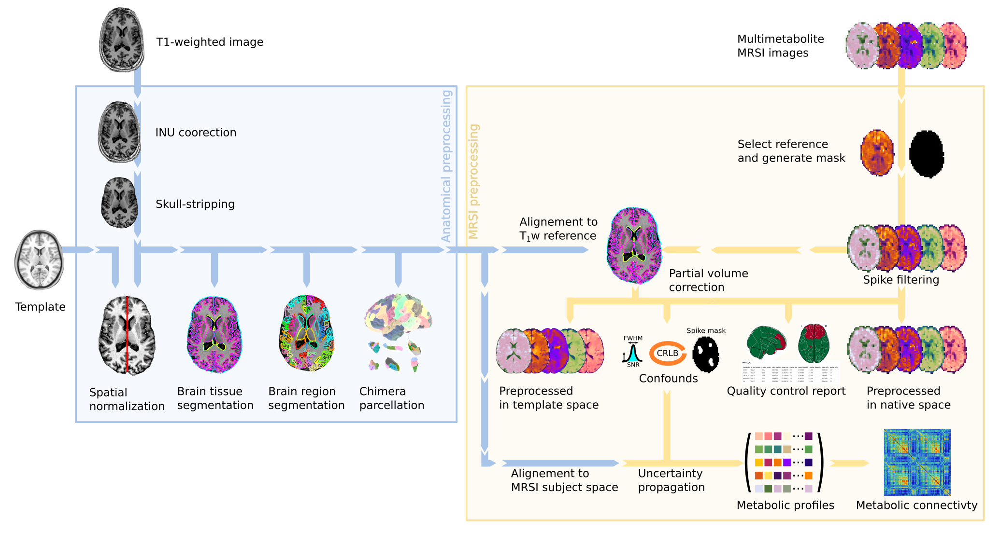

# MRSIPrep

MRSIPrep preprocesses **already-quantified whole-brain MRSI maps**. It runs
as a Docker BIDS App and produces registered metabolite maps, regional
profiles, quality-control reports, and machine-readable provenance for
downstream analyses.

Documentation for MRSIPrep **{{ release }}**.

[](https://mrsiprep.readthedocs.io/en/stable/)
[](https://hub.docker.com/r/mrsiup/mrsiprep)
[](https://pypi.org/project/mrsiprep/)

## Start here

1. [Install MRSIPrep and the Command builder](installation.md).
2. [Prepare your inputs](inputs.md), or use the public synthetic dataset.
3. [Run your first subject](usage_basic.md).
4. [Inspect the outputs and QC report](outputs.md) before starting an analysis.

MRSIPrep starts from NIfTI metabolite and quality maps plus a T1w anatomical
image. Spectral reconstruction and quantification happen upstream. Read
[Limitations and scope](limitations.md) to check whether the pipeline fits
your acquisition and scientific question.

## Command builder

Configure your run with the **Command builder**, a local browser form for
selecting inputs, metabolites, and processing settings. It generates a
`mrsiprep-docker` command for you to copy into a terminal and run.

[Install and launch the Command builder](installation.md#option-a-command-builder-recommended)
to get started. Installation also covers using the wrapper directly or
running plain Docker commands.



## Choose a workflow

All three parcellation modes share preprocessing, registration, regional
extraction, and report generation. Connectivity matrices are an optional
addition with `--write-connectivity`.

| Parcellation | Use | Additional requirements |
|---|---|---|
| `synthseg` (default) | Anatomical labels, regional profiles, and parcelwise QC | No `recon-all` or FreeSurfer licence |
| `atlas` | Bundled or custom MNI-space atlases | Atlas and label table for a custom atlas |
| `chimera` | Multi-atlas cortical/subcortical parcellations | `recon-all` and a FreeSurfer licence |

See [Parcellation, profiles, and connectivity](usage_parcellation.md) for
examples. Tissue processing, output spaces, and experimental corrections
are configured separately.

## Find the right guide

| Task | Read |
|---|---|
| Choose settings or reproduce a published configuration | [Configuration and presets](configuration.md) |
| Understand algorithms and processing assumptions | [Processing methods](methods.md) |
| Assess runtime and validation evidence | [Validation overview](validation.md) |
| Look up a flag or file format | [CLI reference](cli_reference.md) and [Derivative formats](data_reference.md) |
| Diagnose a failed or unexpected run | [Troubleshooting](troubleshooting.md) |
| Extend the pipeline | [Architecture](architecture.md) and [Extending MRSIPrep](extending.md) |

For background, dependencies, and licensing, see [About MRSIPrep](about.md).
For research use, see [How to cite](citing.md).

```{toctree}
:maxdepth: 1
:caption: Getting started
:hidden:

installation
inputs
usage_basic
outputs
```

```{toctree}
:maxdepth: 1
:caption: User guide
:hidden:

configuration
processing
usage_normalization
usage_parcellation
usage_longitudinal
running
future_development
notebooks/README
```

```{toctree}
:maxdepth: 1
:caption: Methods and validation
:hidden:

methods
validation
benchmarks
registration_benchmark
vba_benchmark
cross_sequence_benchmark
```

```{toctree}
:maxdepth: 1
:caption: Reference
:hidden:

cli_reference
data_reference
```

```{toctree}
:maxdepth: 1
:caption: Developers
:hidden:

architecture
contributing
extending
api
```

```{toctree}
:maxdepth: 1
:caption: Project and support
:hidden:

troubleshooting
limitations
citing
about
changelog
```
