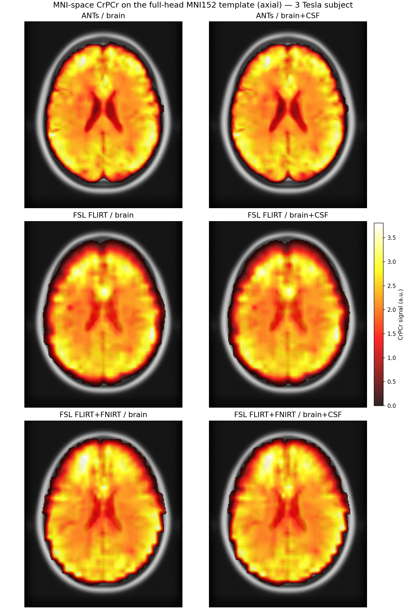
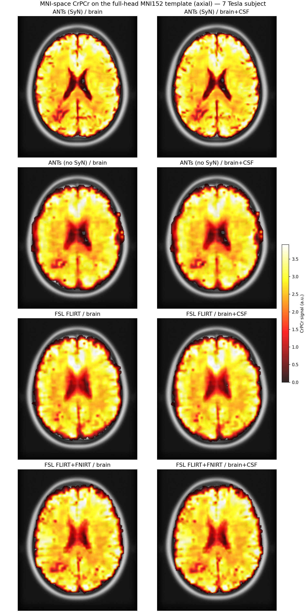

# Registration benchmark

This comparison uses the 3T and 7T subjects, compute hardware, and ECCENTRIC
acquisition described in [Runtime benchmarks](benchmarks.md).

The table below describes the **tested configurations**, including 12-DOF
FLIRT MRSI→T1w registration. The current CLI defaults to 6 DOF for that
stage, so selecting only `--registration-backend fsl` does not reproduce
this benchmark's FLIRT settings.

`--registration-backend` offers **ANTs** (default: rigid+SyN for
MRSI→T1w, rigid+affine+SyN for T1w→MNI; see the transform-stage table
below, since the two ANTs stages are not symmetric) and **FSL** (FLIRT
affine, with an FNIRT deformable stage on by default,
`--no-fsl-deformable` for FLIRT-only). This section compares four
MRSI→T1w registration configurations: **ANTs (Rigid+SyN)**, **ANTs
(Rigid+Affine)**, **FSL FLIRT-only**, and **FSL FLIRT+FNIRT**, each
against both supported T1w registration targets, **brain**
(skull-stripped) and **brain+CSF** (skull-stripped T1w with the CSF
compartment re-added, since CSF also produces real MRSI signal that a
brain-only target would otherwise clip at the boundary).

**Transform used at each registration stage, by backend:**

| Backend | MRSI → T1w | T1w → MNI |
|---|---|---|
| ANTs (Rigid+SyN), mrsiprep's default | Rigid + SyN (deformable), **no separate Affine stage**, `antsRegistrationSyN[sr]` | Rigid + Affine + SyN (deformable), `antsRegistrationSyN[s]` |
| ANTs (Rigid+Affine) | Rigid + Affine, a genuine second registration run (`antsRegistration`, `transform="a"`), since mrsiprep's default MRSI→T1w stage never computes an Affine stage to reuse | Rigid + Affine (the SyN warp dropped from the default `[s]` run above; this stage already has a real Affine, so no extra registration needed here) |
| FSL FLIRT-only | Affine only (FLIRT, 12 DOF, `corratio` cost) | Affine only (FLIRT, 12 DOF) |
| FSL FLIRT+FNIRT | Affine (FLIRT) + deformable warp (FNIRT, `--fsl-deformable`) | Affine only (FLIRT, 12 DOF), FNIRT is not used for this stage |

Note that `--fsl-deformable` only adds a deformable (FNIRT) stage to the
**MRSI→T1w** registration; the **T1w→MNI** stage is always FLIRT affine-only
under the FSL backend, in both the FLIRT-only and FLIRT+FNIRT variants
compared here.

**The two ANTs stages are asymmetric, which is why "ANTs (Rigid+Affine)"
needed a real second registration run, not just a transform dropped from
the default pipeline.** ANTs' default MRSI→T1w stage
(`antsRegistrationSyN[sr]`) runs a Rigid stage followed directly by SyN:
`antsRegistrationSyN.sh`'s own `sr` code has no separate Affine stage at
all (MRSI and T1w start from roughly the same subject geometry, so
mrsiprep's default skips the extra affine correction there). Dropping
SyN from that default leaves Rigid-only, not Rigid+Affine. **ANTs
(Rigid+Affine)** in this comparison therefore required actually running
`antsRegistration` with `transform="a"` at the MRSI→T1w stage, genuine
new registration compute, not a reuse of an already-computed transform.
ANTs' T1w→MNI stage (`antsRegistrationSyN[s]`) already runs the full
three-stage Rigid → Affine → SyN pipeline by default, since subject
anatomy genuinely differs from the MNI template in scale and shape, not
just position.

## Method

The comparison uses the same 3 Tesla and 7 Tesla subjects, varying
registration configuration and `--registration-t1-target` across `brain`
and `brain-csf`. Default ANTs and the FSL configurations are measured with
SynthSeg full-pipeline runs. The ANTs Rigid+Affine comparison instead uses
a separately computed MRSI→T1w affine registration and the existing
T1w→MNI affine component. Its reported timing covers registration only;
it is not a fourth complete pipeline run per target/subject.

Leakage is reported as **signal-weighted mass outside the brain mask**:
at each quality-passing voxel (resampled CRLB ≤ 20, mrsiprep's own default
`--crlb-max`) the resampled CrPCr signal magnitude is summed; the
percentage reported is the fraction of that total signal mass that falls
outside the reference brain mask. This is deliberately **not** a raw
voxel count of "covered" voxels outside the mask: a boundary voxel
carrying negligible signal and a voxel carrying real, substantial signal
in the wrong location both count as "1 voxel" under a voxel-count metric,
which conflates thin resampling/registration boundary artifacts with
genuine misregistration. Weighting by signal magnitude fixes that: a
one-voxel-thick sliver of near-zero smeared or dilated boundary
contributes almost nothing to the percentage, while real signal
displaced into clearly wrong anatomy does. (Two earlier, superseded
versions of this metric were tried and rejected: "resampled signal
nonzero" as the coverage criterion overstated leakage via linear/spline
interpolation smear at the boundary; a corrected mask-based voxel-count
metric fixed that but then over-penalized FNIRT specifically, because
nearest-neighbor-resampling a **binary** mask through FNIRT's nonlinear
warp locally dilates the mask's footprint independent of true
registration accuracy. Weighting by actual signal magnitude avoids both
problems at once.)

This is computed against three reference masks: the T1w brain-only mask,
the T1w brain+CSF mask, and the MNI152 template's own standard brain mask
(in MNI space), summing how much "covered" signal mass falls **outside**
each reference mask.

This same signal-weighted metric is computed automatically for every
recording, not just this benchmark: against the MNI152 standard brain
mask for the default MNI-space output, and against the T1w reference
brain mask when T1w-space output is also requested
(`--output-mrsi-t1w`). See the per-metabolite leakage table in the
standard `reports/*_desc-report.html` output, backed by
`confounds/*_desc-leakageqc.tsv`.

## Results

**3 Tesla subject**, all four backends × both targets, axial slice, same
intensity scale throughout:

**7 Tesla subject**, same layout and intensity-scale convention (its own
scale, since 7T signal levels differ from 3T):

Signal extending past the skull ring, or with a
jagged/scalloped rather than smooth outer edge, indicates voxels that have
leaked beyond the true brain boundary during registration, visible here
for both FSL variants and, most noticeably, for ANTs (Rigid+Affine) at
both field strengths, which shows the coarsest, most scalloped outer edge
of any of the four configurations.

**Signal-weighted MNI-space leakage and total default-configuration wall-clock
runtime, by backend** (brain target; brain+CSF leakage is within ±0.3
points of these and shows the same pattern, not shown). Runtime is
averaged across the `brain`/`brain+CSF` targets; **ANTs (Rigid+Affine)**'s
bar reports registration-only wall-clock time (both stages combined,
timed directly via `mrsiprep.interfaces.ants.register()`, `nthreads=16`
matching the other runs' default, hatched in the figure), since a full
pipeline run for this configuration was not executed (see Method
above):

## Conclusions
* **ANTs (Rigid+SyN), the mrsiprep default, produced the lowest signal-weighted leakage** at both 3T and 7T (0.34% and 0.44%), clearly outperforming FSL FLIRT-only (2.1% and 0.97%) and FLIRT+FNIRT (5.4% and 2.7%). This agrees with the visual overlays, where ANTs yielded the sharpest anatomical alignment.

* **ANTs (Rigid+Affine) performed unexpectedly poorly**, with 4.30% leakage at 3T and 4.73% at 7T. Its additional affine degrees of freedom may overfit the low-resolution MRSI reference when not followed by a deformable SyN stage. This non-default configuration therefore cannot currently be recommended.

* **Adding FNIRT to FLIRT increased both leakage and runtime.** At 7T, FNIRT required 53.0 minutes, compared with 11.2 minutes for FLIRT-only and 27.0 minutes for ANTs (Rigid+SyN). Overall, ANTs (Rigid+SyN) provides the best accuracy–runtime balance. For FSL users, FLIRT-only is preferable to FLIRT+FNIRT based on these results.

* **The choice between brain-only and brain+CSF registration targets had only a minor and inconsistent effect** across field strengths, indicating that the registration backend is the dominant factor.

## Collect a new comparison

Append the following options to a complete [first-run command](usage_basic.md),
using identical input recordings, output grids, reference metabolite, and
quality settings. Use separate output/work directories for each variant.

| Configuration | Options for new runs |
|---|---|
| ANTs default | `--registration-backend ants --ants-mrsi-to-t1-transform sr --ants-t1-to-template-transform s` |
| FLIRT-only with the tested DOF | `--registration-backend fsl --no-fsl-deformable --fsl-mrsi-to-t1-dof 12 --fsl-t1-to-template-dof 12` |
| FLIRT+FNIRT with the tested DOF | `--registration-backend fsl --fsl-deformable --fsl-mrsi-to-t1-dof 12 --fsl-t1-to-template-dof 12` |

Repeat for the two registration targets. The historical ANTs affine
comparison additionally required transform-chain selection described above;
these commands do not reconstruct that manual experiment. Record exact
settings, image digest, runtime scope, and provenance for new comparisons.
The conclusions above are descriptive results for two subjects, not a
general guarantee of a backend's accuracy on other acquisitions.
